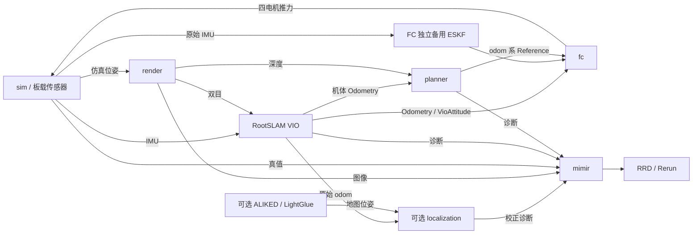
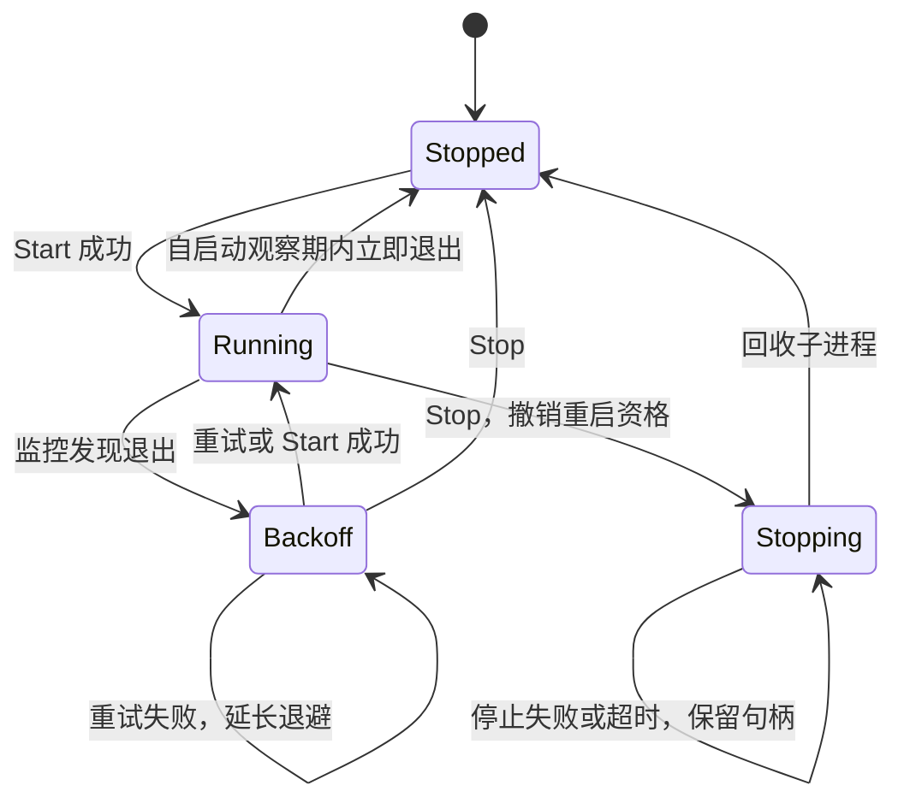
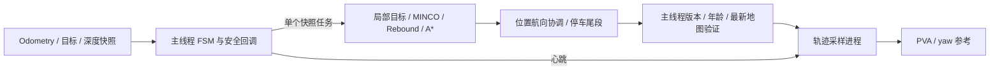

# 系统架构

本文描述模块职责、状态转换、坐标与算法契约。构建和运行见
[开发指南](development.md)，观测登记见 [observability.md](observability.md)，
公开数据集测评见 [RootSLAM 使用指南](../apps/rootslam/README.md)。
参数、容量和门限由对应配置类型与测试源码维护。

## 数据流与职责

默认自主链路从空滚动地图启动：RootSLAM 提供连续 VIO，planner 融合机体里程计和深度，
生成 odom 系轨迹，FC 跟踪参考并输出电机推力。离线库图定位是可选的独立服务。



planner 的状态、目标、占据地图和轨迹都属于 odom。可选 Navigation 输出供外部地图定位
和诊断使用。GroundTruth 服务于传感器生成、评测和展示，PlantState 服务于评测。
观测开关只控制诊断输出，算法参数和业务消息由各自配置管理。

### Basalt 与 RootSLAM 独立应用

`apps/rootslam` 的统一入口通过 `input::Source` 选择 IPC 或
LaMAria/EuRoC/UZH/KITTI 文件源。适配器提供相机模型、传感器外参、噪声与时钟转换，
保留原始图像尺寸，并将 `OpticalFlowInput`、`ImuData` 交给同一 Basalt 实现。
`firefly-calibration` 维护相机、图像、标定与初始化基础设施；
`firefly-basalt` 维护光流、IMU 预积分、局部 VO/VIO、边缘化、mapper 与标定求解。

`firefly-rootslam-mapping` 维护持久稀疏地图、地点检索、几何验证、路标融合、
PGO 和平方根全局 BA。在线默认运行局部 VIO。数据集示例启用持久地图和回环，
输入结束并完成映射排空后执行最终 BA，分别导出局部后验和最终地图轨迹。
实现来源为 Basalt 源码与 RootSLAM 论文；测评指南报告当前覆盖和结果。

顶层 `precision` 选择局部 BA、IMU 预积分、边缘化和全局 BA 的 FP32/FP64。
全局矩阵与迭代向量使用所选精度，递推标量与代价累加使用 FP64。
光流补丁使用 FP32，地图存储、回环几何、PGO 和公开状态接口使用 FP64。

板端 HIL 链路用同一套 IPC 话题：`camera --hil` 把主机仿真图像与 IMU 经 USB 收进板端
再发布，RootSLAM 与 OKVIS2-X 消费同样的双目与 IMU 话题、发布同样的里程计与姿态话题，
因此估计器可按验收需要在两者之间切换，话题层不需要适配。板端 HIL 只跑一个估计器，
两份进程清单由 `xtask deploy-hil --estimator` 选择；RootSLAM 侧的 VIO 参数按 320×240
rig 重选光流网格，详见 [开发指南](development.md#rootslam-的-hil-配置)。

### 板载拓扑

`camera` 的 V4L2、`imu` 的 SPI BMI088、`motor` 的 sysfs PWM 接入同一 IPC。
相机标定由消费者配置；可选深度输入决定 planner 的地图就绪状态。
IMU 发布角速度与比力，备用姿态解算位于 FC 内。
`Airframe` 在仿真中来自 MuJoCo，板端来自实测装配配置。

板端统一使用 `CLOCK_MONOTONIC` 秒，仿真统一使用 `sim_time`。
板端上线以设备同步、标定、实时性与飞行的实机验收结果为依据。

### HIL 闭环（USB）

电脑运行仿真、render、mimir 和主机 USB 桥；板端运行 RootSLAM、FC 与 HIL
输入输出驱动。两端算法使用现有 IPC，真值保留在主机用于渲染与独立评分。

| 侧 | 进程 | 职责 |
|---|---|---|
| 电脑 | `hil` | 下行传感器、机体描述和指令；上行控制、里程计、姿态、标量与日志 |
| 板端 | `hil-gadget` | 管理 configfs、FunctionFS、UDC 与超时恢复 |
| 板端 | `camera --hil` | 将 USB 输入发布为本机传感器与指令话题 |
| 板端 | `motor --hil` | 将本机控制与遥测回传电脑，执行器由主机仿真实现 |

单个 OUT 承载传感器和指令，IN 承载控制与遥测。图像分片之间优先发送 IMU；
主机以双目对为单位入队，背压时整对丢弃；板端在保留图像块前检查块数、块长和
深度像素对齐。每条上行遥测或日志之间重新检查控制队列，IMU 批次发布后唤醒消费者。
暂时无数据的读取保留有效前缀；主机端点读写等待均有 100 ms 上限，任一 USB worker
结束或 panic 都结束整次会话并回收两个 worker。
队列、单帧与重组大小均有固定上限。HIL 协议 v3 保留目标航向、日志 trace、
序号与丢失计数，两端版本不一致时拒绝处理帧。板端按发布者检查诊断连续性，
主机桥为聚合 IPC 发布者分配连续序号。

传感器与状态时间沿用 `sim_time`，链路超时使用各端本机单调时钟。
HIL 与 ADB 互斥；看门狗恢复时先停 HIL 进程，再恢复正常进程清单和 USB 功能。
部署与验收入口见 [开发指南](development.md#hil-部署与运行)。

<a id="frames"></a>

## 坐标与时间

跨模块坐标使用 `firefly-base::{FrameId, RigidTransform, FrameTree}`。
`T_target_source` 将 source 的列向量转换到 target：

```text
p_target = R_target_source p_source + t_target_source
T_a_c = T_a_b T_b_c
T_b_a = inverse(T_a_b)

map
 └─ odom           全局定位修正
     └─ body       连续局部位姿
         ├─ left_camera
         ├─ right_camera
         └─ depth_camera
```

长度为米，角度为弧度，四元数为 Hamilton xyzw、source→target 主动旋转。
`OdomMessage::body_pose(parent)` 按 body→parent 解释消息。
控制核心用 f32，默认在线估计与规划用 f64；Bevy 类型用于渲染边界。
SO(3)/SE(3) 与卡方门限分别由 `firefly-base::se3`、`stats` 提供。

- 组合匹配中间坐标系；树保持单父节点、连通查询和无环结构，验证成功后更新。
- 点应用旋转与平移，自由向量只做旋转换基。
- 扭量顺序为 `[rotation, translation]`，`Ad(T) = [[R,0],[skew(t)R,R]]`；
  协方差按 `P_target = Ad(T) P_source Ad(T)ᵀ` 转换。
- 刚体变换要求有限值、单位四元数、SO(3) 旋转（行列式为 +1）与合法齐次行。

坐标树表示指定时刻的几何快照，调用者负责历史查询和时间配对。
odom 会话变化时重建整条坐标链。mimir 使用相同链表达原始观测，
并独立维护 world 真值的显示对齐；显示变换只存在于 RRD。

### 图像坐标

视觉算法采用像素中心坐标，左上中心为 `(0,0)`。
主点由 `firefly_base::rig::principal_point` 计算，320×240 为 `(159.5,119.5)`。
GPU 采样中心为 `(u+0.5,v+0.5)`，转换为数组坐标时减去半像素。
在线库图使用与传感器匹配的主点及标定契约。

### 控制与外部地图

位置、速度、姿态反馈、起飞原点和 Hold 锚点保持在 odom。
局部规划 Reference 携带恒等变换快照。通用外部参考可携带 map←odom，
或使用同时间戳校正/原始里程计配对；配对历史有界，新鲜度取较早的接收时间。
航向通过旋转后的水平向量转换，角速度通过其水平投影导数转换。
速度换基保持同一物理速度，局部反馈与 Hold 锚点保持原会话坐标。

外部定位在 `configs/localization.toml [origin]` 声明地图中的启动位置和 yaw。
部署时机体位于该位置与朝向，进程在解锁前启动。首个满足静止和局部原点约束的
已初始化样本锁存：

```text
yaw_map_odom = yaw_map_body_start - yaw_odom_body_start
p_map_odom = p_map_body_start - R_map_odom p_odom_body_start
```

锁存只确定航向规范并保留重力倾角。锁存完成后发布地图里程计；
VIO 会话失效使外部定位进入停止状态。任意位置冷启动和绑架重定位属于独立能力。
地图查询使用声明外部对齐的原子 Navigation 快照。

可选 ESKF 采用 odom 系右扰动，令 `D=T_map_odom`、`V=T_odom_body`、
`Y=T_map_body`：

```text
D_true = D Exp(e_odom)
D_observed = Y inverse(V)
z = Log(inverse(D) D_observed)
R_odom = Ad(V) R_body Ad(V)ᵀ
S = P + R_odom
K = P inverse(S)
delta = K z
D_new = D Exp(delta)
P_posterior = (I-K) P (I-K)ᵀ + K R_odom Kᵀ
P_new = Jr(delta) P_posterior Jr(delta)ᵀ
```

PnP 协方差表达为 body 右扰动，顺序 `[rot, trans]`。
经验相机协方差经 `Ad(T_body_camera)` 转到 body；修正限幅时，
增益对应行同步缩放后参与协方差更新。该松耦合模型将 VIO 位姿作为给定输入，
统计一致性验证需评估共享传感器相关性和经验观测协方差。

<a id="vio"></a>

## 状态所有权与转换

每个状态由持有资源的组件维护，输入有效性、任务阶段和退出结果分别表达。
下表列出跨帧、跨消息或跨线程持续存在的状态；转换的数值条件由对应源码维护。
互斥阶段使用枚举并携带该阶段拥有的数据：渲染邮箱的 `Open / Closed`、
Mimir 原点匹配的 `Matching / Anchored / Unavailable`、轨迹执行的
`Idle / Sampling / Finishing`。匹配历史只存在于 `Matching`，轨迹只存在于
`Sampling / Finishing`。独立事实分别保存，例如导航会话、是否收到真值和心跳时间。
配置开关、观测有效位与资源句柄沿用各自类型；它们通过所属组件的转换入口参与生命周期。

| 所有者 | 状态与转换 | 完成、恢复与清理 |
|---|---|---|
| [飞控 FSM](../crates/firefly-flight/src/fsm.rs) | Disarmed → ArmedGrounded → Takeoff → Hold / Track → Land | 落地计时后自动上锁；参考和估计失效选择安全模式 |
| [飞控姿态输入](../apps/fc/src/attitude.rs)、[坐标对齐](../apps/fc/src/frames.rs) | 等待 → 有效 / 暂时失效 / 会话故障锁存；VIO / Standby / Unavailable 选择姿态源 | 新鲜数据恢复暂时失效；会话故障通过重启恢复 |
| [IMU 初始化](../crates/firefly-imu-initialization/src/lib.rs)、[连续估计](../crates/firefly-imu/src/stream.rs) | 静止采样 → 初始化 → 连续传播 → 间隙故障锁存 | 静止条件失效重置采样窗口；连续性故障结束当前估计会话 |
| [IMU 预测器](../crates/firefly-imu-propagation/src/predictor.rs)、[飞控 IMU worker](../apps/fc/src/imu.rs) | 等待后验 → 历史重放 → 单调发布；启动 → 运行 → 停止 → join | 新后验替换传播锚点；拥有者回收线程 |
| [RootSLAM 在线入口](../apps/rootslam/src/online.rs) | 等待重力 → 双目就绪 → 运行 | 输入通道由启动阶段交给估计器；停止后依次回收线程 |
| [数据集入口](../apps/rootslam/src/dataset_app.rs)、[估计器](../crates/firefly-basalt/src/vi_estimator/vio_estimator.rs) | 校验 → 生产图像 / IMU → EOF → 后验收集完成 → 导出 | 失败和取消回收生产器与估计器；新产物路径独占本轮结果 |
| [映射 worker](../apps/rootslam/src/system.rs) | 接收 → 排空局部更新 / 回环 → 等待 Finish 或 Cancel → 最终 BA / 回收 | Finish 授权最终 BA；Cancel 在同步工作边界停止；Drop 回收资源 |
| [全局 BA](../crates/firefly-rootslam-mapping/src/global_optimization.rs) | 线性化 → 求解 → 接受 / 拒绝 → 收敛 / 达到预算 / 数值失败 | 接受步重线性化；拒绝步复用因子并更新阻尼；终态进入结果 |
| [规划 FSM](../crates/firefly-planner/src/fsm.rs) | Init → WaitTarget → GenNewTraj / SequentialStart → ExecTraj ↔ ReplanTraj → EmergencyStop | 目标版本使过期任务失效；故障类型决定恢复资格 |
| [规划里程计](../apps/planner/src/state_input.rs)、[地图输入](../apps/planner/src/map_input.rs) | 等待 → 新鲜且覆盖 / 过期或覆盖不足 / 故障锁存 | 新快照恢复临时覆盖；里程计和地图几何故障通过重启恢复 |
| [深度建图](../apps/planner/src/depth_mapping.rs)、[位姿接收](../apps/planner/src/odometry.rs) | 启动确认 → 运行 → 停止 / 失败 → join | 深度等待位姿插值区间；拥有者传播错误并回收线程 |
| [规划 worker](../crates/firefly-planner/src/worker.rs) | 空闲 → 单个任务在途 → 完成 / 取消 → 采用 / 丢弃过期结果 | 任务票据绑定目标、地图与窗口；Drop 取消并 join |
| [轨迹执行器](../crates/firefly-planner/src/traj_server.rs) | 等待命令 → 采样 → 末端保持；失联 / 门控 → 收尾 → 停止 | 新命令建立新执行状态；心跳恢复保持已承诺收尾 |
| [Mimir ingress](../apps/mimir/src/ingress.rs)、[archive](../apps/mimir/src/archive.rs) | 接收 → 排空诊断 → 通道关闭 → archive finish / sync → join | 体素分块完整后提交基线或增量；未完成组装返回错误 |
| [Mimir frames](../apps/mimir/src/frames.rs)、[status](../apps/mimir/src/status.rs) | 原点匹配开放 → 已对齐 / 已结束匹配；指标采样 → 有效 / 过期 | 导航会话、真值与显示刷新分别持有状态 |
| [进程 supervisor](../apps/ffctl/src/process/supervisor.rs) | Stopped → Running → Backoff → Running；Running → Stopping → Stopped | Stop 取消重启资格；Stopping 持有子进程直到回收，超时保留 PID；逆序 SIGINT |
| [测评进程](../packages/firefly-evaluation/src/firefly_evaluation/process_lifecycle.py)、[任务编排](../packages/firefly-evaluation/src/firefly_evaluation/mission.py) | 进程运行 → 停止 → 输出排空 → 结果；阶段 blocked → running → passed / failed | 输出回调错误在排空和回收后传播；运行锁隔离任务，录制最后退出 |
| [渲染 mailbox](../apps/render/src/process.rs)、[GPU capture](../apps/render/src/capture.rs)、[帧链路](../apps/render/src/link.rs) | 空 / 有值 / 关闭；提交 → GPU 映射 → 应答；帧组装 → 完成 / 退休 | 通道关闭结束等待；请求与 GPU 槽位分别回收 |
| [仿真](../apps/firefly-sim/src/firefly_sim/main.py)、[电机](../apps/motor/src/actuator.rs) | 等待新鲜控制 → 运行 → 控制超时 | 仿真暂停推进时间；执行器回到零输出，退出时归零 |
| [相机](../apps/camera/src/capture.rs)、[IMU 设备](../apps/imu/src/source.rs) | 打开设备 → 发布循环 → 停止 | 进程拥有设备句柄和退出流程 |
| [可选定位](../apps/localization/src/main.rs)、[门控](../crates/firefly-localization/src/filter.rs)、[匹配历史](../apps/lightglue/src/sensors.rs) | 等待对齐 / 历史 → 就绪 → 重置锁存；观测等待 → 接受 / 拒绝 / 过期 | 观测等待里程计区间；拒绝计数归门控，会话重置结束当前定位 |

ALIKED 的离线 / 在线模式在启动时确定；quad 使用 Bevy startup / update 生命周期。
上述状态的操作入口见 [开发指南](development.md)，输入与归档契约见
[可观测性](observability.md)。

### 状态转换的源码导航

状态盘点覆盖应用、领域库、测评包、资产脚本与部署工具。上表给出组件间的生命周期，
下表定位 29 组子状态的所有者、表示与转换边界；互斥阶段使用具名状态，相关数据共同拥有。
数值向量、配置开关和逐帧测量按数据处理；影响后续事件资格、资源所有权或恢复条件的
历史才属于这里的状态。独立条件可以同时成立，按各自语义保存。

| 组 | 所有者 / 源码 | 状态表示与转换入口 | 必须保留的边界 |
|---|---|---|---|
| 1 | [FC 命令处理](../apps/fc/src/main.rs) | `CommandSequence::consume` 单调消费序号 | 序号只向前推进；重复或乱序命令不重复执行 |
| 2 | [飞控 FSM](../crates/firefly-flight/src/fsm.rs) | `FlightState`、可选失联计时与 `LandingProgress::{Approach, Crawl, Confirming}` | 首次失联锁定保持点；降落接近原点后缓降，低推力与低运动持续满足才自动上锁 |
| 3 | [VIO 姿态输入](../apps/fc/src/attitude.rs) | `Validity::{Waiting, Valid, Invalid, SessionFault}`；会话取自最新观测 | 无效数据可恢复；会话改变锁存；预测刷新与后验刷新使用独立时钟 |
| 4 | [控制坐标](../apps/fc/src/frames.rs) | `Alignment::{Waiting, Valid, Invalid}` 同时保存对齐时刻与新鲜度 | 等待同时间戳配对；失效清除对齐新鲜度；历史对齐时刻保持单调 |
| 5 | [静止初始化](../crates/firefly-imu-initialization/src/lib.rs) | 可选 `StationaryWindow` 共同拥有起止时间、计数与统计 | 有序静止窗口积累、失效重置，满足时间和样本数条件后输出重力估计 |
| 6 | [备用 IMU](../crates/firefly-imu/src/stream.rs) | `Phase::{Initializing, Tracking, Discontinuous}`，跟踪态拥有滤波状态 | 初始化前间隙清空窗口；初始化后间隙锁存连续性故障 |
| 7 | [IMU 预测](../crates/firefly-imu-propagation/src/predictor.rs) | 可选 `Anchor` 原子保存后验时刻、状态与零偏；历史重放 | 历史完整覆盖后才发布；新后验重放且发布时钟单调 |
| 8 | [在线 VIO](../apps/rootslam/src/online.rs)、[IMU 适配](../apps/rootslam/src/online/imu.rs) | `Startup::{WaitingGravity, WaitingStereo, Running}`；IMU 采样器成功后移交 | 静止初始化、双目与 IMU 水位分别就绪；输入所有权只移交一次 |
| 9 | [双目配对](../apps/rootslam/src/online.rs) | `Pairing` 左右帧队列、水位与已发序号 `emitted` | 等待配对与 IMU 覆盖；旧帧淘汰；光流队列满时丢弃本次提交 |
| 10 | [估计器宿主](../crates/firefly-basalt/src/vi_estimator/vio_estimator.rs)、[光流宿主](../crates/firefly-basalt/src/optical_flow/optical_flow.rs)、[边缘化 I/O](../crates/firefly-basalt/src/io/marg_data_io.rs) | 估计器 `Worker::{Ready, Running, Joined, Unavailable}` 拥有输入、engine 或线程；光流与 I/O 各自持有 join 句柄 | 启动转移资源，关闭输入与 join 分开；完成通知和处理结果分别传播 |
| 11 | [局部 VIO](../crates/firefly-basalt/src/vi_estimator/sqrt_keypoint_vio.rs)、[VO](../crates/firefly-basalt/src/vi_estimator/sqrt_keypoint_vo.rs) | VIO `EstimationPhase::{Waiting, Tracking, Optimizing}`；VO 的初始化标志与窗口集合 | 初始化、开始优化、选关键帧、边缘化按算法顺序执行 |
| 12 | [映射调度](../apps/rootslam/src/system.rs) | `correction_pending: Option<revision>` 绑定在途地图版本；`Finalization` 授权收尾 | 输入结束、回环排空、最终 BA 授权、取消属于不同事件 |
| 13 | [全局优化](../crates/firefly-rootslam-mapping/src/global_optimization.rs)、[L-BFGS](../crates/firefly-optimize/src/lbfgs.rs) | L-BFGS `Termination::{Converged, Cancelled, IterationLimit}`；全局优化接受步与阻尼控制流 | 仅接受步提交状态；取消、预算耗尽与收敛分别报告；路标块另有显式 `State` |
| 14 | [规划里程计](../apps/planner/src/state_input.rs) | `InputPhase::{Waiting, Active, Stopped}`，有效态共同拥有测量与接收时钟 | 启动等待可继续；有效流之后的超时或无效观测锁存；重复时间戳不续命 |
| 15 | [规划地图输入](../apps/planner/src/map_input.rs) | `fault: Option<reason>` 保留首次失败；覆盖、应用版本与窗口缓存各自维护 | 覆盖不足可恢复；几何故障锁存；窗口移动使应用缓存失效 |
| 16 | [EGO 地图](../crates/firefly-ego-map/src/grid.rs) | `DepthPhase::{Waiting, Pending, Integrated}`；首帧、缓冲初始化与超时独立 | 首帧、缓冲区初始化、待融合、输入超时各自推进；占据与膨胀缓冲按地图更新流程提交 |
| 17 | [规划 worker](../crates/firefly-planner/src/worker.rs)、[应用](../apps/planner/src/main.rs) | `Lane::{Idle, Solving, Unavailable}`、Ticket 取消标志与目标世代 | 取消立即撤销采用资格，任务返回后才释放槽位；轨迹到时与实际到点分别判断 |
| 18 | [深度 worker](../apps/planner/src/depth_mapping.rs)、[里程计 worker](../apps/planner/src/odometry.rs)、[FC IMU worker](../apps/fc/src/imu.rs) | 启动应答、线程句柄与终止守卫；线程退出撤销快照和共享历史资格 | 就绪应答后消费；停止传播给拥有者；join 后报告线程错误 |
| 19 | [Mimir ingress](../apps/mimir/src/ingress.rs)、[archive](../apps/mimir/src/archive.rs) | `PendingVoxels::append` 预算通过后提交块；writer 的 `finish(self)` 消费所有权 | 完整体素批次才提交；缺块、丢失和排空失败进入归档结果；`finish(self)` 消费 writer |
| 20 | [日志发送](../crates/firefly-observability/src/lib.rs)、[状态采样](../apps/mimir/src/status.rs) | 发送序号与丢失计数；可选 `RateWindow` 共同拥有起止时刻与间隔计数 | 丢失计数持续报告到成功发布；频率和新鲜度由各自时间窗口派生 |
| 21 | [渲染 capture](../apps/render/src/capture.rs)、[帧组装](../apps/render/src/link.rs) | 可选 `requested_seq` 表示出图窗口；GPU 在途计数与帧退休序号 | 回调归还 GPU 槽位；三传感器成组发布；退休序号拒绝迟到回复并回收缓冲 |
| 22 | [仿真](../apps/firefly-sim/src/firefly_sim/main.py)、[电机](../apps/motor/src/actuator.rs) | 仿真接收时钟与暂停标志；电机 `ControlState` 共同拥有推力与收到时刻 | 超时暂停物理推进或归零电机；退出执行清理 |
| 23 | [可选定位](../apps/localization/src/main.rs)、[匹配历史](../apps/lightglue/src/sensors.rs)、[融合门控](../crates/firefly-localization/src/filter.rs) | `AlignmentState::{Waiting, Ready, Reset}`；匹配历史与融合门控独立 | 对齐与历史就绪后处理观测；会话重置锁存；观测有等待、拒绝、过期与接受结果 |
| 24 | [测评任务](../packages/firefly-evaluation/src/firefly_evaluation/mission.py)、[子进程](../packages/firefly-evaluation/src/firefly_evaluation/process_lifecycle.py) | 阶段仅从缺省或 `blocked` 进入 `running`，保留终态证据；子进程退出与 reader 排空 | 阶段结果完整记录；轨迹完成后验证实际到点；进程退出与输出排空分别验证 |
| 25 | [测评仿真](../packages/firefly-evaluation/src/firefly_evaluation/mission_sim.py)、[外力脉冲](../packages/firefly-evaluation/src/firefly_evaluation/disturbance_sim.py) | 首次重置标志；`PulsePhase::{IDLE, APPLYING, CLEARING}` 和剩余物理步数 | 首次重置与运行期重置分开；脉冲按序执行，清零后才接收下一轮 |
| 26 | [离线采集](../scripts/collect_vision_map.py)、[库图复用](../packages/firefly-evaluation/src/firefly_evaluation/vision_assets.py)、[建库](../scripts/build_vision_map.py) | 逐帧质量门控；`finish_capture` 回收 renderer 后原子提交清单，清理失败写入原因 | 配对与质量门控后接受帧；完整清单和指纹一致才复用；失败结果保留不完整状态 |
| 27 | [CAD 资产流水线](../packages/firefly-cad/src/firefly_cad/pipeline.py) | 内容缓存与 manifest 的 `building / passed / failed`；失败保留源指纹与原因 | 生成、几何验收、资产指纹完成后发布通过状态 |
| 28 | [数据集导出](../apps/rootslam/src/dataset_app.rs)、[产物预检](../apps/rootslam/src/dataset_app/outputs.rs) | 输入与输出预检、生产、EOF、导出；导出失败通过 `cancel_mapping` 回收并保留清理错误 | 预检本轮新产物路径；生产器、估计器、映射分别完成后导出对应结果 |
| 29 | [部署](../xtask/src/deploy.rs)、[解包](../xtask/src/archive.rs) | 逐步骤检查远端完成标记；停服成功后替换，启动并收到 supervisor 应答后完成 | 发布成功要求 supervisor socket 应答；远端传输与远端执行结果分别检查 |

显式状态的入口为 `FlightState`、`ExecState`、轨迹 `Execution`、渲染 `Mailbox`、
Mimir `Alignment`、supervisor `Lifecycle`、A* `NodeState` 与 Basalt 路标块 `State`。
对隐式表示的调整以所属组件的转换契约为单位；控制、估计、地图与归档各自保持验证边界。

自动降落在接近起飞高度后持续缓降，速度取下降率与地面速度阈值的 1.2 倍中的较小值。
触地确认同时要求低高度、低速和有效控制输出低于最小推力到悬停推力区间的 30% 门限；
任一条件失效会重置确认计时。缓降与推力门控参照
[PX4 多旋翼落地检测](https://github.com/PX4/PX4-Autopilot/blob/main/src/modules/land_detector/MulticopterLandDetector.cpp)，
由现有连续确认时长控制自动上锁。闭环测试覆盖地面接触与估计高度偏差。

### 进程状态契约

`Lifecycle` 把子进程句柄放在 `Running / Stopping`，把重试期限放在 `Backoff`。
`Stopped` 表示已回收且无自动重启安排。状态查询只表明进程生命周期；应用就绪由业务
消息和对应验收决定。停止超时保持 `Stopping` 与原 PID，后续监控回收退出的子进程。
启动请求遇到仍持有子进程的状态时保留原进程；需要重试停止时可再次发送 Stop。



状态投影保留协议的 `running / pid / restarts`，新增可选 `state`。
新客户端读取旧 supervisor 时，沿用 `running` 并将无法判断的阶段显示为 `unknown`；
JSON 保留字段缺失。兼容规则使用 Serde 的[字段默认值](https://serde.rs/field-attrs.html)
和[附加字段处理](https://serde.rs/container-attrs.html)，旧客户端继续读取原有字段。

## 在线 VIO 与映射生命周期

IPC 使用静止初始化和高频 IMU 预测；数据集使用 Basalt 输入初始化，
输出图像时刻后验并在结束后导出评分。两条路径各自管理生产器和退出顺序。

`online.rs` 配对双目；IMU 水位覆盖图像时间后提交光流。
光流、窗口优化、稀疏地图与 IMU 预测各有线程和有界队列。
`online/imu.rs::ImuAdapter` 通过 `firefly-vio-runtime::run_imu` 独立接收 IMU，
完成去重、入队、水位更新和后验消费。
`firefly-imu-propagation::Predictor` 保存有界 IMU 历史，
每个完整后验替换传播锚点后重放到当前测量时刻。

有效 IMU 预测生成 Odometry、VioAttitude、CorrectedOdometry 和 Navigation。
发布要求完整的后验到测量时刻历史覆盖。VioAttitude 携带测量时间、真实后验起点、
非零会话号、Hamilton xyzw、去偏角速度和陀螺偏置；FC 使用这些时间独立判断视觉健康。
预测与优化器分别拥有状态，IMU/body 外参为恒等。

默认 Navigation 为恒等 map←odom 和零修订。`--external-localization`
将校正位姿与 Navigation 的发布权交给 localization，局部里程计和姿态持续发布。
planner 使用局部 Odometry，独占稠密深度占据；稀疏映射服务维护自己的地图。

在线退出设置停止标志、回收 IMU 线程、关闭估计器输入，随后回收光流、估计与地图线程。
数据集映射的输入 EOF 表示生产结束，调用者的完成请求授权最终 BA；
取消请求在工作边界回收资源。已经进入同步 BA 的取消等待该次调用返回。
局部轨迹、映射完成、全局优化与文件导出分别保留结果状态。

全局 BA 使用固定相机外参、位姿图项、列缩放、路标 QR、簇预条件 PCG 和 LM。
每次接受步更新状态并重新线性化，拒绝步复用 QR 并调整阻尼。
数值契约与测评边界见 [mapping README](../crates/firefly-rootslam-mapping/README.md)。

<a id="imu"></a>

## 飞控姿态与控制

### 状态与初始化

`firefly-imu` 是 FC 内独立备用姿态滤波器，只消费原始 IMU，
独立完成静止初始化、陀螺传播和地面加计校正。
FC 在 VIO 预测与备用 ESKF 之间选择反馈源。两者共享物理传感器，
共同 IMU 故障属于传感器层风险。

- 正常姿态为 Hamilton body→odom；备用姿态为 body→本地重力系。
- 位置和速度来自 Odometry；FC 按墙钟 1kHz 调度，在新测量间保持最近姿态和角速度。
- 每条新的 IMU 测量推进一次传播；备用角速度按测量间隔一阶低通。
- 配置噪声为连续时间标准差密度，单位使用 rad/s、m/s²、秒。

上锁时收集有界静止窗口，检查方差、平均角速度和加计模长。
重力确定倾角，平均陀螺确定零偏，航向采用独立本地规范。
部署条件要求机体真实静止；覆盖足够且窗口检查通过后进入就绪。

N 个样本均值的白噪声方差为 `Σ(σg²/Δti)/N²`，窗口末端零偏游走方差为
`Σ σbg² Δti (i/N)²`（i=1…N−1）。额外加入样本协方差除以 N，
首样本周期取相邻周期。模型适用于静止、采样白噪声和已标定噪声密度。

加计 NIS 可逐样本计算；加计状态校正要求上锁及完整静止窗口通过。
绝对航向与持续平移加速的分离需要外部观测。降级接管在备用航向系锁定目标，
滚转/俯仰取备用估计，切换瞬态单独验收。备用传播提供短时姿态支持，
位置保持、高度保持和自主降落由具备相应观测的控制路径负责。

### 姿态方程

名义状态 `(R,bg)`，右误差 `R_true = R Exp(δθ)`，排列 `[δθ,δbg]`。
令 `ω = gyro-bg`：

```text
R+ = R Exp(ω Δt)
Φ = [[Exp(-ω Δt), -Δt Jr(ω Δt)], [0, I]]
h = Rᵀ (0,0,g)ᵀ
H = ([h]×, 0)
r = a_m - h
S = HPHᵀ + R_a
NIS = rᵀ S⁻¹ r
R_a = (σ_accel² / Δt + σ_model²) I
```

过程噪声通过五点 Gauss–Legendre 积分 `∫Φ(s)QcΦ(s)ᵀ ds`，包含交叉项；
零角速度有独立闭式参考。原始三轴比力残差采用 χ²(3) 的 99% 分位数，
并同时检查范数与静止条件。统计门限适用静止高斯线性化模型，
飞行误接受率需实测。拒绝观测时保留预测；接受时均值用完整 Kr，
协方差用同一 K 的 Joseph 形式。零创新仍更新协方差。
注入后通过 `G=diag(Jr(δθ_hat),I)` 重置协方差，保留交叉换基。

### 模式与控制链

FC 同时检查测量年龄、预测到达时间、后验测量年龄和后验更新墙钟年龄。
健康状态由严格递增且属于同一会话的有效观测推进。

```text
Reference PVA/yaw
 → PositionControl → 姿态/推力
 → AttitudeControl → 角速度
 → RateControl → 力矩
 → ControlAllocationSequentialDesaturation → 四电机推力
```

PX4 控制核心使用 NED/FRD 与归一化指令。Z-up/FLU 转换集中于
`px4::controller::Controller` 和 `px4::frames`，`F=diag(1,-1,-1)`。
悬停推力由 `mg/(4T_max)` 计算。分配器从旋翼几何构造
`[roll,pitch,yaw,thrust_z]` 效能矩阵，逐轴归一化后顺序解饱和。
airmode 默认保留滚转/俯仰权限，电机 [0,1] 限幅后的未分配力矩回送抗积分饱和。

起降参考使用 jerk 受限的 VelocitySmoothing，水平位置与航向由 FSM 锁存。
角加速度反馈当前取零，D 增益采用相应的小默认值。
质量、惯量、旋翼几何和推力上限由 Airframe 提供。

解锁条件包括上锁模式、估计与主备姿态就绪、有效会话、机体描述、
新鲜 Odometry/IMU 和地面状态。位号、优先级及动作编码统一在
`firefly-flight::safety`。诊断记录首个解锁失败位、失效位和动作。
RC、电池、GNSS 等扩展条件随相应输入接入。

目标时间戳是航段身份，轨迹、Reference 和 PlannerStatus 回显该身份。
任务层等待对应的新鲜参考后显式 Track，正常结束显式 Hold，
再按实测位置、速度和稳定时间确认到点。Hold 保持锁存目标，
参考失效时以当时 odom 位姿建立零速目标。FC 每 tick 发布 Control，上锁时为零。

空中 VIO 失联进入 ATTITUDE_FALLBACK，锁存备用 ESKF；
备用姿态与 IMU 有效时提供水平姿态和标称悬停推力。
恢复需要同一 odom 会话的有效状态与显式 Hold/Land 指令。
地面失联进入上锁，IMU 失联触发零推力保护。sim 在控制墙钟超时后暂停物理和传感器时间。

<a id="loops"></a>

## 回环与可选库图定位

RootSLAM 持久地图执行地点检索、几何回环验证和 PGO，数据集完成后可执行全局 BA。
离线最终轨迹与在线局部 VIO 分别评分；在线导航沿用局部 VIO 规范。

可选 ALIKED-N16/LightGlue 在库图中匹配特征，以库中三维点求 PnP。
深度标签先注册到左目，采用 z-buffer 和空洞/边缘检查。
图像时刻 t 的先验为
`T_map_body(s) inverse(T_odom_body(s)) T_odom_body(t)`，
要求两个时刻都有原始 VIO 历史，并以图像测量时间作为观测时间。

候选与算子并发有界，非平面支撑和 PnP 质量满足门限后完成查询；
繁忙时保留最新图像，退出回收工作线程。
ESKF 修正提交规则由 `firefly_localization::CorrectionOptions` 维护。
共享图像/IMU 的相关性属于融合模型评估范围。

<a id="mapping"></a>

## 深度、地图与规划

### 地图与输入

独立建图线程使用深度与测量时刻机体 Odometry，计算
`T_odom_camera = T_odom_body × T_body_camera`。
`firefly-ego-map` 保存概率、射线历史、膨胀和滚动窗口；
`firefly-map` 保存规划使用的派生二值占据。

深度配对采用前后里程计插值及最大间隔检查，待配对队列和历史有界。
输入采用最新值语义，融合和衰减各有定时器。
快照在进程内共享覆盖范围、已膨胀障碍和射线空闲位图；
接收端直接使用已有膨胀，重叠障碍通过贡献计数维护。

规划采用 EGO 的乐观占据查询：窗口内未知格可作为候选空间，
碰撞检查使用已知膨胀障碍。射线空闲位图描述感知覆盖，作为独立诊断。
有效自由射线、低于阈值的无命中格及有效帧相机所在格提供空闲证据；
滚出窗口后重新获取证据。概率初值、衰减和空障碍快照表达当前占据状态。
融合时间只由有效深度融合推进。

地图新鲜度同时检查测量年龄与最后成功融合的墙钟年龄。
临时覆盖不足暂停新轨迹接纳，输出端完成已提交停车尾段，
新快照恢复覆盖后继续规划。深度超时或线程结束锁存急停。
Odometry 经过就绪、有效和失效锁存阶段，失效恢复通过 planner 重启建立新会话。
独立接收线程维持真实输入墙钟存活期。

概率融合对照 EGO-Planner-v2 `9d85475ea7b9bf5c112cf7c3c3d0d3f9e96d9010` 的
raycastProcess、fadingCallback 和 clearAndInflateLocalMap。
本项目使用深度＋机体里程计及外参接口；上游仿真默认使用深度＋相机位姿接口。
时间插值、线程调度、几何版本与快照派生属于应用集成。

### 规划与执行生命周期

`ReplanFsm` 编排启动、重规划、执行、完成和急停，
`PlannerManager` 管理全局引导、局部目标、种子和轨迹入库，
`Planner` 执行 MINCO/L-BFGS/Rebound，`firefly-search` 执行 A*。
全局引导起点采用实测位置和速度、零加速度，终点速度/加速度为零。
障碍内终点沿全局曲线反向寻找自由点，零长度目标仍保留有效引导。

执行回调 100Hz、安全回调 20Hz，共用主线程；单独 worker 承担求解。
最多一个在途任务。取消撤销提交资格，worker 归还槽位后接纳最新任务。
任务记录目标世代、定位版本、地图几何版本、执行轨迹序号与原始起始时间。
目标变化、急停、输入失效和地图检查失败撤销资格；优化和搜索合作式取消。

入库检查墙钟年龄、轨迹时钟年龄、实测交接偏差和最新碰撞图。
交接偏差限于地图分辨率，拒绝后从实测状态重新生成种子。
地图几何变化触发最新窗口和障碍复核，主线程保留地图与目标所有权；
worker 使用分块写时复制快照。重目标期间继续持有已提交轨迹，直到候选通过。
碰撞进入急停时限时直接生成停止轨迹。深度超时或线程结束后保持急停锁存，
低速和新求解结果保持该状态；临时覆盖不足由新快照恢复规划。

位置优化后在同一时间轴生成 xyz/yaw 五次多项式。
目标为三维位置及可选终点 yaw，roll/pitch 由 FC 推力方向决定。
航向连续展开，重规划保留指令 yaw、角速度与角加速度。
运动方向超过标定水平半视角时，先连续制动再转向；
实测朝向达标且地图新鲜后推进。完整视锥覆盖和图像可跟踪性分别验证。

正常候选包含有界前缀和完整停车尾段，最终到点轨迹可整体提交。
轨迹按至少 100Hz、最多半个体素行程采样，检查窗口、已膨胀障碍和 V/A/J。
动力学极值通过导数驻点检查；时间重分配保留边界 PVA 与内点并重解 MINCO，
修改后的执行段重新验证。采样中心线验证覆盖已知障碍，
连续扫掠体积、未观测障碍及动态环境的保证需要独立证明。

`planner --traj-server` 独立以 100Hz 采样原子 xyz/yaw 多项式消息。
采样要求轨迹末端静止、心跳有效、Odometry 新鲜。
正常结束保持末端零速参考；心跳失联或门控关闭时完成已提交停车尾段后停止输出，
恢复采样需要新轨迹。Odometry 失联立即停止参考。
正常 FSM 完成表示轨迹到时，实际到点由任务层评估。
集群间距与 formation 队形为库级能力，应用广播属于后续接入范围。



代价和梯度使用同一轮固定障碍平面快照，Rebound 独占下一轮平面池。
线搜索取消后从最后接受点携新平面重新求解。
A* 使用 26 邻域目标节点占据检查；静态、动态与执行碰撞检查各遵循其采样契约。
定位误差、地图分辨率、传感器盲区和非凸求解成功率分别影响任务表现。

### 渲染与深度代理

render/quad 为材质颜色、金属度和粗糙度纹理构建 mip 链：
颜色在线性光下平均，标量纹理直接平均。传感器输出保留原始分辨率。
双目颜色中间纹理使用 sRGB，最终按 BT.601 生成 R8 灰度。
GPU 回读和发布队列有界，IPC User Header 保留测量 trace 与发送时间。

reverse-Z 按 `z=near/reverse_z` 线性化到光轴深度。
在线深度依次执行量程裁剪、几何边缘掩码、相关块状缺测、横向扰动、
视差噪声与量化；离线资产入口输出理想几何标签并由调用者注册到左目。

```text
g = √(1-α) g_fixed + √α g_dynamic(t)
ε = σ_d (√ρ g_d + √(1-ρ) η)
d = fB/z; d_m = q round((d+ε)/q); z_m = fB/d_m
∂z/∂d = -z²/(fB); σ_z ≈ z² σ_d/(fB)
```

空间与时间插值按方差归一化，Φ(g)<p 生成相关缺测，
横向扰动通过最近邻采样真实表面。非正视差、超量程和非有限值输出零。
相同配置、种子、几何和测量时间产生相同结果；缓存支持时间跳转及配置变化。
`enabled=false` 保留量程裁剪，量化独立配置。

该双目代理采用 SimKinect 像素/视差建模与 D400 后处理思路，
相关场固定于图像坐标。材质、IR、多径、遮挡、入射角及真实匹配网络影响属于
实机标定范围；合成验证报告其覆盖的统计量。

<a id="ffmap"></a>

### FFMap 格式

`.ffmap` 为 UTF-8 行式指令，`#` 表示注释，
解析/序列化由 `crates/firefly-map/src/format.rs::MapFile` 维护。

| 指令 | 含义 |
|---|---|
| `FORMAT firefly-map 1` | 格式与版本 |
| `RESOLUTION` / `ORIGIN` / `DIMS` | 米制分辨率、世界系原点、三轴格数 |
| `OCCUPANCY` | 世界系占据格中心 `origin+(index+0.5)*resolution` |
| `DECOR` | 可视化专用体素 |
| `MOTION box cx cy cz sx sy sz` | 动态盒的米制中心与尺寸 |
| `MOTION sphere cx cy cz r` | 动态球的米制中心与半径 |
| `t x y z` / `LOOP` | 严格递增的秒、米制中心航点与循环 |

格式区分大小写，要求合法头部，支持空占据集合。
动态障碍按时间插值后独立体素化。

## 参考实现

| 项目 / 固定版本 | 对照入口与职责 |
|---|---|
| OpenVINS `69488123ed9362dd44b6f28e7f4680abbff1442b` | ROS1Visualizer：VIO/IMU 预测和独立回环输出 |
| VINS-Fusion `be55a937a57436548ddfb1bd324bc1e9a9e828e0` | visualization、pose_graph_node：连续里程计和地图修正 |
| EGO-Planner-v2 `9d85475ea7b9bf5c112cf7c3c3d0d3f9e96d9010` | ego_replan_fsm、planner_manager、poly_traj_optimizer、dyn_a_star |
| ORB-SLAM3 `4452a3c4ab75b1cde34e5505a36ec3f9edcdc4c4` | System、Tracking：跟踪、局部建图与回环职责 |
| PX4 `4dbd2e069a5c30c2e53e47e842095d2576dc38c4` | PositionControl、AttitudeControl、RateControl、分配器、VelocitySmoothing |

数值验证使用独立公式、差分及最终输出。purecv 的 OpenCV 兼容性目标为 4.10.0，
夹具记录各自来源版本。姿态数学参考 Solà《Quaternion kinematics for the error-state
Kalman filter》第 5–6 节。GPLv3 参考仓库 VINS-Fusion、ORB-SLAM3 保留在独立上游目录，
许可证及翻译来源统一在 [许可证索引](licenses/README.md)。
