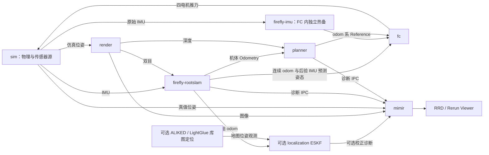
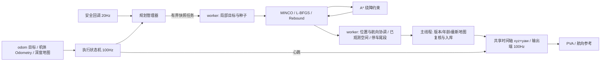

# 系统架构

本文维护职责、数学约定与能力边界；开发、运行和验收见 [development.md](development.md)。
默认值、容量和门限以对应 Options、配置和测试源码为准，本文不维护第二份参数表。

## 数据流与职责

默认从空局部地图启动，`firefly-rootslam` 只提供连续 VIO，`planner` 独立融合深度并规划。
不依赖已知世界起点、`.ffvmap`、`.ffmap` 或神经网络权重；离线库图定位是显式可选增强。



planner 的状态、目标、局部占据地图及轨迹均属于 odom；输入为机体里程计、深度和标定外参。
可选地图定位输出独立供诊断使用，planner 不订阅 Navigation，也不随全局修正清图或换轨。
GroundTruth 只供传感器生成、评测与展示，PlantState 只作评测，均不得进入估计或控制。
render 生成图像，mimir 记录诊断；观测开关不能改变算法参数或业务消息。

### Basalt 与 RootSLAM 独立应用

`apps/rootslam` 提供在线 VIO、数据集运行和 Basalt 无界面工具。
在线与数据集共用 `firefly-rootslam`，由 `input` 选择 IPC、LaMAria ASL 或
EuRoC/UZH/KITTI 文件源。适配器负责相机模型、外参、噪声与时钟转换；
图像保留原始尺寸，输入同一光流和估计器。数据集相机时刻加标定偏移后进入 IMU 时钟，
真值仅用于评分。在线保留静止初始化及高频 IMU 预测，数据集输出图像时刻后验。
`firefly-calibration` 提供相机、图像、标定与初始化基础设施；`firefly-basalt`
提供光流、IMU 预积分、局部 VO/VIO、边缘化、离线 mapper 与标定求解。

`firefly-rootslam-mapping` 在局部估计之上实现持久地图、地点检索、几何回环验证、
地图融合、位姿图优化及平方根全局 BA。在线 Basalt VO/VIO 本身没有地点识别回环；
在线入口默认关闭建图与回环；LaMAria 和 UZH 数据集示例开启持久地图、回环与位姿图优化，
排空输入和回环工作后运行全局 BA，同时导出因果 VIO 后验与最终地图轨迹。
实现依据原版 Basalt 源码及 RootSLAM 论文，不能据此宣称复现论文的精度或性能。

应用顶层 `precision` 统一选择局部 VO/VIO BA、IMU 预积分、边缘化先验和全局 BA
的 float32/float64 算术；全局 BA 的矩阵与迭代向量使用同一精度。
RootBA 的标量递推系数与代价求和保留 float64。光流补丁使用 float32，持久地图、
回环几何、位姿图优化和公共状态接口保留 float64。配置入口与数值回放工具的边界见
[RootSLAM README](../apps/rootslam/README.md)。

### 板载拓扑

真机由 `camera`（V4L2）、`imu`（SPI BMI088）、`motor`（sysfs PWM）接替仿真与渲染，
算法进程使用相同 IPC。相机标定由消费者配置，深度可选；无深度时规划器等待覆盖。
IMU 只发布角速度与比力，备用姿态解算在 FC 内。`Airframe` 在仿真中来自 MuJoCo，
板端来自实测装配配置。
板端时间为同一 `CLOCK_MONOTONIC` 秒，仿真为 `sim_time`，不得混合时钟域。
`camera` 与 `imu` 已实现标准 IPC 接口；设备同步、标定、实时性和板端飞行仍须真实验收。

诊断 topic、实体、录制及 Rerun 数据契约见 [可观测性](observability.md)。

<a id="frames"></a>

## 坐标与时间

跨模块使用 `firefly-base::{FrameId, RigidTransform, FrameTree}`；算法内部矩阵不隐含跨系语义。
算法与飞控使用 nalgebra；控制核心为 f32，默认在线估计与规划为 f64，数据集工具可选求解精度。
Bevy 数学类型用于渲染接线。
通用 SO(3)/SE(3) 运算由 `firefly-base::se3` 提供，95% 卡方门限由 `firefly-base::stats` 提供。
四元数使用 Hamilton 约定；跨进程方向由消息类型明确约定。

### 方向与树

`T_target_source` 将 source 中的列向量坐标转换到 target：

```text
p_target = R_target_source p_source + t_target_source
T_a_c = T_a_b T_b_c
T_b_a = inverse(T_a_b)

map
 └─ odom          全局定位给出的修正，可变化
     └─ body      VIO 给出的连续局部位姿
         ├─ left_camera
         ├─ right_camera
         └─ depth_camera
```

长度为米，角度为弧度，四元数为 Hamilton xyzw、source→target 主动旋转。
`OdomMessage::body_pose(parent)` 按 Hamilton body→parent 解释消息四元数。

- 组合必须匹配中间坐标系；坐标树拒绝自环、闭环、多父节点和不连通查询，错误不修改树。
- 点应用旋转和平移；物理速度等自由向量只旋转换基。
- 扭量顺序为 `[rotation, translation]`；`Ad(T) = [[R,0],[skew(t)R,R]]`，
  协方差换基为 `P_target = Ad(T) P_source Ad(T)ᵀ`。
- 刚体变换拒绝非有限值、缩放、反射和非法齐次行；四元数必须单位化。

树是一个几何快照，不承担时钟、缓存、插值或自动外推。调用方负责让每条边对应
查询所需时刻。不得因为两条消息都很新，就把不同采样时刻的位姿直接相除。
这项约束也适用于 VIO 初始化/重启：更换 odom 原点必须重建整条坐标链。

mimir 使用同一坐标链标记 RRD 中的原始观测，相机外参挂到运动中的机体坐标。
仿真真值使用独立 world；启动时可建立一次性的显示对齐，规则见
[observability.md](observability.md#spatial-frames)。显示变换只写入 RRD，不参与估计、规划或飞控。

### 图像坐标

VIO、特征匹配和深度射线使用像素中心坐标：左上像素中心为 `(0,0)`。
对称透视投影的主点由 `firefly_base::rig::principal_point` 统一给出，
320×240 图像为 `(159.5,119.5)`。GPU 帧缓冲坐标以像素边界为原点，
其采样中心 `(u+0.5,v+0.5)` 转为数组坐标时需减去半个像素。
离线资产契约包含主点；相机标定契约不匹配的库图不得用于在线定位。

### 控制边界

飞控位置、速度、姿态反馈以及起飞原点、Hold 锚点均保持在 odom 系。
局部规划参考直接使用 odom 坐标，通过通用 Reference 接口携带恒等变换快照。
飞控检查原始里程计和参考的新鲜度。通用接口仍支持可选外部参考携带 map←odom，
或在缺少快照时使用同时间戳校正/原始里程计配对；这些路径不参与默认局部规划。

配对历史有界，不做跨时刻近似；配对分支的对齐新鲜度取两条样本接收
时间中较早者。未配对、重复或过期样本不能维持无快照参考的有效性。
参考航向通过旋转航向向量转换，角速度通过该向量在水平面投影的导数转换。

通用参考的速度转换描述同一物理速度；定位修正不会移动局部反馈或 Hold 锚点。
默认规划输出的恒等变换不受可选定位修正影响。

### 会话坐标与可选外部地图

默认自主模式使用视觉惯性初始化的会话规范，无需世界坐标。
以下启动先验与锁存约束仅适用于显式启用的外部地图定位。
外部定位必须在 `configs/localization.toml` 的 `[origin]` 显式声明外部地图中的启动 `position` 和 `yaw`，
该先验必须来自部署配置，禁止读取在线 GroundTruth。

原始 VIO 仍用传感器初始化，位置在局部系归零。定位进程必须在解锁前启动，
以首个满足静止与局部原点约束的已初始化样本锁存：

```text
yaw_map_odom = yaw_map_body_start − yaw_odom_body_start
p_map_odom = p_map_body_start − R_map_odom p_odom_body_start
```

只消除航向规范自由度，保留重力对齐的滚转与俯仰。未完成锁存不发布地图里程计；
VIO 初始化状态失效后锁存停止，不能将重启后的局部坐标直接沿用到当前地图。
固定启动先验要求机体处于配置的启动点和朝向，不能用于空中启动定位进程。
离线地图查询只消费声明外部对齐的原子 Navigation 快照，不能在校正流缺失时用原始局部位置查询地图。该配置不提供任意
位置冷启动或绑架重定位能力。

### 可选 ESKF 后端

令 `D=T_map_odom`、`V=T_odom_body`、观测 `Y=T_map_body`。
统一使用 odom 系右扰动：

```text
D_true = D Exp(e_odom)
D_observed = Y inverse(V)
z = Log(inverse(D) D_observed)
R_odom = Ad(V) R_body Ad(V)ᵀ
S = P + R_odom
K = P inverse(S)
delta = K z
D_new = D Exp(delta)
P_posterior = (I-K) P (I-K)ᵀ + K R_odom Kᵀ
P_new = Jr(delta) P_posterior Jr(delta)ᵀ
```

视觉 PnP 的位姿协方差必须表达为 body 右扰动，顺序为 `[rot, trans]`。
视觉位姿的经验相机协方差先经 `Ad(T_body_camera)` 转到 body，再进入相同融合入口。
若修正被限幅，增益的相应行同步缩放后参与协方差更新。

这是小误差线性化的松耦合模型：把 VIO 位姿作为给定输入，没有传播其全部不确定度
及与视觉观测的相关性。视觉协方差也是经验模型；通过代数回归不等于统计一致性已验收。

<a id="vio"></a>

## RootSLAM 在线通讯与估计

统一入口为 `firefly-rootslam --config <path>`。`input::Source` 选择 IPC 或数据集，
提供传感器标定与重力；两者通过相同的 `[vio]` 配置构造器、`OpticalFlowInput` 和
`ImuData` 进入 Basalt 光流与估计器。输入层保留整数纳秒、各相机原始尺寸和传感器外参，
不通过缩图或重贴时间戳适配固定 IPC 消息。数据集生产器有界读取、验证左右目索引及 IMU
配对，结束后排空队列；不会发布飞控状态。数据集使用 Basalt 输入初始化，IPC 使用机体
静止初始化与高频预测，这两个运行生命周期分别维护。

IPC 适配为 [`online.rs`](../apps/rootslam/src/online.rs)。图像入口负责双目配对与拷贝，
IMU 时间水位覆盖图像测量时间后才提交 Basalt。光流、窗口优化、稀疏地图与 IMU 预测
使用各自的线程和有界队列。光流产生时间及双目关联，IMU 预积分与视觉残差共同优化，
边缘化保留历史信息。标定来自公共 rig，静止重力初始化来自 `firefly-imu-initialization`；
噪声密度与优化先验分别由 IMU 标定和 Basalt 配置负责。

[`online/imu.rs`](../apps/rootslam/src/online/imu.rs) 的 `ImuAdapter` 连接 Basalt 与
`firefly-vio-runtime::run_imu`。独立 IMU 线程持有 IPC 端口，负责事件接收、去重、
估计器入队、水位更新和后验消费；图像处理及视觉诊断在该线程之外执行。
`firefly-imu-propagation::Predictor` 保存有界 IMU 历史，用完整后验替换传播锚点并重放。
每条有效 IMU 从同一预测状态生成姿态、位置、速度和四路输出：
`Odometry`、`VioAttitude`、`CorrectedOdometry`、`Navigation`。预测不回写优化器，
缺少后验到测量时刻的完整历史覆盖时不发布。

`VioAttitude` 包含 IMU 测量时间、真实后验起点时间、非零会话号、Hamilton xyzw、
去偏角速度和陀螺偏置，不携带姿态方差。高频预测保留后验时间，视觉停更由 FC 独立检查；
在线时延标定不能重贴已积分状态的时间戳。初始化积压有界、非阻塞排空，后验按序消费。
退出先设置停止标志并回收 IMU 线程，再关闭估计器输入并回收光流、估计和地图线程。

IMU/body 外参保持恒等。在线默认关闭建图与回环，局部 VIO 不接受后端地图修正。
RootSLAM 同时发布恒等 map←odom、零修订的 Navigation 和对应校正位姿，供记录与可选消费者使用。
`--external-localization` 将这些可选输出的发布权交给 localization，局部里程计和姿态继续发布。
planner 仅消费局部 Odometry；深度直接进入 planner，RootSLAM 不维护稠密占据地图。

离线全局 BA 的 rig 适配遵循 RootSLAM 的固定外参和位姿图项，求解器采用 RootBA 的
列缩放、地标 QR、Schur-Jacobi 块预条件 PCG 与分阶段 LM 重试。默认不构造完整的
约化 Hessian；原始稀疏观测和正交变换用于隐式乘法。数值参考、来源和投影目标的
约定见 [mapping README](../crates/firefly-rootslam-mapping/README.md)。
作者实现未公开的配置与地图管理细节不视为已经复现；论文性能须由完整数据集验证。

<a id="imu"></a>

## 飞控姿态与控制

### 职责与接线

`firefly-imu` 是独立安全热备；`apps/fc/src/imu.rs` 只订阅原始 IMU，独立静止初始化、
传播与地面加计校正。它与 VIO 不交换状态、零偏或协方差，主备输出只选择、不融合。
备用角速度按测量间隔进行一阶低通。两路共用传感器，不能抵御共同的 IMU 故障。

- 正常姿态反馈：VIO 后验的高频预测，Hamilton body→odom。
- 降级姿态反馈：独立六误差状态 ESKF，Hamilton body→备用本地重力系。
- 位置/速度反馈：`Firefly/Odometry`。默认局部规划参考直接使用 odom；通用外部参考可携带坐标变换。
- IMU 与物理各 1kHz；FC 按墙钟 1kHz 调度，样本间保持最近姿态与角速度。
  两路只按新测量时间传播，不在控制 tick 上重复积分或外推。

`configs/fc.toml [imu]` 可覆盖 `firefly_imu::Options`；缺键使用代码默认值。
角速度 rad/s，比力 m/s²，时间秒，噪声配置为连续时间标准差密度。

### 初始化与可观测性

上锁状态收集有界静止窗口，检查三轴方差、平均角速度、加计模长。
重力方向给初始倾角，平均陀螺给三轴零偏；航向是自由规范。
备用初始化选定独立本地航向规范，局部角误差协方差条件于该规范；未知的 odom 航向关系
不作为大角度高斯误差放入局部 ESKF。
覆盖不足保持未就绪；仅靠 IMU 的静止检测不能排除
所有匀加速情况，因此要求部署时确实将机体放稳。真值不参与此判定。

降级接管时，在备用航向系锁定当前航向目标；不把 odom 航向目标直接用于备用姿态，
也不将 VIO 姿态或偏置注入备用滤波器。滚转/俯仰使用备用估计，不保证切换无瞬态。

独立飞控热备使用 `firefly-imu` 的陀螺均值协方差计算，按静止窗口统计，
使用与传播器相同的白噪声密度和随机游走。N 个样本均值的白噪声方差为 `Σ(σg²/Δti)/N²`；均值到窗口末端
零偏的游走方差为 `Σ σbg² Δti (i/N)²`（i=1…N−1）。额外加入样本协方差除以 N
作为模型余量，低样本散布不能压低已标定噪声。首样本周期采用相邻周期。
该模型依赖真正静止、采样白噪声与已标定的密度；不能识别所有缓慢转动或温漂。

加计创新检验每个 IMU 样本都可计算，但只有上锁且完整静止窗口通过时才允许校正。
飞行中不根据 NIS 通过就强制使用重力假设。无磁力计/外部观测时，绝对航向不可观测；
持续平移加速也不能由六轴 IMU 与倾斜完全区分。VIO 失联时继续陀螺传播，零偏随机游走
使不确定性增长；只提供短时姿态支持，不承诺定点、保高或长期姿态精度。

### 方程与卡方检验

名义状态 `(R,bg)`；右误差 `R_true = R Exp(δθ)`，排列 `[δθ,δbg]`。
令 `ω = gyro - bg`，则：

\[
R^+=R\operatorname{Exp}(\omega\Delta t),\qquad
\Phi=\begin{bmatrix}
\operatorname{Exp}(-\omega\Delta t)&-\Delta t J_r(\omega\Delta t)\\
0&I
\end{bmatrix}.
\]

过程噪声使用五点 Gauss–Legendre 对 `∫Φ(s)QcΦ(s)ᵀ ds` 积分，保留姿态/零偏
交叉项；零角速度处有闭式解。加计使用未归一化的三轴原始比力：

\[
h=R^T(0,0,g)^T,\quad H=([h]_\times,0),\quad
r=a_m-h,\quad S=HPH^T+R_a,\quad \mathrm{NIS}=r^TS^{-1}r.
\]

`R_a = (σ_accel²/Δt + σ_model²) I`。静止高斯线性化假设下使用 χ²(3) 的
99% 分位数；三维残差包含模长信息，不套用归一化方向
的两自由度检验。模型余量为工程参数，门限概率不是实际飞行误接受率保证。
范数与静止条件仍须同时满足。大协方差可能让错误加速度通过 NIS。
拒绝只保持预测，不因连续拒绝超过某次数而强制放行。

接受时均值使用完整 `Kr`，协方差用同一 K 的 Joseph 形式。零创新仍更新协方差。
注入后用 `G=diag(Jr(δθ_hat),I)` 重置右误差协方差；一阶姿态块为
`I - 0.5[δθ_hat]×`，含全部交叉协方差换基。

### VIO 预测与主备选择

FC 同时检查预测到达时间、测量年龄、后验测量年龄与后验更新的墙钟年龄。
持续发布 IMU 预测不能掩盖视觉后验停更；重复/乱序样本不能刷新健康状态。
会话改变锁存主链路不可用，需重启 FC；主链路失效不阻断独立 ESKF。
VIO 传播使用实际 IMU 样本及其时间间隔；独立 ESKF 对超限 IMU 间隔锁存失效。

### 控制核心

[`firefly-flight/src/px4`](../crates/firefly-flight/src/px4) 移植 PX4 的控制与分配算法，
不包含 uORB、参数服务和平台调度；固定参考版本见文末。

```text
参考 → PositionControl（P 位置 + PID 速度 + 推力矢量 + 倾角限幅）
     → AttitudeControl（四元数 P + 二阶参考模型 + yaw 权重 + 角速度限幅）
     → RateControl（角速度 PID + 前馈 + 分配饱和反馈）
     → ControlAllocationSequentialDesaturation（效能矩阵 + 顺序解饱和 + airmode）
     → 4 电机推力（归一化 [0,1] × 单电机推力上限）
```

- 模块内部保持 PX4 的 **NED 世界系 / FRD 机体系**与归一化指令：力矩 `[-1,1]`、
  推力 `[0,1]`、执行器 `[0,1]`。产品 Z-up/FLU 的转换只发生在
  `px4::controller::Controller` 与 `px4::frames` 边界（`F = diag(1,-1,-1)`）。
- 归一化悬停推力由质量与推力上限计算（`mg / 4T_max`），不手填。
- 分配器按旋翼几何构造 4×4 效能矩阵（FRD 行序 `[roll, pitch, yaw, thrust_z]`），
  伪逆后按轴归一化；`airmode` 默认开滚转/俯仰，垂直推力饱和时保留姿态权限。
  逐电机 `[0,1]` 限幅是唯一饱和点，未分配力矩回送角速度环做抗积分饱和。
- 起飞/降落的垂直参考由 `VelocitySmoothing` 生成（jerk 受限）；
  `FsmParams` 的 `takeoff_accel/jerk`、`land_accel/jerk` 限制加速度与 jerk，
  位置/速度/加速度一起进入 `PositionControl` 前馈。水平位置与航向仍由状态机锁存。
- 角加速度反馈暂缺省为零（PX4 用 `vehicle_angular_velocity.xyz_derivative`），
  不伪造测量；默认 D 增益因此很小。

### 解锁检查与失效标志

`firefly-flight::safety` 按 PX4 `ArmingCheck` / `FailsafeFlags` 的语义，只定义本产品
能评估的条件；RC/GCS/电池/地理围栏/GNSS/mission/失控检测没有输入，因此不设位，
不伪造“永远通过”的位。

检查项、位号、动作编码与优先级由
[`safety.rs`](../crates/firefly-flight/src/safety.rs) 唯一维护。解锁必须满足上锁模式、
估计与主备姿态就绪、会话有效、机体描述齐全、里程计及 IMU 新鲜、机体在地面。
`apps/fc` 将独立 ESKF 热备可用性计入 `ESTIMATOR_READY`，热备初始化未完成时拒绝解锁。

`fc/arming/failed` 记录首个失败检查的位掩码，`fc/failsafe/flags` 和
`fc/failsafe/action` 记录失效位及动作编码；mimir 以数值和具名 SeriesLines 保存。
拒绝原因和失效事件写入 `logs/fc`，观测契约见 [observability.md](observability.md)。

`configs/fc.toml` 覆盖产品控制包线；角速度/姿态环使用 PX4 默认值。质量、惯量、旋翼几何、
推力上限由 `Firefly/Airframe` 在运行时提供，飞控不保存第二份。

航段交接由任务层负责：`Goal.timestamp` 是目标身份，完整轨迹与 `Reference` 回显该身份，
`PlannerStatus` 报告目标和轨迹结束。每段先等待对应目标的新鲜参考，再显式进入 Track；
正常结束后显式 Hold，并按实测位置、速度和稳定时间确认到点。收到参考不会自动解除 Hold。

起飞进入 Hold 后仍保持指令目标；参考流首次失效即锁定当时 odom 位姿、输出零速目标，
模式超时不重置锚点。飞控每 tick 发布 Control，上锁时为零；指令墙钟超时后 sim 暂停物理
和传感器时间，不以旧控制持续推进。模式编码与超时定义见 `firefly-flight::FlightFsm`。

空中 VIO 失联或后验陈旧进入 `ATTITUDE_FALLBACK`：锁存选择独立 ESKF，
仅在备用姿态可用且 IMU 新鲜时复用控制/分配链稳定水平姿态并提供标称悬停推力；
参考姿态吸附到当前设定值，避免跨航向系平滑过渡。
不保证定点、保高或安全降落，不用陈旧位置判落地。恢复要求同一 odom 会话的有效里程计、
IMU 和显式 Hold/Land 指令；地面失联上锁，IMU 也失联时推力保护归零。

<a id="loops"></a>

## 在线回环

RootSLAM 的持久稀疏地图执行地点检索、几何验证和位姿图优化；数据集入口可在结束后执行全局 BA。
当前后端地图优化未接入在线里程计或规划链路。离线优化轨迹与在线 VIO 分别评估。
外部 ALIKED/LightGlue 定位独立使用地图观测，修正提交门限由
`firefly_localization::CorrectionOptions` 维护。

### 可选离线地图定位

ALIKED-N16 提取左目二维点与描述子，LightGlue 匹配库图特征，PnP 使用库中三维路标。
离线深度标签须重投影注册到左目，执行 z-buffer、空洞与边缘拒绝，不能同索引读取居中深度。
库图查询要求 Navigation 显式外部地图对齐；图像 t 的先验为
`T_map_body(s) inverse(T_odom_body(s)) T_odom_body(t)`，两时刻均需原始 VIO 历史覆盖。
不能用当前航向给旧图像做候选或几何门控，也不能把推理结束时刻当测量时刻。

候选与算子并发有界；非平面支撑及 PnP 质量充足才早退，弱支撑继续聚合候选。
忙时只处理最新图像，停止后回收工作线程，不承诺固定推理时延。在线路标回环不加载 ONNX。
库图观测年龄、融合后分歧仅为诊断量；不能据此将共享图像/IMU 的估计视为统计独立。

<a id="mapping"></a>

## 深度、地图与规划

planner 从空滚动地图开始。独立建图线程融合 `Firefly/Depth` 与测量时刻的机体 `Firefly/Odometry`，
按上游 `depthOdomCallback` 计算 `T_odom_camera = T_odom_body × T_body_camera`，由 `firefly-ego-map`
保存概率、射线历史和障碍膨胀。规划线程持有派生碰撞栅格，地图快照只在进程内传递。

render 与 quad 为未压缩的材质颜色、金属度/粗糙度纹理补齐 mip 链，供资产采样器执行
缩小滤波。颜色在线性光下平均，标量纹理直接平均；传感器输出纹理保持原始分辨率。

深度以前后两条机体里程计样本插值配对，拒绝外推与过大时间间隔；待配对帧和里程计历史
均有界。传感器输入采用最新值语义。融合与衰减按独立定时器运行，不阻塞规划求解。
快照包含覆盖范围、已膨胀障碍和射线确认的空闲位图，接收栅格不追加膨胀。
A*、位置优化和执行检查统一采用 EGO 的乐观障碍查询：未知空间不独立阻断轨迹。
空闲位图用于诊断感知覆盖，不参与执行许可；朝下相机的地面回波不能确认上方空气为空闲，
以该证据作为执行硬条件会让起步爬升在体素边界停住。
概率初值、概率衰减和空障碍快照均不能证明空闲；无命中且占据概率低于阈值的
射线穿越提供证据，有效深度帧也保留相机所在格的空闲证据；上游反向遍历省略这个格。
位图以固定窗口 bitset 共享，移出窗口的观测需要重新获得。
深度缺失、空帧、窗口移动与衰减均不推进有效融合时间。

快照中的障碍包围盒按贡献计数增删体素，重叠源移除不会擦掉仍存在的障碍。
执行与安全回调均先同步最新快照，再规划或检查碰撞；几何未变化时复用栅格。
`firefly-map::GridMap` 保存派生二值占据；概率融合属于 `firefly-ego-map::GridMap`。
快照超出内部容量预算时报错，不截断障碍；空障碍快照仍应用删除。

概率地图对照固定 EGO-Planner-v2 `9d85475ea7b9bf5c112cf7c3c3d0d3f9e96d9010`：
`raycastProcess` 累积命中/空闲概率，`fadingCallback` 衰减概率，
`clearAndInflateLocalMap` 增量更新邻域计数。数值测试直接抽取固定 C++ 函数逐次对照。
测量时刻插值、独立线程、几何版本门控和快照派生属于应用集成。
上游仿真默认使用深度＋相机位姿接口；本项目使用同一地图实现的深度＋机体里程计及外参接口。

新鲜度同时检查融合测量年龄和最后成功融合的墙钟年龄；重复快照不能续期。
滚动窗口暂时超出快照覆盖时停止接纳新轨迹，输出端完成已提交的停车尾段；
收到有效新快照后恢复规划；
深度输入超过新鲜度门限或线程终止时锁存急停。

`Odometry` 未就绪不规划；有效流失联或非法状态锁存停止，恢复须重启 planner。
重复/乱序数据不能续期，发布前再检查墙钟存活期，规划计算不阻塞接收线程。
状态规则见 `apps/planner/src/state_input.rs`，不提供切换反馈源或参考代替实测的捷径。

### 规划编排与执行

应用接入层接收 Odometry、深度和目标；`ReplanFsm` 对应 `ego_replan_fsm.cpp`，
`PlannerManager` 对应 `planner_manager.cpp`，`Planner` 对应 `poly_traj_optimizer.cpp`，
`firefly-search` 的 A* 对应 `dyn_a_star.cpp`。管理器负责全局引导、局部目标、种子选择和
轨迹入库，状态机负责启动、重规划、执行、完成与急停状态转换。
全局引导重建使用当前实测位置与速度，起始加速度和终点速度、加速度取零，
与上游 `planNextWaypoint` 一致。障碍内终点沿全局多项式反向搜索自由点，零长度目标
仍保留有效引导；两者都要求真实导航输入。

执行状态机 100Hz 与安全检查 20Hz 使用同一线程的两个定时回调，耗时求解由独立的
单 worker 执行。回调不等待求解结果，也不获取求解器锁；最多一个在途任务，取消后等待
worker 归还槽位才提交最新状态，避免快照积压。库级种子与失败重试保留上游流程；
在线停车前缀的终点已偏离全局游标，因此从当前指令 PVA 重建多项式种子，不将停车尾段
拼接到旧全局游标。随机源使用 Rust `rand`，与平台 C `rand()` 不保证相同数列。重目标期间保留
已发布轨迹，直到新轨迹成功替换。正常完成表示最终局部轨迹到时，任务层另行确认到点。

每个求解任务拥有局部栅格快照、任务世代、定位版本、地图几何版本、执行轨迹序号和
原始轨迹起始时刻。目标变更、急停、输入失效及地图覆盖/新鲜度检查失败
撤销结果资格；L-BFGS、Rebound 重试和 A* 搜索合作式取消。结果的墙钟和轨迹时钟年龄
均受管理器 `emergency_time` 预算限制，入库时轨迹在当前时刻的位置与实测位置的偏差
不得超过栅格分辨率；不将过期轨迹重新锚定到完成时刻。
位移检查拒绝候选后，从实测状态重新生成轨迹，任务目标和交接门限保持不变。
几何版本变化不直接取消求解；入库前在最新膨胀图和集群轨迹上复核未来检查点，窗口
移动后候选检查点超出当前窗口也拒绝。入库只移入轨迹、引导游标和求解簿记，地图及目标
仍由主线程持有；worker 只读分块写时复制快照，无跨线程地图锁。
安全回调发现碰撞时请求重规划，进入急停时限则直接生成停止轨迹，不等待优化尝试。
这是相对上游同步 `checkCollisionCallback` 的调度与急停策略差异；同步 FSM API 保留给
算法对照测试，生产进程使用 deferred API。

位置优化之后，worker 在同一时间轴上生成位置和航向五次多项式。目标为 odom 中的三维
位置，可附带终点 yaw；roll/pitch 仍由飞控按加速度与推力决定。航向连续展开，重规划保留
原指令的 yaw、角速度和角加速度。输出层不再根据位置临时推算航向。
运动方向超出相机标定的水平半视角时，先用连续 PVA 制动再转向；实测朝向满足门限且
深度地图保持新鲜后才推进。水平朝向门限不等同于完整的视锥或图像可跟踪性证明。

正常候选只提交有界前缀和完整停车尾段；最终到点轨迹可整体提交。整个执行段在窗口内
按最多半个体素的行程、至少 100Hz 采样，检查已膨胀障碍及 V/A/J 上限。
这里检查的是离散中心线与已知障碍膨胀，不保证未知区域无障碍，尚无连续扫掠体积或
动态障碍的安全证明。停车尾段无法通过检查时拒绝新
候选并保留旧指令；新障碍侵入旧指令时不保证仍存在可行停车轨迹。

`planner --traj-server` 是独立的 100Hz 采样进程。IPC 以一个原子样本传递共享起始时间、
分段时长的 xyz/yaw 系数；输出端拒绝末端非静止指令。正常结束后保持末端零速参考。
心跳失联或门控关闭后完成当前已提交的前缀及停车尾段，再停止输出；恢复心跳后须收到
新轨迹才能恢复采样。Odometry 存活期由输出端再次检查，失联立即停止参考输出。
规划器与输出端均不消费全局定位修订。这些运动协调和失联语义属于本项目对 EGO 的扩展。
应用集群广播链路未接入；swarm 间距与 formation 队形属于库级算法能力。

输出端收到轨迹和心跳前不发布参考。
地图融合超时使执行中的轨迹进入急停并禁用 fail-safe，输出端完成已提交的停车尾段；
等待新鲜地图期间不进行碰撞重规划。
此时 fail-safe 不允许凭低速或新求解结果退出急停。



### 规划输出边界

全局单航点多项式提供局部目标，局部 A* 在膨胀图上按 26 邻域检查目标节点占据。
MINCO/L-BFGS 优化保留端点 PVA，分别加权障碍硬/软项、集群间距和 V/A/J 软惩罚；
优化器候选通过集群间距和细碰撞检查后交给运动协调层。软惩罚可能超出 V/A/J 上限；
协调层按多项式导数的驻点极值增加分段时间，保留两端 PVA 和内点并重新求解 MINCO，
有界重试失败则拒绝。修改后的执行段重新检查障碍及动力学，未做连续碰撞证明。

每轮目标持有固定的障碍平面快照，Rebound 检测器独占可追加的下一轮平面池；
当前代价和梯度始终使用同一快照。取消时撤销未接受的线搜索试探，从最后接受点携新平面
重启；避障锁存按完整优化生命周期维护。数值与调度细节由优化器源码及对照测试约束。
静态、动态与执行期碰撞检查均采用上游采样流程；对端时钟与双方净距必须一致，
不能声称对连续曲线给出安全证明。Bernstein 判定仅用于测试侧独立验证。

搜索与执行对未观测格统一采用乐观占据语义；执行段必须在地图窗口内。
双目深度的空洞和超量程均为无效测量，不能提供自由射线；允许经过未知格不代表已确认安全。
航向对准目标也不保证该方向立即获得足够的深度证据。
地图重建后只有新视场提供证据；保留历史不能发现从未观察的障碍。
非凸求解不保证所有可达地图成功；定位漂移会同时移动投影和规划查询，膨胀不补偿任意误差。

### 深度代理模型

双目颜色中间纹理存储 sRGB 编码值，最终按 BT.601 生成 R8 灰度。GPU 打包灰度、
CPU 处理深度，回读缓冲和发布队列有界；IPC User Header 保留测量 trace 与发送时间戳。

`apps/render/src/sensors.rs::linearize_depth` 将 reverse-Z 转为相机光轴深度
`z=near/reverse_z`，无效值与超出有效深度范围的值置零。`apps/render/src/process.rs`
先调用线性化，再在线调用 `depth_noise.rs::apply`，对米制深度施加量程裁剪、由干净几何
生成的边缘掩码、相关块状缺测、横向扰动、视差噪声与量化。`render --offline` 保留
线性化并跳过噪声处理，输出理想几何标签，仍需左目注册。

```text
g = √(1-α) g_fixed + √α g_dynamic(t)
ε = σ_d (√ρ g_d + √(1-ρ) η)
d = fB/z; d_m = q round((d+ε)/q); z_m = fB/d_m
∂z/∂d = -z²/(fB); σ_z ≈ z²σ_d/(fB)
```

空间和时间插值按方差归一化；`Φ(g)<p` 产生相关缺测，横向扰动最近邻采样真实表面，
不插值出虚假中间表面。非正视差、超量程和非有限值归零。相同配置、种子、几何与测量
时间产生相同结果，噪声不依赖工作队列；缓存必须支持时间跳转和配置变化。
默认值和单位见 `DepthNoiseOptions`；`enabled=false` 仍裁剪量程，量化可独立关闭。

这是未用实机数据标定的双目代理，参考 SimKinect 的像素/视差建模和 D400 后处理思路。
不模拟材质、IR 散斑、多径、真实双目遮挡、入射角或匹配网络；相关场固定在图像坐标，
不能视为附着表面的材质缺陷。通过合成测试不证明匹配某款实机。

<a id="ffmap"></a>

### FFMap 格式

`.ffmap` 为 UTF-8 行式指令，`#` 为注释；解析与序列化唯一实现为
`crates/firefly-map/src/format.rs` 的 `MapFile`。

| 指令 | 含义 |
|---|---|
| `FORMAT firefly-map 1` | 格式与版本 |
| `RESOLUTION` / `ORIGIN` / `DIMS` | 分辨率米、世界原点米、三轴格数 |
| `OCCUPANCY` | 后续每行一个世界系占据格中心；中心为 `origin+(index+0.5)*resolution` |
| `DECOR` | 同构体素，仅显示、不参与规划 |
| `MOTION box cx cy cz sx sy sz` | 动态盒中心与尺寸 |
| `MOTION sphere cx cy cz r` | 动态球中心与半径 |
| 动态段 `t x y z` / `LOOP` | 严格递增的秒与中心航点，可循环 |

指令大小写敏感，未知指令或缺头字段报错；无占据体素合法。
动态障碍独立于静态 OCCUPANCY，按航点插值后体素化。

## 参考实现与差异

| 项目 / 固定版本 | 源码位置 | 可迁移的职责边界 |
|---|---|---|
| OpenVINS `69488123ed9362dd44b6f28e7f4680abbff1442b` | `ov_msckf/src/ros/ROS1Visualizer.cpp:245`、`:840` | 初始化后从 VIO/IMU 预测发布里程计；回环信息是另外的输出，不是发布里程计的前提 |
| VINS-Fusion `be55a937a57436548ddfb1bd324bc1e9a9e828e0` | `vins_estimator/src/utility/visualization.cpp:53`；`loop_fusion/src/pose_graph_node.cpp:192` | 本地里程计持续发布；回环节点用保存的对齐与漂移变换校正每条新里程计，不等待下一次回环 |
| EGO-Planner-v2 `9d85475ea7b9bf5c112cf7c3c3d0d3f9e96d9010` | `swarm-playground/main_ws/src/planner/plan_manage/src/ego_replan_fsm.cpp:46`、`:632` | 订阅 `odom_world`，消费位置和速度；规划就绪不以外部视觉匹配成功为条件 |
| ORB-SLAM3 `4452a3c4ab75b1cde34e5505a36ec3f9edcdc4c4` | `src/System.cc:213`；`src/Tracking.cc:1940`、`:2120` | 跟踪、局部建图、回环分工；跟踪状态由运动/局部地图跟踪决定，回环成功与否不是跟踪心跳 |
| PX4-Autopilot `4dbd2e069a5c30c2e53e47e842095d2576dc38c4` | `src/lib/rate_control/rate_control.cpp`；`src/modules/mc_att_control/AttitudeControl/AttitudeControl.cpp`；`src/modules/mc_pos_control/PositionControl/PositionControl.cpp`；`src/lib/control_allocation/control_allocation/`；`src/lib/motion_planning/VelocitySmoothing.cpp` | 位置/姿态/角速度/分配四层与起降 jerk 受限参考；四轴专用分配去掉 6 轴/16 执行器分支 |

源码审查不能替代独立公式、差分与最终输出验证。
OpenCV 兼容性对齐以 purecv 上游约定的 **4.10.0** 为目标；夹具保留各自真实来源版本，
不能据此宣称已与之对齐。

姿态数学参考 Solà《Quaternion kinematics for the error-state Kalman filter》第 5–6 节；
实现不采用连续拒绝后强制放行的经验逻辑。
VINS-Fusion 与 ORB-SLAM3 为 GPLv3，参考仓库保留在 `~/Projects/`，不纳入本仓库。
