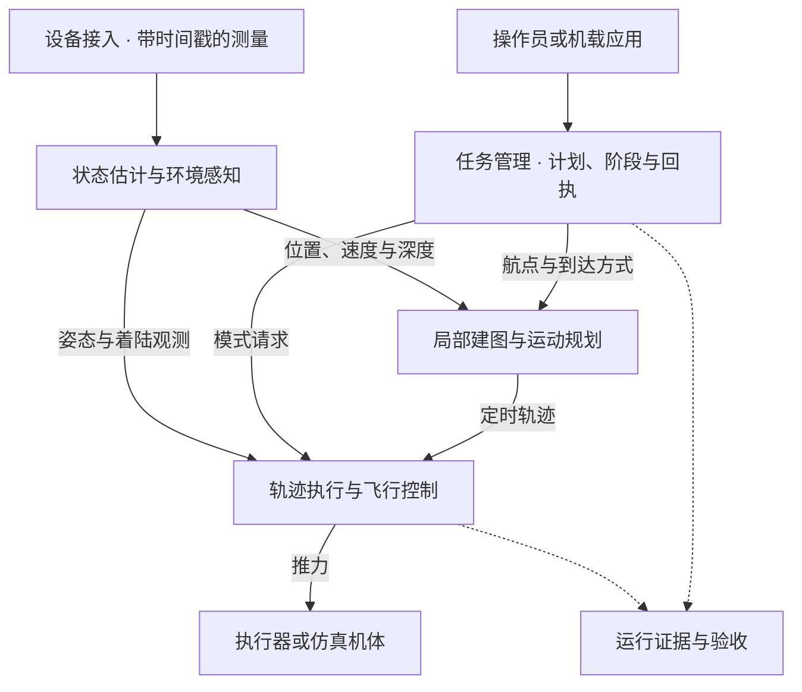
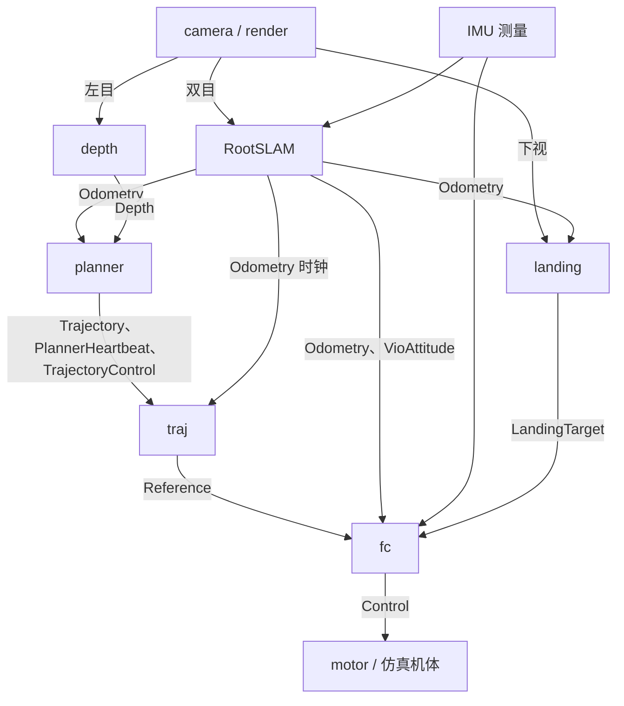
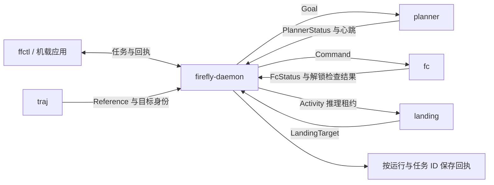
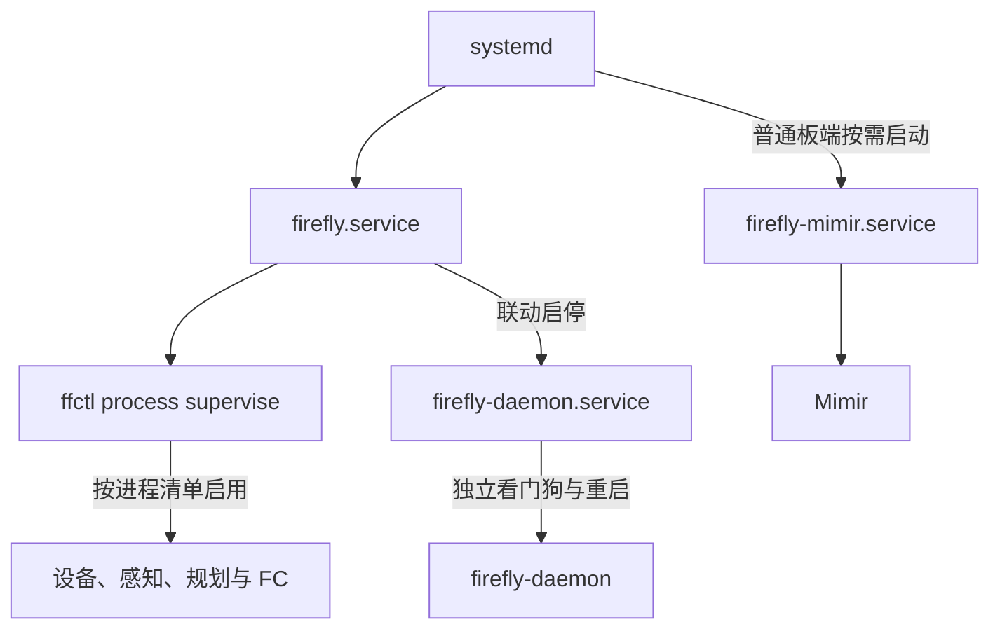
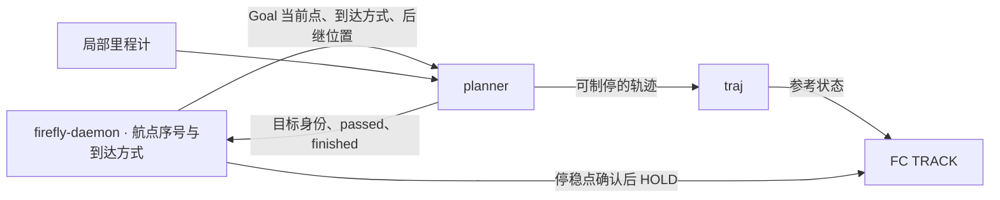
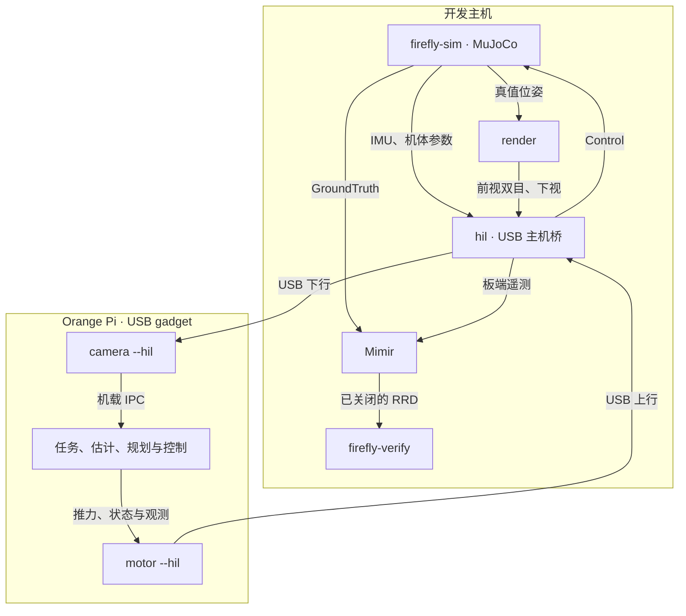

# Firefly 系统架构

Firefly 把一份相对起飞点的任务计划交给机载服务执行。本文按业务决策权、进程间数据流和部署位置描述系统。

## 业务域与职责

下图按“谁有权改变什么状态”划分业务域。箭头表示主要业务输入；相机、规划器和任务服务之间的具体反馈见下一节。

| 业务域 | 状态归属与决策 | 主要实现 |
|---|---|---|
| 任务管理 | 接受计划、记录起飞锚点、分配架次号、推进阶段和航点、持久化回执。模式是否生效以 FC 回报为准。 | [任务协议](../crates/firefly-mission/src/lib.rs)、[daemon](../apps/firefly-daemon/src/flight.rs)、[消息端口](../apps/firefly-daemon/src/bus.rs) |
| 设备接入与执行 | 为图像和惯性测量保留采集时间。普通板端 motor 发布机体参数，把四路推力换算到 PWM；仿真端由物理模型响应推力。 | [camera](../apps/camera/src/capture.rs)、[imu](../apps/imu/src/source.rs)、[motor](../apps/motor/src/actuator.rs) |
| 状态估计与环境感知 | RootSLAM 拥有本次运行的局部位姿与速度；depth 拥有单帧深度预测；landing 拥有精降目标的几何估计、跟踪与有效性。 | [RootSLAM](../apps/rootslam/src/online.rs)、[depth](../apps/depth/src/main.rs)、[landing](../apps/landing/src/tracking.rs) |
| 局部建图与运动规划 | planner 拥有局部占据图、碰撞快照、规划状态和获采纳的轨迹，判定途经点通过并回报目标身份。 | [深度融合](../apps/planner/src/depth_mapping.rs)、[规划入口](../apps/planner/src/main.rs)、[位置与航向协调](../crates/firefly-planner/src/motion.rs) |
| 轨迹执行与飞行控制 | traj 在测量时钟上采样已提交的曲线；FC 裁决解锁、跟踪、降落和失效处置，计算四路电机推力。 | [采样器](../crates/firefly-planner/src/traj_server.rs)、[FC](../apps/fc/src/main.rs)、[飞行模式](../crates/firefly-flight/src/fsm.rs) |
| 运行支撑与验证 | systemd 和 ffctl 管理进程；xtask 编排试验；Mimir 归档观测；verify 独立判断任务和飞行质量。 | [部署](../xtask/src/deploy.rs)、[试验编排](../xtask/src/mission.rs)、[Mimir](../apps/mimir/README.md)、[评分器](../apps/firefly-verify/src/lib.rs) |

## 机载数据流

同机业务进程通过 iceoryx2 发布、订阅消息。图中使用 topic 短名，完整名称带 `Firefly/` 前缀。操作端通过本机 Unix socket 与任务服务交换请求和回执。

任务与飞控各自维护状态机。daemon 同时读取机体参数、估计会话、FC 模式、规划心跳、规划状态、轨迹参考和降落目标。以下反馈解释了“已发送指令”和“已执行阶段”在接口上的区别。[daemon 消息端口](../apps/firefly-daemon/src/bus.rs) · [topic 目录](observability.md#ipc-topic-catalog)

### 坐标、时间与地图所有权

| 数据 | 使用约定 |
|---|---|
| `odom` | 本次 VIO 初始化建立的连续局部坐标。每一架次重新记录起飞点，任务偏移沿同一组轴相加。规划器、精降和 FC 使用局部反馈。 |
| 相机与机体 | 深度是左相机光轴方向的米制距离。建图按图像采集时刻查机体位姿，并应用相机外参；精降对下视相机做同样的时间配对，输出机体接触位置。 |
| `map` 与 `world` | `Navigation` 携带地图对里程计的对齐。可选外部定位用 `PoseObservation` 与局部里程计更新对齐；启用时由 localization 独占导航和校正里程计发布。`world` 是模拟器真值系，评分器以首架次起飞锚点建立固定对齐。 |
| 测量时间与运行时间 | 图像配对、位姿插值、轨迹采样使用测量时间，RRD 以 `sim_time` 保存；新鲜度、看门狗和耗时采用进程单调时钟。RRD 的 `wall_time` 保存墙钟时间。 |

RootSLAM 的可选稀疏地标地图服务于定位；planner 的局部占据图服务于碰撞查询，来自深度帧和里程计。USB HIL 关闭 RootSLAM 的稀疏建图和回环，同时运行 planner 的深度建图。[在线估计配置](../apps/rootslam/README.md#online-operation-and-validation) · [外部定位](../apps/localization/src/main.rs) · [HIL 进程清单](../configs/processes-hil.toml) · [评分对齐](../apps/firefly-verify/src/flight.rs)

### 图像进入闭环后的处理

`planner`、`traj` 和 `landing` 各自在进程内通过 `firefly-odometry` 接收并校验里程计。
`landing` 按图像时间查询历史样本，`traj` 按样本时间采样轨迹，`planner` 将实测位置和速度转换为规划初态，并为这个起点指定零加速度。

默认在线飞行从停机坪静止启动。RootSLAM 用静止窗口的加速度确定重力方向，用首帧航向定义里程计的水平轴，航点沿用这组轴。首帧优化保留重力测得的倾角、起始航向和零初速，后续各帧的姿态与速度由双目和 IMU 估计。

精降识别在每张参与推理的下视图像上用 YOLO 提取候选框。框内的白色连通轮廓按最小面积外接矩形归一化，通过两条竖笔、横梁和两侧缺口确认 H 的形状。四个矩形顶点与标志的实际尺寸、相机标定和拍摄时刻的姿态共同确定目标位置。跟踪器已有候选后，也在整幅图像中搜索 H，并用位置连续性校验后续观测。

## 系统运行、架次和任务

一次系统运行（SystemRun）从整机启动持续到关机或整机重启，可以包含零个或多个架次（Flight）。一次实际离地到着陆计一个架次。解锁后在地面取消属于起飞尝试。起飞、航线执行、返航、着陆是飞行阶段，落稳上锁后系统进入地面待命。

任务（Mission）描述有验收条件的工作，任务计划（MissionPlan）描述可复用的航线和动作。当前接口一次提交一项悬停或往返任务，每项任务安排一次起飞尝试。调用方为任务命名；daemon 在 FC 进入飞行模式、同一 VIO 会话实测相对起飞位置升高超过 0.15 米时分配本运行内的架次序号。地面取消的任务仍有回执，架次序号为空。同一计划用新的任务 ID 可以再飞一次。

一次运行共享传感器、飞控和 VIO。首次初始化确定 odom 轴向。每架次从地面观测重新记录起飞位置和机头姿态，航点偏移沿共享 odom 轴。落稳上锁后释放本架次的航点进度和视觉确认窗口，等待下一项显式提交。运行中更换 VIO 会话会终止当前任务并阻止使用新坐标系再次起飞。

### 板上服务与控制权

进程清单决定应用及其 CPU 亲和性。A733 的 CPU 6、7 分给 RootSLAM，CPU 5 分给 FC，CPU 2、4 承担规划与建图，CPU 3 运行深度进程；CPU 4 同时承载采样与精降。不同模式的设备入口由各自清单选定。[普通进程清单](../configs/processes.toml) · [HIL 进程清单](../configs/processes-hil.toml) · [任务服务单元](../configs/firefly-daemon.service)

一个相近的产品例子是 NetworkManager。连接和设备状态由常驻进程维护，命令行工具和桌面程序通过同一控制接口操作它。Firefly 沿用这种控制关系，板上其他应用与 `ffctl` 可以独立连接和退出。[NetworkManager 服务](https://networkmanager.dev/docs/api/latest/NetworkManager.html) · [nmcli 客户端](https://networkmanager.dev/docs/api/latest/nmcli.html)

Orange Pi 的 BSP 启用 `firefly.service`。其主进程 `ffctl process supervise` 管理设备、FC 和 VIO。部署时默认关闭板端 `firefly-mimir.service` 自启动。普通板端运行可手动启动该服务录制，USB HIL 由宿主机 Mimir 同步录制板端遥测和仿真真值。`cargo xtask deploy` 安装并启用独立的 `firefly-daemon.service`，跟随整组服务启停。daemon 打开 IPC、完成任务恢复并监听客户端后发送 READY。传感器就绪与允许起飞由任务接口单独报告。`WatchdogSec=4s` 是初始故障检测预算。daemon 每完成一轮工作检查单调时钟，按 systemd 下发超时的一半发送 WATCHDOG。卡在 IPC、主线程被停止或运行循环失去进展都会中断通知。systemd 按 `Restart=on-failure` 单独拉起任务服务，FC、VIO 和录制保持运行。该超时针对服务活性，20 ms 调度周期的超期需要单独测量。[systemd.service](https://www.freedesktop.org/software/systemd/man/latest/systemd.service.html) · [sd_event_set_watchdog](https://www.freedesktop.org/software/systemd/man/latest/sd_event_set_watchdog.html)

`crates/firefly-mission` 定义计划与请求。`ffctl mission` 在板上通过仅服务用户可访问的 `/run/firefly/mission.sock` 发送一行 JSON 并读取一行回执。状态查询在传感器上线前即可使用。首次提交要有新鲜的里程计、姿态与飞控上锁状态。一架飞机一次执行一项任务，忙时立即答复。任务执行中的人工取消进入收尾，地面已解锁时请求上锁，空中请求普通降落，飞控已在降落或失效保护模式时等待飞控处理。

板上以 Linux 的 `/proc/sys/kernel/random/boot_id` 标识一次操作系统启动，包含同次启动内的全部架次和 daemon 重启。macOS 原生 SIL 在隔离的安装目录中，通过内核接口读取开发机的 `kern.bootsessionuuid`。同一次 Mac 开机内启动的独立 SIL 场景可以有相同的 ID，各场景的回执由安装目录隔离。两种值各自标识产生它的系统，跨机器或板端与仿真对账需另外绑定录制来源。daemon 启动时取得 ID 并传给回执存储。回执位于 `state/missions/<boot-id>/<mission-id>.json`。串行写线程执行文件同步、原子替换和目录同步。主循环持续接收遥测并推进普通飞行阶段，写线程按顺序确认最多八个排队的回执。首次提交落盘后才答复并发送 ARM，架次号落盘后才发布离地事件。取消确认和下一项任务也以已提交的回执为准。写失败或等待超过三秒会结束服务并触发恢复。同一运行内重复提交相同 ID 与计划返回已有回执。同 ID 换计划会被拒绝。进程重启时，未完成任务从收尾阶段接管。

任务执行由 daemon 内的一份状态驱动。下表中的等待步骤与所属阶段共用超时预算。回执、RRD、xtask 和评分器共用 `firefly-mission::Phase` 的阶段名。评分器按计划独立检查观测顺序。

| 对外阶段 | daemon 推进条件 |
|---|---|
| `arm` | 发送一次 ARM，等待 FC 报告 `ARMED_GROUNDED` 后进入起飞。 |
| `takeoff`、`hover` | 请求起飞，等待 FC 转入 HOLD，再按计划计满悬停时间。带航点的任务开始导航，悬停任务进入着陆流程。 |
| `navigate` | 发布本次目标，核对同一目标的规划状态与参考，再请求 TRACK。途经点以 `passed` 推进，停稳点以完成标志和实测到达条件推进。返航沿用导航阶段。 |
| `hold`、`dwell` | 确认 FC 已从 TRACK 切入 HOLD，计满停留时间后进入下一航点或着陆流程。精降计划先进入 acquire。 |
| `acquire` | 进入阶段时建立本次确认窗口，累计至少三个不同时间戳的有效目标，首尾至少相隔 0.15 秒。目标失效时重新计数。 |
| `land` | 请求降落，观测到 FC 的 LAND 后等待 DISARMED；若 FC 回到 HOLD，重新请求并等待本次确认。 |
| `ground` | 连续 0.75 秒保持上锁且里程计速度不超过 0.12 m/s，才记为完成。 |
| `recover`、`needs_operator` | 按 FC 实测模式请求地面上锁或空中降落。需人工处理时保留任务占用，持续确认上锁后记为 interrupted。 |
| `complete`、`interrupted` | 持久回执分别记录正常完成和中断收尾。每项已受理任务均可按 ID 查询。 |

受理、实测离地、阶段或航点变更分别随对应回执排队。落盘确认后，daemon 用该回执和转换时的测量时间发布事件。进程重启时根据持久阶段进入收尾，已交由操作员的任务继续等待上锁。

`ready` 表示 daemon 空闲、机体参数新鲜、姿态与有效里程计时间相符、估计会话一致、机体静止，且 FC 已上锁并报告 `can_arm=1`。带航点的任务在提交时还需要 planner 心跳。最终解锁由 FC 的实时检查裁决。运行状态给出最近一次新鲜的 `fc_mode`。收尾时，FC 进入锁存的 `ATTITUDE_FALLBACK`，或 45 秒内仍未确认上锁，daemon 进入 `needs_operator`。操作员可查询原因并接管飞控，该任务持续占用执行位置，直至 FC 连续报告上锁。单独停止任务服务时，它先保存中断原因，在两秒的退出窗口内请求地面上锁或空中降落。整机停机按落稳上锁后的流程执行。

普通降落使用本架次起飞高度估算距地高度。精降采用识别到的停机坪高度和横向对准条件。遇到高于起飞面的接触位置时，普通降落可能一直等待触地确认。任务服务保留飞控的上锁判据，并通过任务回执报告需要处置的状态。

## 航点执行

停稳点等待规划完成、里程计进入 0.15 米且速度不超过 0.12 m/s，持续 0.5 秒后切入 HOLD。途经点和后继位置一起投递。planner 在实测位置进入途经点 0.35 米球内时切换到后继目标并锁存 `passed`，任务在 TRACK 下继续。后继目标默认停稳；连续途经时任务用下一条带后继位置的命令接续。目标身份采用命令时间戳，任务按访问序号区分相同坐标。

`STOP` 的底层 Goal 可携带终点 yaw；任务文件的 Waypoint 只有三维偏移和到达方式。最终可达段把位置和航向放在同一时间轴上，traj 同时采样两条曲线。重规划延续既有航向的角度、角速度和角加速度。目标方向超出前视范围时也可先制停转向。心跳过期时 traj 执行已提交的制停尾段，在尾段结束后停止提供参考。[任务字段](../crates/firefly-mission/src/lib.rs) · [Goal 契约](../crates/firefly-pubsub/src/goal.rs) · [航向规划](../crates/firefly-planner/src/motion.rs) · [采样与心跳](../crates/firefly-planner/src/traj_server.rs)

## 部署与验证边界

| 模式 | 测量与执行 | 任务和在线算法 | 证据 |
|---|---|---|---|
| 普通板端 | Linux camera 采集图像，imu 读 BMI088，motor 接收推力并输出 PWM。设备进程按装配启用。 | 板上 daemon 和算法进程。可选 localization 需配置原点并指定导航发布者。 | 按需开启板端 Mimir。board 评分检查任务生命周期、FC 模式、会话及架次间上锁。 |
| 软件在环（SIL） | 主机 MuJoCo 生成运动、IMU 和机体参数，render 生成图像，动力学接收 FC 推力。 | 主机运行同一套任务、估计与控制程序；xtask 按计划启用精降、航点规划与采样，模型走仿真后端。 | 主机 Mimir 记录业务观测与独立真值；SIL 评分包含物理航线。 |
| USB 硬件在环（HIL） | 物理与成像仿真在主机，USB 下发测量，板上 camera 的 HIL 入口发布图像、IMU 等输入，motor 的 HIL 入口回传推力。 | 任务服务、RootSLAM、depth、landing、planner、traj 与 FC 在 A733 上运行。宿主机用任务代理查询同一个板端 daemon。 | 主机 Mimir 合并真值与板端遥测，录制关闭后运行 HIL 评分。 |

`hil-gadget` 管理板端 USB 功能的建立和模式切换。传感器、任务请求与回执经主机桥和板端端点传输。HIL 的板端推理走 VIPLite，SIL 的模型走 ONNX。普通 motor 的 PWM 实现和硬件规格中的 Matrix/MSP 方案对应不同的执行接口；后者仍需适配和台架验证。[试验启动入口](../xtask/src/mission.rs) · [普通板端清单](../configs/processes.toml) · [USB 配置](../configs/processes-hil.toml) · [硬件设计规格](hw/spec.md)

### 从一次运行到验收结果

1. daemon 将请求和阶段写入任务回执，Mimir 把任务事件、机载状态和配置写入本次运行目录的 `rrd/` 分段。前者供服务恢复，后者供回放与验收。板端按开机身份归档，同一次桌面命令的子进程共享运行目录。
2. verify 按运行、任务和架次检查阶段顺序、会话与 FC 实测模式。SIL/HIL 再把 `odom` 目标变换到仿真 `world`，计算途经点距离与速度、返航误差及落地后的稳定性。
3. xtask 核对提交结果、进程退出、任务 ID 和评分器退出状态。Rerun 可沿同一测量时间查看图像、估计、轨迹与真值，定位哪一步产生了偏差。[录制契约](mimir.md) · [真值评分](../apps/firefly-verify/src/flight.rs) · [运行入口](development.md#运行)

公开数据集沿 RootSLAM 的离线入口评估定位，可独立开启稀疏建图、回环与全局优化。CAD 与 MuJoCo 场景包提供机体和场地资产；`quad` 是复用控制核心的独立交互演示。三者在仓库中分别承担算法对照、资产准备和演示职责。[数据集测评](../apps/rootslam/README.md) · [CAD](../packages/firefly-cad/README.md) · [quad](../apps/quad/README.md)
