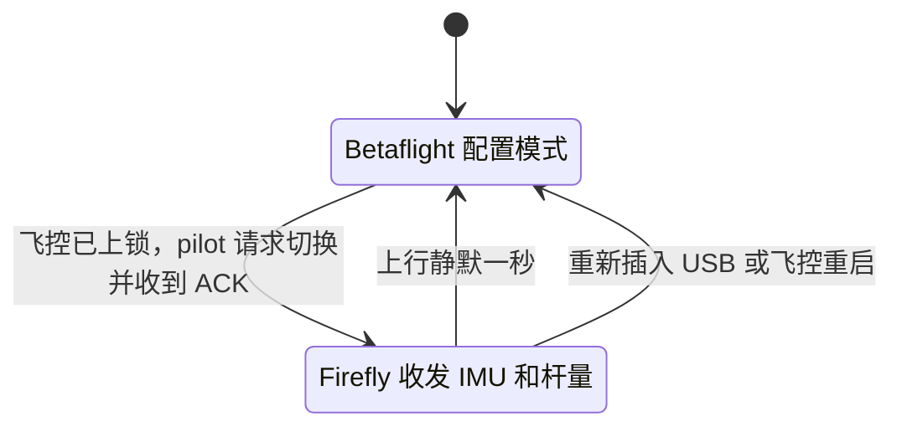
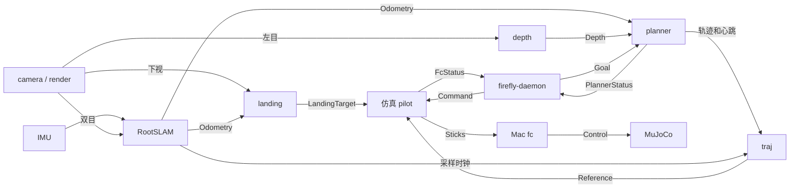

# Firefly 系统架构

## 部署与验证边界

| 环境 | IMU 和相机从哪里来 | 谁产生杆量，谁驱动电机 |
|---|---|---|
| 实机 | Orange Pi 的 `pilot` 从 Matrix USB 接收 BMI270 样本并发布 `Firefly/Imu`。Linux `camera` 按装配启用。 | 板上发布者向 `Firefly/Sticks` 写四通道杆量。`pilot` 下发给 Matrix，由 Betaflight 自稳、混控并输出 DShot。 |
| Mac 软件在环（SIL） | MuJoCo 生成 IMU 和机体状态，`render` 生成双目和下视图像。 | `pilot --simulation` 将任务参考转换成杆量。Mac `fc` 用杆量和仿真 IMU 计算四电机推力，MuJoCo 推进动力学。 |
| USB 硬件在环（HIL） | Mac 生成测量，通过 USB 桥发送给 Orange Pi 的 `camera --hil`。 | 任务、感知、规划和仿真 pilot 在 Orange Pi 运行。`motor --hil` 回传杆量，Mac `fc` 解算推力。宿主机 Mimir 同时录制板端遥测与仿真真值。 |

实机已在台架上验证 Matrix → pilot → RootSLAM 的 IMU 链路。固件当前回传 IMU，daemon 仍需机体参数和飞控状态才能受理飞行任务。SIL 和 HIL 提供这两项反馈。[台架结果](hw/spec.md#飞控电调板) · [板端进程](https://github.com/3SE-Competitive-Robotics-Team/firefly/blob/main/configs/processes.toml) · [HIL 进程](https://github.com/3SE-Competitive-Robotics-Team/firefly/blob/main/configs/processes-hil.toml)

## Matrix USB 会话

Orange Pi 的 `pilot` 独占 Matrix 的 USB 数据口。MSPv2 用于请求切换，收到 ACK 后，双方通过同一端口收发 `firefly_serial_protocol` 帧。

pilot 将飞控时间戳映射到 Orange Pi 单调时钟，加速度以 m/s²、角速度以 rad/s 发布。实机杆量发布者按横滚、俯仰、偏航、油门填写四个通道，`state_time` 使用 Orange Pi 单调时钟的秒数。

单独读取 IMU 时，pilot 每 250 ms 发送一次心跳。杆量有独立的 100 ms 超时，只有新的有效控制帧能续期。实体遥控器负责解锁并授权接管。ANGLE 模式下，横滚和俯仰给定倾角，偏航给定转速，油门给定推力。[帧格式和控制条件](https://github.com/3SE-Competitive-Robotics-Team/betaflight/blob/8f5dbb8a737780d39716e7542b21788836e9e2f0/docs/firefly_serial_protocol.md#usb-connection)

## 机载数据流

同机进程通过 iceoryx2 交换消息。下图中的线名省略了 `Firefly/` 前缀。操作员用 `ffctl mission` 通过本机 Unix socket 提交计划、查询回执或取消任务。[topic 目录](observability.md#ipc-topic-catalog)

### 坐标、时间与地图所有权

| 数据 | 使用约定 |
|---|---|
| `odom` | 本次 VIO 初始化建立的连续局部坐标。每一架次重新记录起飞点，任务偏移沿同一组轴相加。规划器、精降和 FC 使用局部反馈。 |
| 相机与机体 | 相机 ID 统一使用光学轴（右、下、前），机体轴为前、左、上。默认外参由 `firefly_base::rig::body_from_optical` 提供，Bevy 在相机挂载处转换渲染轴。在线深度沿左目光轴计米，离线渲染深度以独立深度机位为原点。建图和精降按采集时间配对机体位姿，再应用各自的相机外参。 |
| `map` 与 `world` | `Navigation` 携带地图对里程计的对齐。可选外部定位用 `PoseObservation` 与局部里程计更新对齐。启用时由 localization 独占导航和校正里程计发布。`world` 是模拟器真值系，评分器以首架次起飞锚点建立固定对齐。 |
| 测量时间与运行时间 | 图像配对、位姿插值、轨迹采样使用测量时间，RRD 以 `sim_time` 保存。新鲜度、看门狗和耗时采用进程单调时钟。RRD 的 `wall_time` 保存墙钟时间。 |

RootSLAM 的可选稀疏地标地图服务于定位。planner 的局部占据图服务于碰撞查询，由深度帧和同一发布端的里程计生成。已登记的场地以独立固定层参与碰撞查询。里程计发布端变化时，接收器停止提供状态与插值历史。USB HIL 关闭 RootSLAM 的稀疏建图和回环，同时运行 planner 的深度建图。[地图管理](map-management.md) · [在线估计配置](rootslam.md#online-operation-and-validation) · [外部定位](https://github.com/3SE-Competitive-Robotics-Team/firefly/blob/main/apps/firefly/localization/src/main.rs) · [HIL 进程清单](https://github.com/3SE-Competitive-Robotics-Team/firefly/blob/main/configs/processes-hil.toml) · [评分对齐](https://github.com/3SE-Competitive-Robotics-Team/firefly/blob/main/apps/firefly/firefly-verify/src/flight.rs)

RootSLAM 在静止窗口中估计重力方向，首帧航向确定 `odom` 的水平轴。精降用下视图像中的 H 标志、尺寸、相机标定和拍摄时的姿态求目标位置。planner 融合深度与里程计生成局部占据图，traj 在里程计的测量时间上采样已提交的轨迹。[在线估计](https://github.com/3SE-Competitive-Robotics-Team/firefly/blob/main/apps/firefly/rootslam/src/online.rs) · [精降跟踪](https://github.com/3SE-Competitive-Robotics-Team/firefly/blob/main/apps/firefly/landing/src/tracking.rs) · [深度融合](https://github.com/3SE-Competitive-Robotics-Team/firefly/blob/main/apps/firefly/planner/src/depth_mapping.rs)

## 系统运行、架次和任务

一次开机可以执行多项任务，共享一个 VIO 会话。每项计划用独立 ID 提交，daemon 在地面重新记录起飞位置。实测升高超过 0.15 米且飞控已进入飞行模式时分配架次号。地面取消仍有回执，架次号为空。VIO 会话在任务中改变时，daemon 中断任务。

### 板上服务与控制权

`firefly.service` 的主进程 `ffctl process supervise` 按进程清单启动设备和算法。独立的 `firefly-daemon.service` 监听 `/run/firefly/mission.sock`。systemd 在 daemon 停止响应时单独重启它。`ffctl mission status` 在传感器上线前也可查询。`ready` 需要机体参数、同一估计会话中的新鲜里程计和姿态、机体静止，以及飞控报告上锁并允许解锁。带航点的计划还需要 planner 心跳。[服务单元](https://github.com/3SE-Competitive-Robotics-Team/firefly/blob/main/configs/firefly-daemon.service) · [任务接口](https://github.com/3SE-Competitive-Robotics-Team/firefly/blob/main/crates/firefly-mission/src/lib.rs)

回执保存在 `state/missions/<boot-id>/<mission-id>.json`。同一开机内重试相同 ID 和计划会得到已有回执。首次受理落盘后才发送 ARM，架次号落盘后才发布离地事件。daemon 重启时从持久回执恢复，未完成任务进入收尾。桌面 SIL 用独立安装目录区分同一次 Mac 开机内的不同场景。[任务实现](https://github.com/3SE-Competitive-Robotics-Team/firefly/blob/main/apps/firefly/firefly-daemon/src/flight.rs)

| 对外阶段 | daemon 推进条件 |
|---|---|
| `arm` | 发送一次 ARM，等待 FC 报告 `ARMED_GROUNDED` 后进入起飞。 |
| `takeoff`、`hover` | 请求起飞，等待 FC 转入 HOLD，再按计划计满悬停时间。带航点的任务开始导航，悬停任务进入着陆流程。 |
| `navigate` | 发布本次目标，核对同一目标的规划状态与参考，再请求 TRACK。途经点以 `passed` 推进，停稳点以完成标志和实测到达条件推进。返航沿用导航阶段。 |
| `hold`、`dwell` | 确认 FC 已从 TRACK 切入 HOLD，计满停留时间后进入下一航点或着陆流程。精降计划先进入 acquire。 |
| `acquire` | 进入阶段时建立本次确认窗口，累计至少三个不同时间戳的有效目标，首尾至少相隔 0.15 秒。目标失效时重新计数。 |
| `land` | 请求降落，观测到 FC 的 LAND 后等待 DISARMED。若 FC 回到 HOLD，重新请求并等待本次确认。 |
| `ground` | 连续 0.75 秒保持上锁且里程计速度不超过 0.12 m/s，才记为完成。 |
| `recover`、`needs_operator` | 按 FC 实测模式请求地面上锁或空中降落。需人工处理时保留任务占用，持续确认上锁后记为 interrupted。 |
| `complete`、`interrupted` | 持久回执分别记录正常完成和中断收尾。每项已受理任务均可按 ID 查询。 |

若降落面高于起飞点，普通降落可能持续等待触地。精降采用识别出的停机坪高度。收尾时，飞控进入 `ATTITUDE_FALLBACK` 或 45 秒内未确认上锁，回执进入 `needs_operator`，直至飞控持续报告上锁。

## 航点执行

停稳点等待规划完成、里程计进入 0.15 米且速度不超过 0.12 m/s，持续 0.5 秒后切入 HOLD。途经点和后继位置一起投递。planner 在实测位置进入途经点 0.35 米球内时切换到后继目标并锁存 `passed`，任务在 TRACK 下继续。后继目标默认停稳。连续途经时任务用下一条带后继位置的命令接续。目标身份采用命令时间戳，任务按访问序号区分相同坐标。

`STOP` 的底层 Goal 可携带终点 yaw。任务文件的 Waypoint 只有三维偏移和到达方式。最终可达段把位置和航向放在同一时间轴上，traj 同时采样两条曲线。重规划延续既有航向的角度、角速度和角加速度。目标方向超出前视范围时也可先制停转向。心跳过期时 traj 执行已提交的制停尾段，在尾段结束后停止提供参考。[任务字段](https://github.com/3SE-Competitive-Robotics-Team/firefly/blob/main/crates/firefly-mission/src/lib.rs) · [Goal 契约](https://github.com/3SE-Competitive-Robotics-Team/firefly/blob/main/crates/firefly-pubsub/src/goal.rs) · [航向规划](https://github.com/3SE-Competitive-Robotics-Team/firefly/blob/main/crates/firefly-planner/src/motion.rs) · [采样与心跳](https://github.com/3SE-Competitive-Robotics-Team/firefly/blob/main/crates/firefly-planner/src/traj_server.rs)

### 从一次运行到验收结果

1. daemon 将请求和阶段写入任务回执，Mimir 把任务事件、机载状态和配置写入本次运行目录的 `rrd/` 分段。前者供服务恢复，后者供回放与验收。板端按开机身份归档，同一次桌面命令的子进程共享运行目录。
2. verify 按运行、任务和架次检查阶段顺序、会话与 FC 实测模式。SIL/HIL 再把 `odom` 目标变换到仿真 `world`，计算途经点距离与速度、返航误差及落地后的稳定性。
3. xtask 核对提交结果、进程退出、任务 ID 和评分器退出状态。Rerun 可沿同一测量时间查看图像、估计、轨迹与真值，定位哪一步产生了偏差。[录制契约](mimir.md) · [真值评分](https://github.com/3SE-Competitive-Robotics-Team/firefly/blob/main/apps/firefly/firefly-verify/src/flight.rs) · [运行入口](development.md#运行)
