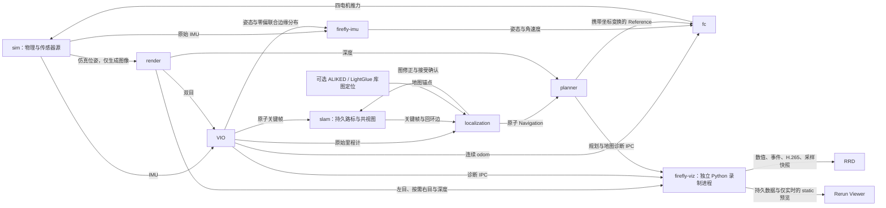

# 系统架构

本文维护职责、数学约定与能力边界；开发、运行和验收见 [development.md](development.md)。
默认值、容量和门限以对应 Options、配置和测试源码为准，本文不维护第二份参数表。

## 数据流与职责

默认从空会话地图启动：双目/IMU VIO、持久路标回环、在线深度建图规划。
不依赖已知世界起点、`.ffvmap`、`.ffmap` 或神经网络权重；离线地图定位是显式增强。



- `vio` 输出有米制尺度、重力对齐的局部位姿和速度；初始位置与航向是坐标规范。
  `Odometry` 始终在 odom 系，回环不回写滤波状态。
- `localization` 组合 `T_map_body = T_map_odom T_odom_body`。没有新地图约束时保持
  变换并使用新鲜 VIO，不冻结位置、不重发旧状态伪造新鲜度。
- `planner` 只消费原子 `Navigation`，检查状态、深度覆盖和碰撞，不识别定位算法或
  库图匹配频率。地图观测质量是诊断量，不是 VIO 可用性或绝对精度证明。
- `fc` 的位置反馈和 Hold 锚点固定在 odom 系，地图参考用消息自带的变换转入 odom。
- GroundTruth 只供合成传感器、评测和可视化；PlantState 只作评测。两者不得进入
  估计器初始化、状态修正、飞控反馈、解锁判据或失效回退。
- `render` 是无窗口的传感器生成进程，只渲染场景与左、右、深度相机。调试界面、
  机体模型、图像叠加、轨迹、地图和曲线由独立 Python `firefly-viz` 与 Rerun Viewer 承担。

### 诊断记录与展示

`Firefly/VizScalars` 使用小型定长消息长期保存数值；`Firefly/Viz` 保存位姿、点集、矩阵、
标定等空间诊断；`Firefly/VizVoxels` 单独传输 planner 的地图更新。体素更新分块连续发送，
接收端检查序号、完整性和容量后更新集合，再按录制频率保存完整快照。缺块、乱序或未知
基线上的增量使录制明确失败；不能把截断地图当作完整证据。

左目灰度原图经 FFmpeg 编成无 B 帧的低码率 H.265，Annex B access unit 逐帧写入
`cameras/left/image` 的 `VideoStream`。codec、相机标定与场景资产只写一次 static；
视频 sample 属于原始采集 `sim_time`。编码输入只有有界缓冲，允许编码前丢帧，
已经编码的依赖帧不能丢弃。视频是有损调试背景，不作为像素精度评测或算法输入。
Rerun 绘制特征点，点集只有与已保存图像的采集时间完全一致才进入叠加层；每张已保存图像
先写空点集，避免沿用上一张图的标记。原始点集与 track_id 独立长期保存。
算法与 IPC 使用整数像素中心；[Rerun 0.38.1 图像边界从零开始](https://github.com/rerun-io/rerun/blob/0.38.1/crates/views/re_view_spatial/src/visualizers/video/mod.rs#L574)，
展示层的主点与叠加点统一加半个像素，原始诊断坐标保持不变。

右目和深度支持独立采样；有界原图环形缓冲支持错误事件或 SIGUSR1 触发的前后无损窗口。
窗口按各相机实际接收帧数计数，不声称未收到的帧存在。采样、队列丢帧和退出状态写入 RRD。
无损快照保存原始灰度值或米制深度，H.265 不承载深度。

需要频繁替换的大数据预览写入同 recording 的 `/live/**`，通过只有 gRPC sink 的独立
stream 发送 static，永不进入文件 sink。反复 static log 仍会产生传输和存储开销，
因此预览另有限频，历史分析使用 temporal 视频和采样快照。录制和实时查看可以同时启用。
仿真世界、map 与 VIO odom 分开显示；没有显式对齐时不能把三个坐标系的位姿混画。
接收、诊断写入和媒体处理独立调度；小型诊断队列溢出、编码失败、部分体素更新或退出
清理失败都报告录制不完整，不静默切换编码器。配置与具体预算见 `configs/viz.toml`
及 `firefly_viz.config`，不在此复制参数表。
退出先停止接收，再排空诊断（包括最后的错误触发），随后排空媒体与编码器，最后 flush
并关闭 Rerun sinks。关闭信号不占队列槽位；超时残留须报告，仍有写入线程时不提前断开 sink。

<a id="frames"></a>

## 坐标与时间

跨模块使用 `firefly-base::{FrameId, RigidTransform, FrameTree}`；算法内部矩阵不隐含跨系语义。
算法与飞控统一使用 nalgebra，飞控保持 f32，估计与规划保持 f64；Bevy 数学类型仅用于渲染接线。
通用 SO(3)/SE(3) 运算由 `firefly-base::se3` 提供，95% 卡方门限由 `firefly-base::stats` 提供。
VIO 的 `quat_ops` 保留 OpenVINS JPL 四元数语义，通用李群函数转用基础库。

### 方向与树

`T_target_source` 将 source 中的列向量坐标转换到 target：

```text
p_target = R_target_source p_source + t_target_source
T_a_c = T_a_b T_b_c
T_b_a = inverse(T_a_b)

map
 └─ odom          全局定位给出的修正，可变化
     └─ body      VIO 给出的连续局部位姿
         ├─ left_camera
         ├─ right_camera
         └─ depth_camera
```

长度为米，角度为弧度，四元数为 Hamilton xyzw、source→target 主动旋转。
IPC 中 JPL world→body 四元数的同一组分量按 Hamilton 解释恰为 body→world；
`OdomMessage::body_pose(parent)` 集中处理这一边界。消息布局不变。

- `compose` 检查中间坐标系，不能把 map 位姿与 odom 位姿直接混乘。
- `FrameTree::set` 拒绝自环、闭环、多父节点；错误不修改树。
- `lookup(target, source)` 经公共祖先组合，未知/不连通坐标系返回错误。
- 点应用旋转和平移；物理速度等自由向量只旋转换基。
- 扭量顺序为 `[rotation, translation]`；`Ad(T) = [[R,0],[skew(t)R,R]]`，
  协方差换基为 `P_target = Ad(T) P_source Ad(T)ᵀ`。
- 矩阵构造拒绝非有限值、缩放、反射和非法齐次行；四元数必须单位化。

树是一个几何快照，不承担时钟、缓存、插值或自动外推。调用方负责让每条边对应
查询所需时刻。不得因为两条消息都很新，就把不同采样时刻的位姿直接相除。
这项约束也适用于 VIO 初始化/重启：更换 odom 原点必须重建整条坐标链。

### 图像坐标

VIO、特征匹配和深度射线使用像素中心坐标：左上像素中心为 `(0,0)`。
对称透视投影的主点由 `firefly_base::rig::principal_point` 统一给出，
320×240 图像为 `(159.5,119.5)`。GPU 帧缓冲坐标以像素边界为原点，
其采样中心 `(u+0.5,v+0.5)` 转为数组坐标时需减去半个像素。
离线资产契约包含主点；相机标定契约不匹配的库图不得用于在线定位。

### 控制边界

飞控位置、速度、姿态反馈以及起飞原点、Hold 锚点均保持在 odom 系。
规划参考携带生成时的 `T_map_odom` 快照；飞控必须使用该快照转换参考，并检查原始
里程计和参考的新鲜度。没有快照的参考仅能使用同时间戳校正/原始里程计配对结果：

```text
T_map_odom = T_map_body inverse(T_odom_body)
p_odom_ref = inverse(T_map_odom) p_map_ref
v_odom_ref = R_odom_map v_map_ref
```

配对历史有界（2 秒、最多 256 帧），不做跨时刻近似；配对分支的对齐新鲜度取两条样本接收
时间中较早者。未配对、重复或过期样本不能维持无快照参考的有效性。
参考航向通过旋转航向向量转换，角速度通过该向量在水平面投影的导数转换。

速度转换描述同一物理速度，不把全局定位修正的跳变当成真实速度。
校正不会直接移动局部反馈或 Hold 锚点；Track 的地图目标误差仍可能随重定位改变，
因此修正版本切换后规划器必须废弃旧轨迹并重建局部深度地图；参考携带生成时的变换，
禁止用新回环变换解释在途旧参考。

### 会话坐标与可选外部地图

默认以静止启动位置为会话地图零点，启动航向为 +X；无需世界坐标。
`configs/localization.toml` 可选 `[origin]` 显式声明外部地图中的启动 `position` 和 `yaw`，
该先验必须来自部署配置，禁止读取在线 GroundTruth。

原始 VIO 仍用传感器初始化，位置在局部系归零。定位进程必须在解锁前启动，
以首个已初始化、速度 ≤0.1m/s、距离局部原点 ≤0.1m 的样本锁存：

```text
yaw_map_odom = yaw_map_body_start − yaw_odom_body_start
p_map_odom = p_map_body_start − R_map_odom p_odom_body_start
```

只消除航向规范自由度，保留重力对齐的滚转与俯仰。未完成锁存不发布地图里程计；
VIO 初始化状态失效后锁存停止，不能将重启后的局部坐标直接沿用到当前地图。
固定启动先验要求机体处于配置的启动点和朝向，不能用于空中启动定位进程。
离线地图查询只消费声明外部对齐的原子 Navigation 快照，不能在校正流缺失时用原始局部位置查询地图。该配置不提供任意
位置冷启动或绑架重定位能力。

### 可选 ESKF 后端

令 `D=T_map_odom`、`V=T_odom_body`、观测 `Y=T_map_body`。
统一使用 odom 系右扰动：

```text
D_true = D Exp(e_odom)
D_observed = Y inverse(V)
z = Log(inverse(D) D_observed)
R_odom = Ad(V) R_body Ad(V)ᵀ
S = P + R_odom
K = P inverse(S)
delta = K z
D_new = D Exp(delta)
P_posterior = (I-K) P (I-K)ᵀ + K R_odom Kᵀ
P_new = Jr(delta) P_posterior Jr(delta)ᵀ
```

视觉 PnP 的位姿协方差必须表达为 body 右扰动，顺序为 `[rot, trans]`。
视觉位姿的经验相机协方差先经 `Ad(T_body_camera)` 转到 body，再进入相同融合入口。
若修正被限幅，增益的相应行同步缩放后参与协方差更新。

这是小误差线性化的松耦合模型：把 VIO 位姿作为给定输入，没有传播其全部不确定度
及与视觉观测的相关性。视觉协方差也是经验模型；通过代数回归不等于统计一致性已验收。

<a id="vio"></a>

## VIO

`firefly-vio-types` 提供 JPL/SO(3)/SE(3) 与变量类型；`firefly-vio-core` 提供相机、前端、
IMU 传播及三角化；`firefly-vio-init` 负责初始化；`firefly-vio` 编排状态与更新。
对照 OpenVINS，在线入口为 `apps/vio`。

1. 默认采用静态初始化，检查 IMU 静止条件与图像视差；测量不足或不满足静态初始化条件时
   保持未就绪。`firefly-vio-init` 在 `init_dyn_use=true` 且视差检测到运动时尝试动态初始化；
   该选项默认关闭，`apps/vio` 的 TOML 配置未暴露此开关。路径选择见
   `crates/firefly-vio-init/src/inertial_init.rs`，默认值见同 crate 的 `options.rs`。
2. 前端在上一帧补网格 FAST 点，对新增左点做左→右 LK 同 ID 配对，再做左右时间 LK、
   几何外点剔除和归一化测量入库。右目去重必须保留已配对点。
3. IMU 传播至相机时刻并增广克隆；三角化、FEJ 雅可比、零空间投影、创新检验与
   测量压缩后执行 MSCKF/SLAM 更新，边缘化最旧克隆。已有 SLAM 路标观测不能重复用于 MSCKF。
4. 高频里程计来自独立 IMU 预测缓存，不推进相机滤波状态或增广克隆。状态时间戳必须
   对应实际 IMU 时刻；测量未覆盖时不发布。速度转到局部世界系。

在线内参更新须同步投影模型与下一帧跟踪器；锚定表示的 FEJ 由统一表示雅可比处理。
IMU 白噪声使用连续时间密度，采样噪声换算 `σ_density = σ_sample / √fs`。
`firefly-voxel-svio` 为可选体素选点与交会缓存，关闭时不执行该路径。
默认静止初始化、局部跟踪可用性不等于所有退化运动下的可观测性或精度保证。
动态初始化的 MLE 使用 traditional DOGLEG 与 CauchyLoss(1)，对照 OpenVINS 的
Ceres 2.2 配置及 `DoglegStrategy` / `Corrector`。正规方程使用稠密 Cholesky；
真实代价决定候选步接受与信赖域收缩，收敛检查使用相对代价、梯度及流形更新后的参数步长。
返回最后接受的状态及其线性化；无效预积分协方差、预算耗尽与信赖域塌缩均拒绝初始化。
相机类型由模型显式提供，不能从投影结果猜测。

<a id="imu"></a>

## 飞控姿态与控制

### 职责与接线

`firefly-imu` 为纯算法 crate；`apps/fc/src/imu.rs` 拥有独立工作线程、IMU 和
VIO 外援订阅端。控制线程通过非阻塞内存快照读取姿态与去偏低通角速度。
原始 `Firefly/Imu` 同时供 VIO 使用，FC 的姿态输出不回流 VIO。

- 角速度反馈：`gyro - estimated_bias`，按测量间隔的一阶 30Hz 低通。
- 姿态反馈：本地六误差状态 ESKF，Hamilton body→odom。
- 位置/速度反馈：`Firefly/Odometry`。地图融合只通过坐标树转换规划参考。
- IMU 与物理各 1kHz；FC 按墙钟 1kHz 调度，样本间保持最近姿态与角速度。
  ESKF 只按新测量的时间戳传播，不在控制 tick 上重复积分或外推。

`configs/fc.toml [imu]` 可覆盖 `firefly_imu::Options`；缺键使用代码默认值。
角速度 rad/s，比力 m/s²，时间秒，噪声配置为连续时间标准差密度。

### 初始化与可观测性

上锁状态允许收集连续 2 秒静止窗口，检查三轴方差、平均角速度、加计模长。
重力方向给初始倾角，平均陀螺给三轴零偏；航向是自由规范。
静止窗口有 4096 样本上限，覆盖不足保持未就绪；仅靠 IMU 的静止检测不能排除
所有匀加速情况，因此要求部署时确实将机体放稳。真值不参与此判定。

首次有效 VIO 外援只确定 odom 航向规范：左乘世界竖直轴旋转，保留静止标定的倾角、
陀螺零偏与机体系右误差协方差；随后与外援做 CI 并重放 IMU。首次外援与后续外援
使用相同创新门，禁止用视觉启动分布覆盖静止标定。
飞控同时要求本地姿态可用、odom 对齐与新鲜 VIO，才可解锁。

VIO 与飞控静态初始化共用 `firefly-imu` 的陀螺均值协方差计算，按各自静止窗口统计，
使用与传播器相同的白噪声密度和随机游走。N 个样本均值的白噪声方差为 `Σ(σg²/Δti)/N²`；均值到窗口末端
零偏的游走方差为 `Σ σbg² Δti (i/N)²`（i=1…N−1）。额外加入样本协方差除以 N
作为模型余量，低样本散布不能压低已标定噪声。首样本周期采用相邻周期。
该模型依赖真正静止、采样白噪声与已标定的密度；不能识别所有缓慢转动或温漂。
姿态、位置、速度和加计偏置先验仍按 OpenVINS 静态初始化约定。

加计创新检验每个 IMU 样本都可计算，但只有上锁且完整静止窗口通过时才允许校正。
飞行中不根据 NIS 通过就强制使用重力假设。无磁力计/外部观测时，绝对航向不可观测；
持续平移加速也不能由六轴 IMU 与倾斜完全区分。VIO 失联时继续陀螺传播，零偏随机游走
使不确定性增长；只提供短时姿态支持，不承诺定点、保高或长期姿态精度。

### 方程与卡方检验

名义状态 `(R,bg)`；右误差 `R_true = R Exp(δθ)`，排列 `[δθ,δbg]`。
令 `ω = gyro - bg`，则：

\[
R^+=R\operatorname{Exp}(\omega\Delta t),\qquad
\Phi=\begin{bmatrix}
\operatorname{Exp}(-\omega\Delta t)&-\Delta t J_r(\omega\Delta t)\\
0&I
\end{bmatrix}.
\]

过程噪声使用五点 Gauss–Legendre 对 `∫Φ(s)QcΦ(s)ᵀ ds` 积分，保留姿态/零偏
交叉项；零角速度有闭式测试。加计使用未归一化的三轴原始比力：

\[
h=R^T(0,0,g)^T,\quad H=([h]_\times,0),\quad
r=a_m-h,\quad S=HPH^T+R_a,\quad \mathrm{NIS}=r^TS^{-1}r.
\]

`R_a = (σ_accel²/Δt + σ_model²) I`。静止高斯线性化假设下使用 χ²(3) 的
99% 分位数 **11.344866730144373**；三维残差包含模长信息，不套用归一化方向
的两自由度检验。模型余量为工程参数，门限概率不是实际飞行误接受率保证。
范数与静止条件仍须同时满足。大协方差可能让错误加速度通过 NIS，测试显式覆盖该反例。
拒绝只保持预测，不因连续拒绝超过某次数而强制放行。

接受时均值使用完整 `Kr`，协方差用同一 K 的 Joseph 形式。零创新仍更新协方差。
注入后用 `G=diag(Jr(δθ_hat),I)` 重置右误差协方差；一阶姿态块为
`I - 0.5[δθ_hat]×`，含全部交叉协方差换基。

### VIO 外援与相关性

`Firefly/VioAttitudeAid` 包含：状态的 IMU 时间、非零会话号、Hamilton xyzw、
三轴陀螺零偏以及按行展开的 6×6 右误差协方差。
VIO 从完整滤波协方差提取姿态/零偏联合边缘块（含交叉项），不使用单位阵或
把相机状态协方差贴到预测里程计时刻。在线时延标定不能重贴已积分状态的时间戳。
OpenVINS JPL 的左误差在转换为 Hamilton body→odom 后等于同符号右误差，
该转换有独立增量测试。

本地 IMU 分支和其历史只接收 IMU 传播及已确认的地面静止校正。CI 后验单独作为
控制输出并传播，不回写本地分支、静止零偏或重放历史；每次外援均与其测量时刻
的本地分布比较。这样视觉修正不能成为下一次视觉创新检验的本地基准。

两估计器共享 IMU，禁止作为独立高斯测量做普通 EKF 更新。所有外援采用局部
切空间的协方差交集（CI）：

\[
P_c^{-1}=wP_l^{-1}+(1-w)P_v^{-1},\qquad
\delta_c=P_c(1-w)P_v^{-1}\delta_v.
\]

VIO 误差协方差先用 `Jr(log(Rl⁻¹Rv))⁻¹` 转到当前切空间，交叉块同步变换。
在 `[0,1]` 的 21 个权重中最小化 `log det(Pc)`，包含两个端点；相同相关估计
不会把协方差减半。此保守性依赖输入边缘协方差可信与局部线性化有效，不是消除
VIO 模型错误的保证。旋转差超过 0.5rad 拒绝；六维差异另用任意未知相关下的
协方差上界 `2(Pl+Pv)` 与 χ²(6) 99.9% 门控。

重放缓存上限 2048 个 IMU 样本。支持落在两个样本之间的外援时间，在该时刻融合，
再按相同右端零阶保持积分到当前时刻。同一 IMU 区间内多份外援分别与本地分支
对齐，禁止累计之前的视觉后验。乱序、重复和缓存覆盖外的外援不更新状态。
VIO 会话改变锁存未对齐，需重启 FC；IMU 间隔超过 50ms 锁存不连续，禁止补造测量。

### 控制与失联

`Command → FlightFsm → 位置/姿态控制 → Airframe::allocate → Control`。
机体质量、惯量、旋翼几何和推力上限来自 Airframe；四旋翼只能沿机体 +Z 产生推力，
水平加速依赖倾斜。逐电机分配为唯一饱和点，按总推力、滚转/俯仰、偏航优先级保留可行分量。

起飞进入 Hold 后仍保持指令目标；参考流首次失效即锁定当时 odom 位姿、输出零速目标，
模式超时不重置锚点。飞控每 tick 发布 Control，上锁时为零；指令墙钟超时后 sim 暂停物理
和传感器时间，不以旧控制持续推进。模式编码与超时定义见 `firefly-flight::FlightFsm`。

空中 VIO 失联进入 `ATTITUDE_FALLBACK`：仅在新鲜 IMU 下稳定姿态并提供标称悬停推力，
不保证定点、保高或安全降落，不用陈旧位置判落地。恢复要求同一 odom 会话的有效里程计、
IMU 和显式 Hold/Land 指令；地面失联上锁，IMU 也失联时推力保护归零。

<a id="loops"></a>

## 持久路标与回环

VIO 发布同刻原始位姿、轨迹 ID、像素/归一化观测、可靠三维初值、左右图像及标定的
原子快照。地图拥有数据副本，不持有滤波变量、不回写协方差或 FEJ。关键帧图像用于算法 IPC；
调试图像由独立 viz 按上述视频与快照策略记录，算法端不直接写 RRD。
几何初值优先复用 VIO Global3D SLAM 点，其余使用 VIO 多视图三角化与精化；它们不是
独立于 VIO 的新传感器观测，不能作为额外位置先验重复计权。

`slam` 在 VIO 像素计算 ORB 描述子，并用多层 ORB 补充外观覆盖。补充像素只能通过
实际双目往返 LK 或多视图对应取得几何，禁止借用相邻 VIO 点坐标。无可靠几何的二维
特征仍保留并参与检索；描述子、补充匹配、建图和回环均在 slam 进程，不阻塞 VIO。

- 路标以宿主关键帧坐标保存实际观测，轨迹 ID 延续身份；局部固定关键帧位姿精化三维点，
  保留左右观测与尺度约束。使用 Huber 重投影代价、解析雅可比、线搜索和条件数检查。
- 几何离群观测不参与共视或验证。有效共享路标建立共视连接，不足时保留最强非零连接。
  路标清理不删除关键帧外观；VIO 点和补充点共用持久地图。
- 多表二进制倒排索引按稀有度召回，完整 Hamming 匹配投票排序，排除当前共视邻居及其邻居。
  候选区域由代表帧与共视邻居组成；当前点、历史路标各计一次。
- 双侧几何来自持久路标，不要求两张图各有可用深度图。固定尺度三点刚体假设按双向
  重投影判共识，初解用于投影扩匹配与精化；再检查内点、支持比例、图像覆盖与 VIO 新息。
- 连续不同图像沿确认区域、传播初解并重新匹配，不能把运动预测当确认；区域解冲突拒绝。
  几何验证门限见 `crates/firefly-landmarks/src/map.rs`；连续确认与发布冷却由
  `apps/slam/src/backend.rs` 编排，不得因一次失败调低门限。
- 后端独立验收回环。只有明确接受才融合跨区路标身份；等待确认时停止新关键帧，
  超时报错。已接受的修正快照必须覆盖全部已建关键帧：地图锚点快照缺帧时暂缓，
  等待完整快照；匹配当前待确认回环的已接受快照缺帧时，`Map::correct` 返回错误，
  经 `apps/slam/src/main.rs` 传播并退出进程。分支判断见 `apps/slam/src/backend.rs`；
  原始 VIO 位姿不可覆盖。

地图、图节点、路标及等待队列均有容量上限，耗尽显式拒绝，不静默扩容。
本实现不是 ORB-SLAM3 联合局部 BA，不含 DBoW、Atlas、全局视觉惯性 BA、跨会话恢复或
任意位置重定位。VIO 重启后，定位、规划与视觉进程必须建立新会话。

### 四自由度位姿图

节点 `x_i=(p_i,ψ_i)`；滚转/俯仰固定为 VIO 重力估计。首个注册节点固定启动规范，
异步补入更早的相机节点不切换固定节点。同刻原始位姿由首个节点固定，地图与回环端点复用。

```text
R_i = Rz(ψ_i) R_tilt_i
r_ij = [R_iᵀ(p_j-p_i)-t_ij, wrap(ψ_j-ψ_i-Δψ_ij)]
r_map = [p_i-p_observed, wrap(ψ_i-ψ_observed)]
R_map_odom = Rz(ψ_optimized-ψ_raw)
t_map_odom = p_optimized-R_map_odom p_raw
```

VIO 边只连相邻节点，标准差为扩散密度乘 `√Δt`，避免同批增量重复计权及权重随分段数变化。
残差按米/弧度白化；VIO 用二次代价，地图与回环用 Huber 核。权重见 `GraphOptions`。
解析雅可比构成稀疏四维块正规方程，块 Jacobi 预条件 PCG 与回溯求解；优化副本一次提交，
失败不发布部分解。仅更新 map←odom，不把地图跳变当物理速度。
该图不传播完整 VIO 协方差，也不完整去相关视觉信息；工程权重不等于统计校准。
`backend="eskf"` 与图后端互斥，不接收图回环校正。

### 可选离线地图定位

ALIKED-N16 提取左目二维点与描述子，LightGlue 匹配库图特征，PnP 使用库中三维路标。
离线深度标签须重投影注册到左目，执行 z-buffer、空洞与边缘拒绝，不能同索引读取居中深度。
库图查询要求 Navigation 显式外部地图对齐；图像 t 的先验为
`T_map_body(s) inverse(T_odom_body(s)) T_odom_body(t)`，两时刻均需原始 VIO 历史覆盖。
不能用当前航向给旧图像做候选或几何门控，也不能把推理结束时刻当测量时刻。

候选与算子并发有界；非平面支撑及 PnP 质量充足才早退，弱支撑继续聚合候选。
忙时只处理最新图像，停止后回收工作线程，不承诺固定推理时延。在线路标回环不加载 ONNX。
库图观测年龄、融合后分歧仅为诊断量；不能据此将共享图像/IMU 的估计视为统计独立。

<a id="mapping"></a>

## 深度、地图与规划

默认 planner 建立空滚动深度地图；仅显式 `--map` 加载场地先验，且要求外部坐标对齐。
深度按测量时间使用同一来源的 Navigation 历史插值，不外推、不跨采样空洞或修正版本。
每帧每体素统计 hit/miss 后只更新一次 log-odds，票数相等取 hit；无效深度不是空闲证据，
无有效投票不刷新建图新鲜度。膨胀、射线与缓存参数见 `apps/planner/src/config.rs`。

窗口外传感器 log-odds 保存在有界世界体素缓存，重新入窗恢复；耗尽时停止运动参考，
不静默淘汰障碍。启用历史缓存时不按时间衰减，但真实空闲射线仍能清除在线障碍。
FFMap 先验独立保护，不可被射线、衰减、动态障碍移除擦除，移窗后仍恢复。

回环修正版本变更后清除局部及历史传感器融合、保留显式先验，废弃轨迹并重建全局引导；
地图目标不变。等待有效深度期间发布当前测量位置的零速参考，不复用旧参考变换。
历史各段误差不同，不能把整张历史占据图按单一刚体变换搬移；本实现没有全局稠密地图优化。

`Navigation` 未就绪不规划；有效流失联或非法状态锁存停止，恢复须重启 planner。
重复/乱序数据不能续期，发布前再检查墙钟存活期和版本，规划计算不阻塞接收线程。
状态规则见 `apps/planner/src/state_input.rs`，不提供切换反馈源或参考代替实测的捷径。

### 规划输出边界

全局单航点多项式仅提供局部目标；局部 A* 在膨胀图上检查连续连边，MINCO/LBFGS 优化
保留端点 PVA、分别加权障碍硬/软项。时间再分配须重解并检查导数极值，失败明确拒绝。
静态最终碰撞检查用 Bernstein 凸包与递归二分覆盖曲线，无法确认则拒绝；对端时钟与
双方净距必须一致，动态与执行期检查仍为采样，不能声称连续动态安全证明。

未观测格采用乐观占据语义，窗口外和视场外不是已验证自由空间；前视深度不保证倒飞避障。
地图重建后只有新视场提供证据；保留历史不能发现从未观察的障碍。
非凸求解不保证所有可达地图成功；定位漂移会同时移动投影和规划查询，膨胀不补偿任意误差。

### 深度代理模型

`apps/render/src/sensors.rs::linearize_depth` 将 reverse-Z 转为相机光轴深度
`z=near/reverse_z`，无效值与超出有效深度范围的值置零。`apps/render/src/process.rs`
先调用线性化，再在线调用 `depth_noise.rs::apply`，对米制深度施加量程裁剪、由干净几何
生成的边缘掩码、相关块状缺测、横向扰动、视差噪声与量化。`render --offline` 保留
线性化并跳过噪声处理，输出理想几何标签，仍需左目注册。

```text
g = √(1-α) g_fixed + √α g_dynamic(t)
ε = σ_d (√ρ g_d + √(1-ρ) η)
d = fB/z; d_m = q round((d+ε)/q); z_m = fB/d_m
∂z/∂d = -z²/(fB); σ_z ≈ z²σ_d/(fB)
```

空间和时间插值按方差归一化；`Φ(g)<p` 产生相关缺测，横向扰动最近邻采样真实表面，
不插值出虚假中间表面。非正视差、超量程和非有限值归零。相同配置、种子、几何与测量
时间产生相同结果，噪声不依赖工作队列；缓存必须支持时间跳转和配置变化。
默认值和单位见 `DepthNoiseOptions`；`enabled=false` 仍裁剪量程，量化可独立关闭。

这是未用实机数据标定的双目代理，参考 SimKinect 的像素/视差建模和 D400 后处理思路。
不模拟材质、IR 散斑、多径、真实双目遮挡、入射角或匹配网络；相关场固定在图像坐标，
不能视为附着表面的材质缺陷。通过合成测试不证明匹配某款实机。

<a id="ffmap"></a>

### FFMap 格式

`.ffmap` 为 UTF-8 行式指令，`#` 为注释；解析与序列化唯一实现为
`crates/firefly-map/src/format.rs` 的 `MapFile`。

| 指令 | 含义 |
|---|---|
| `FORMAT firefly-map 1` | 格式与版本 |
| `RESOLUTION` / `ORIGIN` / `DIMS` | 分辨率米、世界原点米、三轴格数 |
| `OCCUPANCY` | 后续每行一个世界系占据格中心；中心为 `origin+(index+0.5)*resolution` |
| `DECOR` | 同构体素，仅显示、不参与规划 |
| `MOTION box cx cy cz sx sy sz` | 动态盒中心与尺寸 |
| `MOTION sphere cx cy cz r` | 动态球中心与半径 |
| 动态段 `t x y z` / `LOOP` | 严格递增的秒与中心航点，可循环 |

指令大小写敏感，未知指令或缺头字段报错；无占据体素合法。
动态障碍独立于静态 OCCUPANCY，按航点插值后体素化。

## 参考实现与差异

| 项目 / 固定版本 | 源码位置 | 可迁移的职责边界 |
|---|---|---|
| OpenVINS `69488123ed9362dd44b6f28e7f4680abbff1442b` | `ov_msckf/src/ros/ROS1Visualizer.cpp:245`、`:840` | 初始化后从 VIO/IMU 预测发布里程计；回环信息是另外的输出，不是发布里程计的前提 |
| VINS-Fusion `be55a937a57436548ddfb1bd324bc1e9a9e828e0` | `vins_estimator/src/utility/visualization.cpp:53`；`loop_fusion/src/pose_graph_node.cpp:192` | 本地里程计持续发布；回环节点用保存的对齐与漂移变换校正每条新里程计，不等待下一次回环 |
| EGO-Planner-v2 `9d85475ea7b9bf5c112cf7c3c3d0d3f9e96d9010` | `swarm-playground/main_ws/src/planner/plan_manage/src/ego_replan_fsm.cpp:46`、`:632` | 订阅 `odom_world`，消费位置和速度；规划就绪不以外部视觉匹配成功为条件 |
| ORB-SLAM3 `4452a3c4ab75b1cde34e5505a36ec3f9edcdc4c4` | `src/System.cc:213`；`src/Tracking.cc:1940`、`:2120` | 跟踪、局部建图、回环分工；跟踪状态由运动/局部地图跟踪决定，回环成功与否不是跟踪心跳 |

VINS-Fusion 的四自由度残差、固定首节点和漂移输出是参考；本项目使用弧度、相邻增量链、
地图锚点和自有 PCG，并非 Ceres 的逐项移植。ORB-SLAM3 参考共视排除、固定尺度几何与
连续确认，不包含其完整词袋和 BA。源码审查不能替代独立公式、差分和最终输出验证。
OpenCV 兼容性对齐以 purecv 上游约定的 **4.10.0** 为目标。现有参考材料的版本分别为：

- 源码查阅快照 `d7b17c1bbc361f608768a44d9cd89458fe70bea8` 属于 5.x
  （`git describe` 为 `5.0.0-712-gd7b17c1bb`），不作为 4.10.0 数值一致性的证据。
- `crates/firefly-vio-core/src/track/histogram.rs` 的 CLAHE CPU 夹具及
  `crates/firefly-vio-core/src/cam.rs` 的鱼眼去畸变夹具来自 **4.12.0**；
  它们保留真实来源标注，不能据此宣称已与 4.10.0 对齐。

姿态数学参考 Solà《Quaternion kinematics for the error-state Kalman filter》第 5–6 节、
Julier/Uhlmann 的协方差交集；实现不采用连续拒绝后强制放行的经验逻辑。
VINS-Fusion 与 ORB-SLAM3 为 GPLv3，参考仓库保留在 `~/Projects/`，不纳入本仓库。
