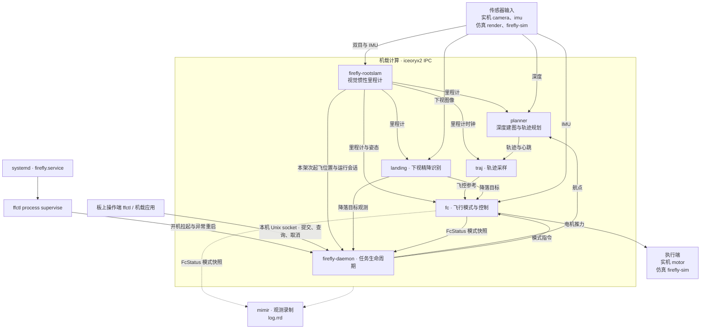
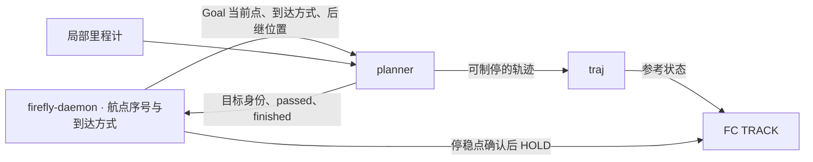

# Firefly 系统架构

`planner`、`traj` 和 `landing` 各自在进程内通过 `firefly-odometry` 接收并校验里程计。
`landing` 按图像时间查询历史样本，`traj` 按样本时间采样轨迹，`planner` 将实测位置和速度转换为规划初态，并为这个起点指定零加速度。

默认在线飞行从停机坪静止启动。RootSLAM 用静止窗口的加速度确定重力方向，用首帧航向定义里程计的水平轴，航点沿用这组轴。首帧优化保留重力测得的倾角、起始航向和零初速，后续各帧的姿态与速度由双目和 IMU 估计。

精降识别在每张参与推理的下视图像上用 YOLO 提取候选框。框内的白色连通轮廓按最小面积外接矩形归一化，通过两条竖笔、横梁和两侧缺口确认 H 的形状。四个矩形顶点与标志的实际尺寸、相机标定和拍摄时刻的姿态共同确定目标位置。跟踪器已有候选后，也在整幅图像中搜索 H，并用位置连续性校验后续观测。

## 系统运行、架次和任务

一次系统运行（SystemRun）从整机启动持续到关机或整机重启，可以包含零个或多个架次（Flight）。一次实际离地到着陆计一个架次。解锁后在地面取消属于起飞尝试。起飞、航线执行、返航、着陆是飞行阶段，落稳上锁后系统进入地面待命。

任务（Mission）描述有验收条件的工作，任务计划（MissionPlan）描述可复用的航线和动作。当前接口一次提交一项悬停或往返任务，每项任务安排一次起飞尝试。调用方为任务命名；daemon 在 FC 进入飞行模式、同一 VIO 会话实测相对起飞位置升高超过 0.15 米时分配本运行内的架次序号。地面取消的任务仍有回执，架次序号为空。同一计划用新的任务 ID 可以再飞一次。

一次运行共享传感器、飞控和 VIO。首次初始化确定 odom 轴向。每架次从地面观测重新记录起飞位置和机头姿态，航点偏移沿共享 odom 轴。落稳上锁后释放本架次的航点进度和视觉确认窗口，等待下一项显式提交。运行中更换 VIO 会话会终止当前任务并阻止使用新坐标系再次起飞。

### 板上服务与控制权

一个相近的产品例子是 NetworkManager。连接和设备状态由常驻进程维护，命令行工具和桌面程序通过同一控制接口操作它。Firefly 沿用这种控制关系，板上其他应用与 `ffctl` 可以独立连接和退出。[NetworkManager 服务](https://networkmanager.dev/docs/api/latest/NetworkManager.html) · [nmcli 客户端](https://networkmanager.dev/docs/api/latest/nmcli.html)

Orange Pi 的 BSP 在 `multi-user.target` 启用 `firefly.service`。该单元以前台方式启动 `ffctl process supervise`，监管器按 `configs/processes.toml` 启动各进程并处理异常退出。`apps/firefly-daemon` 拥有当前任务、FC 模式请求、规划目标和精降识别租约。`fc` 独立执行解锁检查、模式转换和失效保护。客户端退出后任务继续，机载按键服务和板上 CLI 均可使用同一控制协议。该进程分工参考 PX4 POSIX 的常驻服务和短生命周期客户端，以及 systemd 的进程监管语义。[PX4 System Startup](https://docs.px4.io/main/en/concept/system_startup) · [systemd.service](https://www.freedesktop.org/software/systemd/man/latest/systemd.service.html)

`crates/firefly-mission` 定义计划与请求。`ffctl mission` 在板上通过仅服务用户可访问的 `/run/firefly/mission.sock` 发送一行 JSON 并读取一行回执。状态查询在传感器上线前即可使用。首次提交要有新鲜的里程计、姿态与飞控上锁状态。一架飞机一次执行一项任务，忙时立即答复。任务执行中的人工取消进入收尾，地面已解锁时请求上锁，空中请求普通降落，飞控已在降落或失效保护模式时等待飞控处理。

Linux 内核的 boot ID 标识一次 SystemRun。daemon 在发出首条指令前将任务写入 `state/missions/<boot-id>/<mission-id>.json`，在状态转换时通过文件同步、原子替换和目录同步更新回执。同一次运行内重复提交相同 ID 和计划返回已有回执，修改该 ID 的计划会被拒绝。进程重启读回未终结任务并进入收尾，整机重启产生新的运行身份，历史回执保留在原运行目录。Mimir 按测量时钟录制阶段和原始观测，质量评分使用独立测量数据。

`ready` 表示 daemon 空闲、执行器已报告机体参数、飞控已上锁且有效里程计显示静止。带航点的任务在提交时还需要 planner 心跳。最终解锁由 FC 的实时检查裁决。运行状态给出最近一次新鲜的 `fc_mode`。收尾时，FC 进入锁存的 `ATTITUDE_FALLBACK`，或 45 秒内仍未确认上锁，daemon 进入 `needs_operator`。操作员可查询原因并接管飞控，该任务持续占用执行位置，直至 FC 连续报告上锁。单独停止任务服务时，它先保存中断原因，在两秒的退出窗口内请求地面上锁或空中降落。整机停机按落稳上锁后的流程执行。

普通降落使用本架次起飞高度估算距地高度。精降采用识别到的停机坪高度和横向对准条件。遇到高于起飞面的接触位置时，普通降落可能一直等待触地确认。任务服务保留飞控的上锁判据，并通过任务回执报告需要处置的状态。

## 航点执行

停稳点等待规划完成、里程计进入 0.15 米且速度不超过 0.12 m/s，持续 0.5 秒后切入 HOLD。途经点和后继位置一起投递。planner 在实测位置进入途经点 0.35 米球内时切换到后继目标并锁存 `passed`，任务在 TRACK 下继续。后继目标默认停稳；连续途经时任务用下一条带后继位置的命令接续。目标身份采用命令时间戳，任务按访问序号区分相同坐标。
