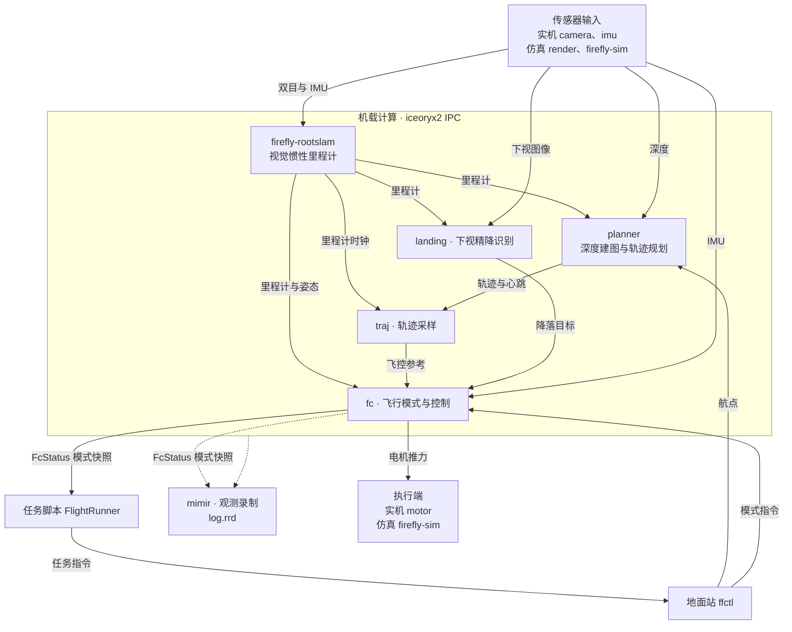
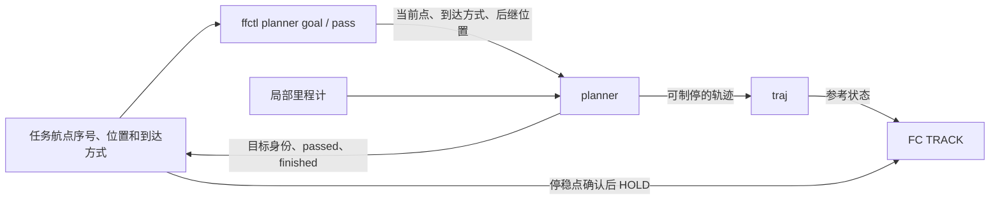

# Firefly 系统架构

`planner`、`traj` 和 `landing` 各自在进程内通过 `firefly-odometry` 接收并校验里程计。
`landing` 按图像时间查询历史样本，`traj` 按样本时间采样轨迹，`planner` 将实测位置和速度转换为规划初态，并为这个起点指定零加速度。

## 航点执行

停稳点等待规划完成、里程计进入 0.15 米且速度不超过 0.12 m/s，持续 0.5 秒后切入 HOLD。途经点和后继位置一起投递。planner 在实测位置进入途经点 0.35 米球内时切换到后继目标并锁存 `passed`，任务在 TRACK 下继续。后继目标默认停稳；连续途经时任务用下一条带后继位置的命令接续。目标身份采用命令时间戳，任务按访问序号区分相同坐标。
