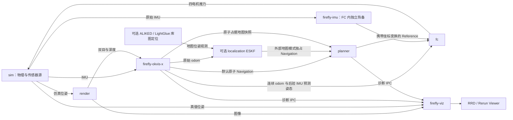
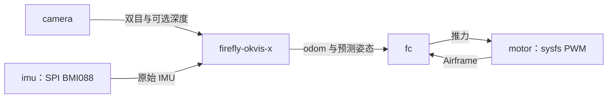
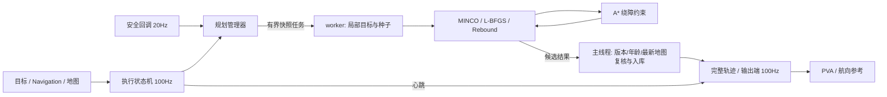

# 系统架构

本文维护职责、数学约定与能力边界；开发、运行和验收见 [development.md](development.md)。
默认值、容量和门限以对应 Options、配置和测试源码为准，本文不维护第二份参数表。

## 数据流与职责

默认从空会话地图启动，`firefly-okvis-x` 在一个进程内执行视觉惯性图优化、在线回环和深度子地图。
不依赖已知世界起点、`.ffvmap`、`.ffmap` 或神经网络权重；离线库图定位是显式可选增强。



- 视觉惯性图和回环共同更新 OKVIS 状态与历史轨迹。适配层用共同历史锚点维护
  map←odom，向现有控制接口发布局部 odom，将全图修正与物理运动分开表达。
- 默认由 OKVIS 发布 `Navigation`；外部库图模式由 `localization` 独占发布。
  没有新地图观测时使用新鲜里程计，不能重发旧状态伪造新鲜度。
- `planner` 消费原子 `Navigation` 与 OKVIS 占据地图快照，检查状态、融合新鲜度与碰撞。
  传感器深度只由 OKVIS 融合；地图质量诊断不代表绝对精度。
- `fc` 的位置反馈与 Hold 锚点属于 odom 系；地图参考用消息内的变换转入 odom。
- 航段交接由任务层负责：`Goal.timestamp` 是目标身份，完整轨迹与 `Reference`
  回显该身份，`PlannerStatus` 持续发布当前目标及轨迹是否正常结束。
  每段须等待对应目标的新鲜参考后显式进入 Track；正常结束后显式切换 Hold，
  再按实测位置、速度和稳定时间确认到点。轨迹结束本身不是到点证明。
  异常断流仍由飞控失联保护处理，收到参考不会自动解除 Hold。
- GroundTruth 只供合成传感器、评测与可视化；PlantState 只作评测，均不得进入估计或控制。
- `render` 只生成传感器图像，诊断记录与展示由独立 `firefly-viz` 承担。

### 板载拓扑

真机由 `camera`、`imu`、`motor` 接替仿真与渲染；算法进程使用相同 IPC 消息。



相机标定由消费者配置，深度可选；无深度时规划器等待覆盖。IMU 进程只发布角速度与比力，
独立备用姿态解算在 FC 内。`Airframe` 在仿真中来自 MuJoCo，板端来自实测装配配置。
板端时间为同一 `CLOCK_MONOTONIC` 秒，仿真为 `sim_time`，不得混合时钟域。
通讯适配的测试不代表设备驱动、运行时限或板端飞行验收。

### 诊断记录与展示

`firefly-viz` 从 `Firefly/GroundTruth` 记录 `gt/pose` 与 `gt/traj`，从 `okvis/odom`
位姿诊断生成 `okvis/traj`，从 OKVIS 发布的 `Firefly/CorrectedOdometry` 按 10Hz
记录 `okvis/map/pose` 与 `okvis/map/traj`。轨迹按测量时刻记录相邻两点构成的线段，记录进程为每条轨迹
保留一个前序点，Viewer 按时间范围展示历史。

OKVIS 跟踪质量以 `StateChange` 写入 `okvis/tracking`，仅在 Lost、Marginal、Good
之间变化时记录，由 `StateTimelineView` 展示离散状态；回环更新次数与视觉查询耗时保留数值曲线。

OKVIS 的帧诊断回调读取当前帧的二维关键点与路标 ID，
在 `okvis/debug` 下发布有界诊断。关键点时间恢复为相机采集时刻；记录端按采集时间容差配对
图像与关键点，保留原始像素坐标和路标 ID，显示时应用像素中心偏移。

`Firefly/VizScalars` 使用小型定长消息长期保存数值；`Firefly/Viz` 保存位姿、点集、
标定等空间诊断；`Firefly/VizVoxels` 单独传输 planner 的地图更新。体素更新分块连续发送，
接收端检查序号、完整性和容量后更新集合，再按录制频率保存完整快照。缺块、乱序或未知
基线上的增量使录制明确失败；不能把截断地图当作完整证据。planner 的显示体素在密集区域
按二倍尺度合并，直到单次快照满足消息容量；所有原占据体积均被覆盖，消息携带实际显示
分辨率，规划栅格分辨率不受影响。

左右目灰度原图分别经 FFmpeg 编成无 B 帧的低码率 H.265，Annex B access unit 逐帧写入
`cameras/left/image` 与 `cameras/right/image` 的 `VideoStream`。codec、双目标定与无人机模型按 static 记录；
视频 sample 属于原始采集 `sim_time`。编码输入只有有界缓冲，允许编码前丢帧，
已经编码的依赖帧不能丢弃。视频是有损调试背景，不作为像素精度评测或算法输入。
Rerun 绘制特征点，点集按 `MatchedPoints` 定义的容差匹配最近的已保存图像，
叠加使用图像的采集时间与视频帧索引；每张已保存图像
先写空点集，避免沿用上一张图的标记。点集与 track_id 只保存在各相机的 `points` 叠加层，
不另外保存 `okvis/debug/keypoints/**` 副本。
算法与 IPC 使用整数像素中心；[Rerun 0.38.1 图像边界从零开始](https://github.com/rerun-io/rerun/blob/0.38.1/crates/views/re_view_spatial/src/visualizers/video/mod.rs#L574)，
展示层的主点与叠加点统一加半个像素，原始诊断坐标保持不变。

图像区仅有左右目 recorded 视图，在 Horizontal 容器中并排展示视频和同帧关键点；深度图的业务话题由估计与
建图进程消费。左右目关键点由 OKVIS 当前帧诊断提供。视频队列丢帧和退出状态写入 RRD。

Viewer 和文件 sink 使用同一个 recording stream，只展示视频、关键点和地图的历史记录。
不创建 `/live/**` static 预览流；录制和实时查看可以同时启用。
单个 3D 视图同时展示真值、VSLAM odom、VSLAM map 与规划轨迹，保留各来源的原始
坐标，不添加对齐变换。不同来源的原点可能不同，视图中的间距不能直接解释为定位误差。
接收、诊断写入和媒体处理独立调度；小型诊断队列溢出、编码失败、部分体素更新或退出
清理失败都报告录制不完整，不静默切换编码器。配置与具体预算见 `configs/viz.toml`
及 `firefly_viz.config`，不在此复制参数表。
退出先停止接收，再排空诊断，随后排空媒体与编码器，最后 flush
并关闭 Rerun sinks。关闭信号不占队列槽位；超时残留须报告，仍有写入线程时不提前断开 sink。

<a id="frames"></a>

## 坐标与时间

跨模块使用 `firefly-base::{FrameId, RigidTransform, FrameTree}`；算法内部矩阵不隐含跨系语义。
算法与飞控统一使用 nalgebra，飞控保持 f32，估计与规划保持 f64；Bevy 数学类型仅用于渲染接线。
通用 SO(3)/SE(3) 运算由 `firefly-base::se3` 提供，95% 卡方门限由 `firefly-base::stats` 提供。
OKVIS 内部使用 Hamilton 四元数及自己的流形运算；跨进程方向由消息类型明确约定。

### 方向与树

`T_target_source` 将 source 中的列向量坐标转换到 target：

```text
p_target = R_target_source p_source + t_target_source
T_a_c = T_a_b T_b_c
T_b_a = inverse(T_a_b)

map
 └─ odom          全局定位给出的修正，可变化
     └─ body      VIO 给出的连续局部位姿
         ├─ left_camera
         ├─ right_camera
         └─ depth_camera
```

长度为米，角度为弧度，四元数为 Hamilton xyzw、source→target 主动旋转。
`OdomMessage::body_pose(parent)` 按 Hamilton body→parent 解释消息四元数。

- `compose` 检查中间坐标系，不能把 map 位姿与 odom 位姿直接混乘。
- `FrameTree::set` 拒绝自环、闭环、多父节点；错误不修改树。
- `lookup(target, source)` 经公共祖先组合，未知/不连通坐标系返回错误。
- 点应用旋转和平移；物理速度等自由向量只旋转换基。
- 扭量顺序为 `[rotation, translation]`；`Ad(T) = [[R,0],[skew(t)R,R]]`，
  协方差换基为 `P_target = Ad(T) P_source Ad(T)ᵀ`。
- 矩阵构造拒绝非有限值、缩放、反射和非法齐次行；四元数必须单位化。

树是一个几何快照，不承担时钟、缓存、插值或自动外推。调用方负责让每条边对应
查询所需时刻。不得因为两条消息都很新，就把不同采样时刻的位姿直接相除。
这项约束也适用于 VIO 初始化/重启：更换 odom 原点必须重建整条坐标链。

### 图像坐标

VIO、特征匹配和深度射线使用像素中心坐标：左上像素中心为 `(0,0)`。
对称透视投影的主点由 `firefly_base::rig::principal_point` 统一给出，
320×240 图像为 `(159.5,119.5)`。GPU 帧缓冲坐标以像素边界为原点，
其采样中心 `(u+0.5,v+0.5)` 转为数组坐标时需减去半个像素。
离线资产契约包含主点；相机标定契约不匹配的库图不得用于在线定位。

### 控制边界

飞控位置、速度、姿态反馈以及起飞原点、Hold 锚点均保持在 odom 系。
规划参考携带生成时的 `T_map_odom` 快照；飞控必须使用该快照转换参考，并检查原始
里程计和参考的新鲜度。没有快照的参考仅能使用同时间戳校正/原始里程计配对结果：

```text
T_map_odom = T_map_body inverse(T_odom_body)
p_odom_ref = inverse(T_map_odom) p_map_ref
v_odom_ref = R_odom_map v_map_ref
```

配对历史有界（2 秒、最多 256 帧），不做跨时刻近似；配对分支的对齐新鲜度取两条样本接收
时间中较早者。未配对、重复或过期样本不能维持无快照参考的有效性。
参考航向通过旋转航向向量转换，角速度通过该向量在水平面投影的导数转换。

速度转换描述同一物理速度，不把全局定位修正的跳变当成真实速度。
校正不会直接移动局部反馈或 Hold 锚点；Track 的地图目标误差仍可能随重定位改变，
因此修正版本切换后规划器必须废弃旧轨迹并重建派生规划栅格；参考携带生成时的变换，
禁止用新回环变换解释在途旧参考。

### 会话坐标与可选外部地图

默认自主模式使用视觉惯性初始化的会话规范，无需世界坐标。
以下启动先验与锁存约束仅适用于显式启用的外部地图定位。
外部定位必须在 `configs/localization.toml` 的 `[origin]` 显式声明外部地图中的启动 `position` 和 `yaw`，
该先验必须来自部署配置，禁止读取在线 GroundTruth。

原始 VIO 仍用传感器初始化，位置在局部系归零。定位进程必须在解锁前启动，
以首个已初始化、速度 ≤0.1m/s、距离局部原点 ≤0.1m 的样本锁存：

```text
yaw_map_odom = yaw_map_body_start − yaw_odom_body_start
p_map_odom = p_map_body_start − R_map_odom p_odom_body_start
```

只消除航向规范自由度，保留重力对齐的滚转与俯仰。未完成锁存不发布地图里程计；
VIO 初始化状态失效后锁存停止，不能将重启后的局部坐标直接沿用到当前地图。
固定启动先验要求机体处于配置的启动点和朝向，不能用于空中启动定位进程。
离线地图查询只消费声明外部对齐的原子 Navigation 快照，不能在校正流缺失时用原始局部位置查询地图。该配置不提供任意
位置冷启动或绑架重定位能力。

### 可选 ESKF 后端

令 `D=T_map_odom`、`V=T_odom_body`、观测 `Y=T_map_body`。
统一使用 odom 系右扰动：

```text
D_true = D Exp(e_odom)
D_observed = Y inverse(V)
z = Log(inverse(D) D_observed)
R_odom = Ad(V) R_body Ad(V)ᵀ
S = P + R_odom
K = P inverse(S)
delta = K z
D_new = D Exp(delta)
P_posterior = (I-K) P (I-K)ᵀ + K R_odom Kᵀ
P_new = Jr(delta) P_posterior Jr(delta)ᵀ
```

视觉 PnP 的位姿协方差必须表达为 body 右扰动，顺序为 `[rot, trans]`。
视觉位姿的经验相机协方差先经 `Ad(T_body_camera)` 转到 body，再进入相同融合入口。
若修正被限幅，增益的相应行同步缩放后参与协方差更新。

这是小误差线性化的松耦合模型：把 VIO 位姿作为给定输入，没有传播其全部不确定度
及与视觉观测的相关性。视觉协方差也是经验模型；通过代数回归不等于统计一致性已验收。

<a id="vio"></a>

## OKVIS2-X 在线通讯

`firefly-okvis-x` 默认运行在线 IPC 模式，单个应用承载 BRISK/AGAST、视觉惯性图、DBoW2
回环和 Supereight2 深度子地图。传感器接收与预测发布分为 `okvis-ingress`（双目/深度
接收、配对、拷贝与深度转换）和 `okvis-imu`（IMU 入队、前向预测与四路发布）两条线程，
IMU 时间水位经原子量传给接收线程做覆盖判定；两者都独立于图求解。`okvis-imu` 与 FC 的
`fc-imu` 由 IMU 事件经 WaitSet 唤醒、2ms 超时兜底，板端 `imu` 发布端带事件通知。各图的所有者仍在线程内
持有非 Send 参数块，通过有界队列传递输入和数值快照。在线图发布使用背压保留全部提交，
线程退出关闭传感器队列并回收估计与地图工作线程。

`DENSE_SCHUR` 按因子连接直接组装保留变量的稠密约化系统、各路标的 3×3 块及
实际连接的交叉块，避免分配完整法方程。阻尼在消元前加入对应变量对角线；
因子同时连接不同路标时回退完整稠密系统，保留全部耦合项。
法方程组装与带阻尼求解分离：信赖域策略为当前已缩放线性化保存未加阻尼的约化块、
路标块及连接布局；拒绝或无效步只重做阻尼、消元和求解，接受新状态时释放缓存。
稠密回退同样复用未加阻尼的完整法方程。每次求解在独立矩阵副本上加入当前阻尼，
不累加历史阻尼，也不跨线性化或跨完整优化调用复用缓存。

Rust 求解器持有常驻 Rayon 线程池及求值工作区。单线程模式在调用线程执行；多线程模式
只使用求解器自己的线程池，不使用全局池。迭代期间参数快照只读，因子按固定大小切片，
每个任务独占因子及其可变 IMU/GPS 缓存，计算残差、流形 Jacobian、鲁棒权重和局部梯度。
任务全部结束后按原始因子顺序归并数值与错误，不并发写共享法方程。结果槽、掩码、
局部梯度/对角线和线性化容器跨求值复用；因子自身返回的 Jacobian 仍由因子实现分配。
独立路标消元及回代使用同一池，约化系统累加顺序固定，约化 Cholesky 保持串行。
后台求解任务独占其工作区并在各阶段之间复用线程池；活图参数和缓存只在提交时写回。
在线求解线程数由 `solver_threads` 控制，默认值和校验位于在线配置源码。
`fixed_factor_evaluation = "once_per_solve"` 将全冻结因子的鲁棒代价限制为每次求解
首次求值时计算，后续候选步与重新线性化复用该代价；`"repeated"` 每次重新求值。
常量代价仍按原因子顺序归并并计入求解摘要，不进入梯度、步接受和收敛判据的活动代价。
工作区在每次求解及后台阶段入口失效缓存，禁止跨参数快照、冻结集合或禁用集合复用。
因子首次求值的 IMU/GPS 缓存更新与求解后的缓存提交沿用同一路径。

IMU/GPS 因子的原始 IMU 测量通过私有 `Arc<ImuMeasurementDeque>` 持有，读取 API
只返回不可变引用。求解快照及图间同步共享同一输入版本；预积分、信息矩阵和重算标记
仍按值复制，由各因子实例独占。替换测量创建新版本，边缘化追加测量使用写时复制，
保证后台快照持有的历史输入不受活图修改影响。参数快照、数值计算和缓存提交顺序不变；
缓存写回沿用整个因子的提交语义，但不再复制原始测量队列。

深度子地图保存多分辨率占据体素，子地图重叠查询与可选地图对齐直接访问体素数据。
块内向粗层传播时借用互不重叠的父子层切片，直接写入父层的均值与极值，不复制整层临时数组。
传播顺序与浮点运算顺序保持固定；粗层缓冲生效时保留首层均值，只更新极值。
planner 用 `Firefly/MapRegion` 请求 odom 系的局部覆盖范围，包含窗口移动余量。
积分线程在提交后只导出该区域：子地图根包围盒的空间索引仅更新创建或位姿改变的项，
查询只读取相交子地图，并按八叉树节点包围盒剪枝；回环可更新全部受影响的索引项，
但不遍历全局体素。无请求时不导出地图。
局部快照包含各子地图按其自身位姿变换后的已观测体素包围盒，
区分占据与空闲，缺席表示未知。`Firefly/OccupancyMap` 用单个切片样本原子传输；
有界最新快照邮箱允许替换未发送样本，独立发布线程负责 IPC，不占用 IMU 接收线程。
快照关联图修订；发布端仅在对应图后验已提交时附加同版本的 map←odom、会话号与导航修订。
地图时间只由成功积分的有效深度推进，回环、重复发送和跳过积压帧均不刷新该时间。

输入复用 `Firefly/Imu`、`CameraLeft`、`CameraRight` 和 `Depth`。双目严格按标定容差配对，
IMU 时间未覆盖不提交视觉帧；接收端在释放 loan 前复制成自有图像。深度话题的 sensor_id=0
映射到算法内部第 3 个标定槽，具有独立内外参，米制深度不重复缩放；无效深度表示为 0。
标定来自公共 rig 或明确配置，不从真值推导。

`Odometry` 与 `VioAttitude` 表达在适配层的局部 odom 系。全图修正提交有独立单调版本，
通过更新后的共同历史锚点计算 map←odom；不将修正的位姿跳变当成物理速度。
`CorrectedOdometry` 与原子 `Navigation` 来自同一预测状态及修正版本。
预测仅传播真实 IMU 覆盖的时间段，并保持后验时刻；在线路径不计算或发布状态协方差，
有效姿态预测的发布不依赖协方差。
预测按上游 `Trajectory::addImuMeasurement` 从已提交状态和现有 IMU 测量继续传播，
不额外按跟踪质量、后验年龄或固定 IMU 间隔停发；缺少起始状态或测量覆盖时不输出。
后验时刻保持真实测量时间，下游独立判断视觉新鲜度。

可选外部库图模式显式设置 `navigation="external_localization"`，由外部定位服务消费
原始 odom 和 ALIKED/LightGlue 的位姿观测并独占地图导航发布；默认自主模式由 OKVIS 发布。
本节定义通讯与坐标适配，不代表完整数据集精度、运行时限或飞行验收。

## 视觉惯性估计

入口在 `apps/okvis2-x/src/application`，算法按相机、前端、因子、图与运行时领域组织。
BRISK/AGAST 检测和描述子匹配产生双目与时间关联，IMU 预积分与重投影因子进入局部图，
边缘化保留历史信息；DBoW2/OpenGV 支持在线回环，全图优化异步提交。
初始化、阈值、鲁棒核与退化输入处理以算法源码及测试为准。
独立预测复用同一 IMU 传播实现，使用后验副本与真实测量，不回写优化图。

双目特征提取由 `frontend/image_proc` 编排：`brisk.rs` 负责参数与提取器构造，
`mod.rs` 定义单相机输入、特征结果与检测/描述/反投影计算，`worker.rs` 管理固定线程和
容量为 1 的请求/结果通道，`pipeline.rs` 管理整批提交与收齐。每个实际收到图像的相机
惰性启动一个 worker；双目为两个，未输入图像的深度槽不启动线程。提取器在其 worker
内构造、复用和销毁，不要求实现 Send；图、MultiFrame 及其 Rc/RefCell 留在图线程。

每批先从预测位姿及相机外参计算相机坐标系重力方向，再传入自有图像与不可变标定。
提取器参数在该相机首次提交时固定，标定对象身份必须保持一致；重配置需重建 pipeline。
批处理 API 独占借用 pipeline，只允许一批在途，按相机编号返回结果，保留提取器产生的
关键点顺序、描述子字节及反投影有效位。全部成功后由图线程统一安装，失败不安装部分
结果；已提交任务全部收齐后关闭并回收 worker。正常关闭及 Drop 均 join 线程，panic
通过结果通道断开和 join 错误传播。输入索引预检失败不提交任务，也不关闭 pipeline。

<a id="imu"></a>

## 飞控姿态与控制

### 职责与接线

VIO 是正常飞行的状态来源：视觉/IMU 联合估计后，`apps/okvis2-x/src/application/live/output.rs` 的独立接收线程
复用 `ImuError::propagation`，传播完整 IMU 后验的副本。
相机处理不占用预测线程；每次后验更新使预测缓存失效，并从后验时刻重放已覆盖的 IMU。
预测不回写滤波器，不产生额外观测。姿态与标定去偏角速度经 `Firefly/VioAttitude` 发布。

`firefly-imu` 是独立安全热备；`apps/fc/src/imu.rs` 只订阅原始 IMU，独立静止初始化、
传播与地面加计校正。它与 VIO 不交换状态、零偏或协方差，主备输出只选择、不融合。
备用角速度按测量间隔进行一阶低通。两路共用传感器，不能抵御共同的 IMU 故障。

- 正常姿态反馈：VIO 后验的高频预测，Hamilton body→odom。
- 降级姿态反馈：独立六误差状态 ESKF，Hamilton body→备用本地重力系。
- 位置/速度反馈：`Firefly/Odometry`。地图融合只通过坐标树转换规划参考。
- IMU 与物理各 1kHz；FC 按墙钟 1kHz 调度，样本间保持最近姿态与角速度。
  两路只按新测量时间传播，不在控制 tick 上重复积分或外推。

`configs/fc.toml [imu]` 可覆盖 `firefly_imu::Options`；缺键使用代码默认值。
角速度 rad/s，比力 m/s²，时间秒，噪声配置为连续时间标准差密度。

### 初始化与可观测性

上锁状态允许收集连续 2 秒静止窗口，检查三轴方差、平均角速度、加计模长。
重力方向给初始倾角，平均陀螺给三轴零偏；航向是自由规范。
备用初始化选定独立本地航向规范，局部角误差协方差条件于该规范；未知的 odom 航向关系
不作为大角度高斯误差放入局部 ESKF。
静止窗口有 4096 样本上限，覆盖不足保持未就绪；仅靠 IMU 的静止检测不能排除
所有匀加速情况，因此要求部署时确实将机体放稳。真值不参与此判定。

飞控要求独立热备姿态可用、VIO 预测与里程计新鲜，才可解锁。
降级接管时，在备用航向系锁定当前航向目标；不把 odom 航向目标直接用于备用姿态，
也不将 VIO 姿态或偏置注入备用滤波器。滚转/俯仰使用备用估计，不保证切换无瞬态。

独立飞控热备使用 `firefly-imu` 的陀螺均值协方差计算，按静止窗口统计，
使用与传播器相同的白噪声密度和随机游走。N 个样本均值的白噪声方差为 `Σ(σg²/Δti)/N²`；均值到窗口末端
零偏的游走方差为 `Σ σbg² Δti (i/N)²`（i=1…N−1）。额外加入样本协方差除以 N
作为模型余量，低样本散布不能压低已标定噪声。首样本周期采用相邻周期。
该模型依赖真正静止、采样白噪声与已标定的密度；不能识别所有缓慢转动或温漂。
该热备的初始化模型与 OKVIS 的视觉惯性初始化各自独立。

加计创新检验每个 IMU 样本都可计算，但只有上锁且完整静止窗口通过时才允许校正。
飞行中不根据 NIS 通过就强制使用重力假设。无磁力计/外部观测时，绝对航向不可观测；
持续平移加速也不能由六轴 IMU 与倾斜完全区分。VIO 失联时继续陀螺传播，零偏随机游走
使不确定性增长；只提供短时姿态支持，不承诺定点、保高或长期姿态精度。

### 方程与卡方检验

名义状态 `(R,bg)`；右误差 `R_true = R Exp(δθ)`，排列 `[δθ,δbg]`。
令 `ω = gyro - bg`，则：

\[
R^+=R\operatorname{Exp}(\omega\Delta t),\qquad
\Phi=\begin{bmatrix}
\operatorname{Exp}(-\omega\Delta t)&-\Delta t J_r(\omega\Delta t)\\
0&I
\end{bmatrix}.
\]

过程噪声使用五点 Gauss–Legendre 对 `∫Φ(s)QcΦ(s)ᵀ ds` 积分，保留姿态/零偏
交叉项；零角速度处有闭式解。加计使用未归一化的三轴原始比力：

\[
h=R^T(0,0,g)^T,\quad H=([h]_\times,0),\quad
r=a_m-h,\quad S=HPH^T+R_a,\quad \mathrm{NIS}=r^TS^{-1}r.
\]

`R_a = (σ_accel²/Δt + σ_model²) I`。静止高斯线性化假设下使用 χ²(3) 的
99% 分位数 **11.344866730144373**；三维残差包含模长信息，不套用归一化方向
的两自由度检验。模型余量为工程参数，门限概率不是实际飞行误接受率保证。
范数与静止条件仍须同时满足。大协方差可能让错误加速度通过 NIS。
拒绝只保持预测，不因连续拒绝超过某次数而强制放行。

接受时均值使用完整 `Kr`，协方差用同一 K 的 Joseph 形式。零创新仍更新协方差。
注入后用 `G=diag(Jr(δθ_hat),I)` 重置右误差协方差；一阶姿态块为
`I - 0.5[δθ_hat]×`，含全部交叉协方差换基。

### VIO 预测与主备选择

`Firefly/VioAttitude` 包含预测的 IMU 时间、后验起点时间、非零会话号、Hamilton xyzw、
校正角速度及陀螺零偏，不携带姿态方差。IMU 预测传播位姿、速度与偏置，
在线时延标定不能重贴已积分状态的时间戳。预测缓冲与后验邮箱均有界，缺少测量覆盖时
不输出；新后验直接替换预测起点，不与备用 ESKF 做信息融合。

独立预测线程同时发布姿态与 odom；位置、速度和姿态来自同一次 IMU 传播，
速度转换回 odom 系。视觉计算不阻塞位置输出；按上游条件持续使用 IMU 传播，
有效消息保留真实后验时间，不以高频预测掩盖视觉停更。

FC 同时检查预测到达时间、测量年龄、后验测量年龄与后验更新的墙钟年龄。
持续发布 IMU 预测不能掩盖视觉后验停更；重复/乱序样本不能刷新健康状态。
会话改变锁存主链路不可用，需重启 FC；主链路失效不阻断独立 ESKF。
VIO 传播使用实际 IMU 样本及其时间间隔；独立 ESKF 对超限 IMU 间隔锁存失效。

### 控制核心（PX4 1:1 移植）

控制律是 PX4-Autopilot `4dbd2e069a5c30c2e53e47e842095d2576dc38c4` 的 1:1 Rust 移植：
参考源码在 `~/Projects/PX4-Autopilot`（BSD-3；与 OpenVINS/VINS/ORB-SLAM 一样不纳入本仓库），
`crates/firefly-flight/src/px4/` 是逐类、逐函数、逐字段对应的实现，不含 uORB/参数/调度等平台层。

```text
参考 → PositionControl（P 位置 + PID 速度 + 推力矢量 + 倾角限幅）
     → AttitudeControl（四元数 P + 二阶参考模型 + yaw 权重 + 角速度限幅）
     → RateControl（角速度 PID + 前馈 + 分配饱和反馈）
     → ControlAllocationSequentialDesaturation（效能矩阵 + 顺序解饱和 + airmode）
     → 4 电机推力（归一化 [0,1] × 单电机推力上限）
```

- 模块内部保持 PX4 的 **NED 世界系 / FRD 机体系**与归一化指令：力矩 `[-1,1]`、
  推力 `[0,1]`、执行器 `[0,1]`。产品 Z-up/FLU 的转换只发生在
  `px4::controller::Controller` 与 `px4::frames` 边界（`F = diag(1,-1,-1)`）。
- 位置/速度反馈来自 `Firefly/Odometry`；地图参考用消息自带的变换转入 odom。
- 归一化悬停推力由质量与推力上限计算（`mg / 4T_max`），不手填。
- 分配器按旋翼几何构造 4×4 效能矩阵（FRD 行序 `[roll, pitch, yaw, thrust_z]`），
  伪逆后按轴归一化；`airmode` 默认开滚转/俯仰，垂直推力饱和时保留姿态权限。
  逐电机 `[0,1]` 限幅是唯一饱和点，未分配力矩回送角速度环做抗积分饱和。
- 四旋翼只能沿机体 `+Z` 产生推力，水平加速依赖倾斜。
- 起飞/降落的垂直参考由 `VelocitySmoothing` 生成（jerk 受限），替换旧的位置斜坡；
  `FsmParams` 的 `takeoff_accel/jerk`、`land_accel/jerk` 限制加速度与 jerk，
  位置/速度/加速度一起进入 `PositionControl` 前馈。水平位置与航向仍由状态机锁存。
- 角加速度反馈暂缺省为零（PX4 用 `vehicle_angular_velocity.xyz_derivative`），
  不伪造测量；默认 D 增益因此很小。
- `ATTITUDE_FALLBACK` 复用同一姿态/角速度/分配链，只给水平姿态与悬停推力，
  并将参考姿态吸附到当前设定值，避免跨航向系平滑过渡。

### 解锁检查与失效标志

`firefly-flight::safety` 按 PX4 `ArmingCheck` / `FailsafeFlags` 的语义，只定义本产品
能评估的条件；RC/GCS/电池/地理围栏/GNSS/mission/失控检测没有输入，因此不设位，
不伪造“永远通过”的位。

解锁前检查（位号 = 枚举判别值，顺序即首次失败上报顺序）：

| 位 | 检查 | 失败条件 |
|---:|---|---|
| 0 | `DISARMED` | 不在 `DISARMED` |
| 1 | `ESTIMATOR_READY` | 估计未初始化或主姿态链路不新鲜 |
| 2 | `ATTITUDE_SESSION` | VIO 会话改变 |
| 3 | `AIRFRAME_READY` | 未收到机体描述 |
| 4 | `ODOMETRY_ALIVE` | 里程计陈旧 |
| 5 | `IMU_ALIVE` | IMU 陈旧 |
| 6 | `ON_GROUND` | 不在起飞点地面 |

`apps/fc` 在 `Arm` 时还把独立 ESKF 热备可用折入 `ESTIMATOR_READY`：主链路 VIO 已就绪
但热备尚未完成静止初始化时仍拒绝解锁。`fc/arming/failed` 使用同一判定，地面站应等待
该位清零后重试，不得绕过检查。

失效条件（位号固定，`fc/failsafe/flags` 的 u32 位掩码）：

| 位 | 标志 | 置位条件 |
|---:|---|---|
| 0 | `ATTITUDE_INVALID` | 估计未就绪或姿态会话失效 |
| 1 | `LOCAL_POSITION_INVALID` | 里程计陈旧 |
| 2 | `LOCAL_VELOCITY_INVALID` | 里程计陈旧（与位置同源） |
| 3 | `IMU_STALE` | IMU 陈旧 |
| 4 | `AIRFRAME_MISSING` | 未收到机体描述 |
| 5 | `ATTITUDE_SESSION_CHANGED` | VIO 会话改变 |
| 6 | `REFERENCE_STALE` | `TRACK` 下参考缺席（未到超时） |
| 7 | `REFERENCE_LOST` | `TRACK` 下参考超过失联超时 |

失效动作（`fc/failsafe/action` 的整数编码）：`0 NONE`、`1 HOLD`、
`2 ATTITUDE_FALLBACK`、`3 DISARM`。

IPC 诊断：`fc/arming/failed` 为未解锁时首个失败检查的位掩码；`fc/failsafe/flags`
与 `fc/failsafe/action` 为失效位与动作编码，均以 10Hz 发布；viz 将其记录为具名状态时间线。1Hz 日志输出
`失效标志 [<名字>] 动作 <NAME>，解锁检查失败位 0xNN`；指令被拒时输出
`指令 <cmd> 被拒：<检查名>（<中文原因>）`。

`configs/fc.toml` 只覆盖产品包线（位置/速度增益、3 m/s 水平限速、32° 倾角、airmode）；
角速度/姿态环用 PX4 默认值。质量、惯量、旋翼几何、推力上限仍由 `Firefly/Airframe`
在运行时提供，飞控不保存第二份。

起飞进入 Hold 后仍保持指令目标；参考流首次失效即锁定当时 odom 位姿、输出零速目标，
模式超时不重置锚点。飞控每 tick 发布 Control，上锁时为零；指令墙钟超时后 sim 暂停物理
和传感器时间，不以旧控制持续推进。模式编码与超时定义见 `firefly-flight::FlightFsm`。

空中 VIO 失联或后验陈旧进入 `ATTITUDE_FALLBACK`：锁存选择独立 ESKF，
仅在备用姿态可用且 IMU 新鲜时稳定姿态并提供标称悬停推力，
不保证定点、保高或安全降落，不用陈旧位置判落地。恢复要求同一 odom 会话的有效里程计、
IMU 和显式 Hold/Land 指令；地面失联上锁，IMU 也失联时推力保护归零。

<a id="loops"></a>

## 在线回环

回环在 OKVIS 内执行：DBoW2 对 BRISK 描述子检索历史关键帧，几何匹配和 OpenGV
验证提供回环约束，后台全图优化完成后同步状态与历史轨迹。候选召回不等于后端提交。
`okvis/loop_commits` 记录已提交全图修订次数，不代表候选数或回环边总数。
局部估计、回环与子地图通过进程内回调和数值快照连接，不需要跨进程关键帧协议。
词典是内嵌的压缩 BRISK 视觉词汇资源，不是神经网络权重；在线回环不依赖 ALIKED/LightGlue。

全图修订经适配层转换为原子导航快照；可选外部库图 ESKF 使用独立的对齐修订号。
外部修正提交门限由 `firefly_localization::CorrectionOptions` 维护。

### 可选离线地图定位

ALIKED-N16 提取左目二维点与描述子，LightGlue 匹配库图特征，PnP 使用库中三维路标。
离线深度标签须重投影注册到左目，执行 z-buffer、空洞与边缘拒绝，不能同索引读取居中深度。
库图查询要求 Navigation 显式外部地图对齐；图像 t 的先验为
`T_map_body(s) inverse(T_odom_body(s)) T_odom_body(t)`，两时刻均需原始 VIO 历史覆盖。
不能用当前航向给旧图像做候选或几何门控，也不能把推理结束时刻当测量时刻。

候选与算子并发有界；非平面支撑及 PnP 质量充足才早退，弱支撑继续聚合候选。
忙时只处理最新图像，停止后回收工作线程，不承诺固定推理时延。在线路标回环不加载 ONNX。
库图观测年龄、融合后分歧仅为诊断量；不能据此将共享图像/IMU 的估计视为统计独立。

<a id="mapping"></a>

## 深度、地图与规划

默认 planner 建立空滚动规划栅格；仅显式 `--map` 加载场地先验，且要求外部坐标对齐。
OKVIS/Supereight2 是唯一在线深度融合来源；planner 不订阅深度、不累计 log-odds、
不维护传感器观测历史。OKVIS 只导出覆盖范围内的完整障碍集合；空闲体素保留在融合地图中，
不参与规划消息传输。导出利用融合后逐层传播的占据最大值跳过没有障碍的子树。
规划栅格按局部完整快照派生，将占据体素包围盒覆盖的格子保守标为障碍，
旋转后取轴对齐包围盒，可能扩大障碍；跨子地图重叠采用占据优先，不把另一子地图的空闲
证据当作独立观测再融合。已观测空闲与未知仍采用乐观规划查询，二者均不能覆盖显式先验。
栅格化包围盒做差后按贡献计数增删体素，重叠源移除不会擦掉仍存在的障碍。
执行与安全回调均先将已接收快照同步到栅格，再进行规划或碰撞检查。
几何未变化时复用局部栅格，融合时间仍独立更新；分辨率与窗口配置见 `apps/planner/src/config.rs`。
GridMap 只保存二值占据，不提供深度投影、射线投票、log-odds 更新或窗口外观测缓存。
膨胀层按占据状态变化的体素增量同步；同一体素在同步前的多次变化合并为最终状态，
重叠障碍保留邻域计数。窗口平移前同步待处理变化，移出条带撤销障碍贡献，先验
恢复再增量加入；存活障碍不重复膨胀。观测清空或直接编辑膨胀计数后按占据层全量重建。

与固定 EGO-Planner-v2 `9d85475ea7b9bf5c112cf7c3c3d0d3f9e96d9010` 的地图职责有意不同：
上游 `raycastProcess` 在局部栅格累积深度命中/空闲概率，`fadingCallback` 定时衰减概率；
本系统的观测融合与历史属于 OKVIS，planner 根据有版本、覆盖范围和融合时间的快照派生占据，
不自行衰减障碍。上游 `clearAndInflateLocalMap` 遍历本帧缓存体素并增减邻域计数，
也是增量膨胀；这里用去重的状态变化地址替代射线缓存。环形窗口、膨胀邻域和虚拟墙沿用
上游局部地图语义，固定先验保护、保守包围盒栅格化与地图新鲜度门控属于应用集成差异。
因此规划输入不与上游逐体素等价，不能把规划算法对齐理解为整条建图链路等价。

窗口外观测由 OKVIS 子地图保留，重新入窗请求局部快照。消息头携带 odom 系覆盖范围，
只表示该区域的障碍数据已完整枚举，不表示整个区域已经被传感器观测为空闲。
自由观测清除障碍后，下一份完整快照不再包含该障碍；只有消息头的快照也必须应用删除。
请求按栅格窗口及坐标变换计算；窗口超出返回覆盖范围时停止规划和参考输出，
收到覆盖当前窗口且版本、新鲜度有效的快照后恢复。窗口移动和重复发布都不推进融合时间。
局部快照独立完整，丢包可由后续快照恢复，不依赖增量补包。快照容量上限由 IPC
消息模块维护，超限报错，不截断障碍。FFMap 先验独立保护，动态障碍移除不能擦除它。

回环修正版本变更后清除派生栅格、保留显式先验，废弃轨迹并重建全局引导；地图目标不变。
只有同导航修订且覆盖当前窗口的局部地图快照才解除门控；各子地图按各自修正位姿重投影，不整体搬移历史地图。
外部库图模式通过快照的源 map←odom 和 Navigation 的目标 map←odom 转换派生栅格。
新鲜度同时检查融合测量年龄与融合时间最后推进的墙钟年龄；重复快照不能续期。
缺地图、过期、无效消息或会话改变停止参考输出，会话改变须重启 planner。

`Navigation` 未就绪不规划；有效流失联或非法状态锁存停止，恢复须重启 planner。
重复/乱序数据不能续期，发布前再检查墙钟存活期和版本，规划计算不阻塞接收线程。
状态规则见 `apps/planner/src/state_input.rs`，不提供切换反馈源或参考代替实测的捷径。

### 规划编排与执行

应用接入层接收 Navigation、占据地图快照和目标；`ReplanFsm` 对应 `ego_replan_fsm.cpp`，
`PlannerManager` 对应 `planner_manager.cpp`，`Planner` 对应 `poly_traj_optimizer.cpp`，
`firefly-search` 的 A* 对应 `dyn_a_star.cpp`。管理器负责全局引导、局部目标、种子选择和
轨迹入库，状态机负责启动、重规划、执行、完成与急停状态转换。

执行状态机 100Hz 与安全检查 20Hz 使用同一线程的两个定时回调，耗时求解由独立的
单 worker 执行。回调不等待求解结果，也不获取求解器锁；最多一个在途任务，取消后等待
worker 归还槽位才提交最新状态，避免快照积压。首次规划每次最多尝试
10 次，同一状态连续失败后采用随机种子；局部重规划依次尝试当前种子、冷启动、一次随机
初始化。暖启动内点沿旧局部轨迹剩余段与全局轨迹的组合时间轴等时选取，直接计算
多项式位置；段数至少为 2，不设置额外上限。旧局部轨迹过期时由管理器重试冷启动。
随机中点使用上游的整数归一化、方向与连败幅度公式；随机源使用 Rust `rand`，
与平台 C `rand()` 不保证相同数列。完成依据最终局部轨迹结束时间；重目标期间保留
已发布轨迹，直到新轨迹成功替换。

每个求解任务拥有局部栅格快照、任务世代、定位版本、地图几何版本、执行轨迹序号和
原始轨迹起始时刻。目标变更、定位修正、急停、输入失效及地图覆盖/新鲜度检查失败
撤销结果资格；L-BFGS、Rebound 重试和 A* 搜索合作式取消。结果的墙钟和轨迹时钟年龄
均受管理器 `emergency_time` 预算限制，入库时轨迹在当前时刻的位置与实测位置的偏差
不得超过栅格分辨率；不将过期轨迹重新锚定到完成时刻。
几何版本变化不直接取消求解；入库前在最新膨胀图和集群轨迹上复核未来检查点，窗口
移动后候选检查点超出当前窗口也拒绝。只移入轨迹、引导游标和求解簿记，不回写 worker
持有的地图或任务目标。占据、膨胀计数和更新标记使用分块写时复制缓冲，快照共享块表，
不复制体素数组；写入只分离块表和实际修改的块，清空直接替换共享内容，不复制被丢弃
的数据。先验集合也按写时复制共享，坐标与版本元数据按值保留。所有写入由主线程持有
可变引用完成，worker 只读其快照，无跨线程地图锁。A* 节点池在 worker 内跨任务复用。
窗口清理不重复写入空格；块的保守均匀值摘要允许跳过已知全空区段，跳过范围同时受
占据和膨胀缓冲的环形行边界约束。任意单元素写入均使该块摘要失效。
安全回调发现碰撞时请求重规划，进入急停时限则直接生成停止轨迹，不等待优化尝试。
这是相对上游同步 `checkCollisionCallback` 的调度与急停策略差异；同步 FSM API 保留给
算法对照测试，生产进程使用 deferred API。

`TrajectoryServer` 对应 `traj_server.cpp`，接收完整轨迹和心跳，独立以 100Hz 采样 PVA 与
航向。`planner --traj-server` 作为独立进程运行，对应上游独立 ROS 节点；规划进程通过
IPC 传递完整多项式切片和心跳。切片是单个原子样本，不设置轨迹段数上限。Navigation
存活期与坐标修正版本由输出端再次检查；版本变化使旧轨迹失效。心跳超时当拍先发布零速
保持，再执行该拍轨迹发布，下一拍停止；恢复心跳后须收到新轨迹才能恢复采样。
集群广播链路未接入。

输出端收到轨迹和心跳前不发布参考；默认关闭上游末端转向功能时，轨迹结束后不再发布
常规参考。心跳超时仍可触发一次最后发布位置的零速保持，随后必须收到新轨迹才恢复。
地图融合超时使执行中的轨迹进入急停并禁用 fail-safe，同时停止参考输出；
等待新鲜地图期间不进行碰撞重规划。
禁用 fail-safe 阻止急停执行分支按低速条件恢复；生产安全回调不会用求解结果退出急停。



### 规划输出边界

全局单航点多项式仅提供局部目标；局部 A* 在膨胀图上按 26 邻域检查目标节点占据，MINCO/LBFGS 优化
保留端点 PVA、分别加权障碍硬/软项。局部候选后检查依次检查集群间距和细碰撞约束，
集群检查复用最后一次联合求值在主采样循环记录的最小椭球距离，不额外重采样轨迹。
通过后直接入库，不额外重分配时间或运行连续碰撞验收。V/A/J 限值用于软惩罚，
局部输出不提供硬上限保证。
MINCO 的正向系数求解与梯度伴随求解共用时长对应的带形 LU；时长变化才重新分解。
联合回调按上游顺序执行：虚拟时间映射、MINCO 生成、平滑代价及梯度、主采样积分、
Uniform 后置计算与映射、Rebound 检测、伴随传播、虚拟时间梯度与时间代价。
主积分循环现场共用 P/V/A/J/snap 和 beta，逐点按障碍、集群、V/A/J 顺序累加；
未激活惩罚跳过梯度映射。Uniform 保留上游的 dps/dsqrs/gdp 数组及独立映射循环，
不缓存采样状态或基函数。可选队形项沿用 formation 工作区公式；独立代价和梯度接口用于测试。
每轮目标持有固定的障碍平面快照，Rebound 检测器独占可追加的下一轮平面池；
检测命中后，本次代价和梯度仍用旧快照。线搜索按上游在每次试探开始前轮询停止标志，
取消时撤销未接受试探，从最后接受点携新平面重启；当前试探的收敛与失败判定先于下一次轮询。
criterion 3 的避障锁存跨内层重启保留，在新一次完整优化开始时复位。
静态、动态与执行期碰撞检查均采用上游采样流程；对端时钟与双方净距必须一致，
不能声称对连续曲线给出安全证明。Bernstein 判定仅用于测试侧独立验证。

未观测格采用乐观占据语义，窗口外和视场外不是已验证自由空间；前视深度不保证倒飞避障。
地图重建后只有新视场提供证据；保留历史不能发现从未观察的障碍。
非凸求解不保证所有可达地图成功；定位漂移会同时移动投影和规划查询，膨胀不补偿任意误差。

### 深度代理模型

双目传感器的颜色中间纹理存储 sRGB 编码值，最终 blit 按 BT.601 生成 R8 灰度。
GPU 将灰度打包为紧凑的一字节像素缓冲，回读不含行对齐填充；CPU 只处理深度。
回读字节由有界缓冲池持有，装配、任务替换和发布结束后归还；像素线程复用深度工作缓冲。
图像发布直接填充共享内存 loan，User Header 仍承载测量 trace 上下文与发送时间戳。

`apps/render/src/sensors.rs::linearize_depth` 将 reverse-Z 转为相机光轴深度
`z=near/reverse_z`，无效值与超出有效深度范围的值置零。`apps/render/src/process.rs`
先调用线性化，再在线调用 `depth_noise.rs::apply`，对米制深度施加量程裁剪、由干净几何
生成的边缘掩码、相关块状缺测、横向扰动、视差噪声与量化。`render --offline` 保留
线性化并跳过噪声处理，输出理想几何标签，仍需左目注册。

```text
g = √(1-α) g_fixed + √α g_dynamic(t)
ε = σ_d (√ρ g_d + √(1-ρ) η)
d = fB/z; d_m = q round((d+ε)/q); z_m = fB/d_m
∂z/∂d = -z²/(fB); σ_z ≈ z²σ_d/(fB)
```

空间和时间插值按方差归一化；`Φ(g)<p` 产生相关缺测，横向扰动最近邻采样真实表面，
不插值出虚假中间表面。非正视差、超量程和非有限值归零。相同配置、种子、几何与测量
时间产生相同结果，噪声不依赖工作队列；缓存必须支持时间跳转和配置变化。
默认值和单位见 `DepthNoiseOptions`；`enabled=false` 仍裁剪量程，量化可独立关闭。

这是未用实机数据标定的双目代理，参考 SimKinect 的像素/视差建模和 D400 后处理思路。
不模拟材质、IR 散斑、多径、真实双目遮挡、入射角或匹配网络；相关场固定在图像坐标，
不能视为附着表面的材质缺陷。通过合成测试不证明匹配某款实机。

<a id="ffmap"></a>

### FFMap 格式

`.ffmap` 为 UTF-8 行式指令，`#` 为注释；解析与序列化唯一实现为
`crates/firefly-map/src/format.rs` 的 `MapFile`。

| 指令 | 含义 |
|---|---|
| `FORMAT firefly-map 1` | 格式与版本 |
| `RESOLUTION` / `ORIGIN` / `DIMS` | 分辨率米、世界原点米、三轴格数 |
| `OCCUPANCY` | 后续每行一个世界系占据格中心；中心为 `origin+(index+0.5)*resolution` |
| `DECOR` | 同构体素，仅显示、不参与规划 |
| `MOTION box cx cy cz sx sy sz` | 动态盒中心与尺寸 |
| `MOTION sphere cx cy cz r` | 动态球中心与半径 |
| 动态段 `t x y z` / `LOOP` | 严格递增的秒与中心航点，可循环 |

指令大小写敏感，未知指令或缺头字段报错；无占据体素合法。
动态障碍独立于静态 OCCUPANCY，按航点插值后体素化。

## 参考实现与差异

| 项目 / 固定版本 | 源码位置 | 可迁移的职责边界 |
|---|---|---|
| OpenVINS `69488123ed9362dd44b6f28e7f4680abbff1442b` | `ov_msckf/src/ros/ROS1Visualizer.cpp:245`、`:840` | 初始化后从 VIO/IMU 预测发布里程计；回环信息是另外的输出，不是发布里程计的前提 |
| VINS-Fusion `be55a937a57436548ddfb1bd324bc1e9a9e828e0` | `vins_estimator/src/utility/visualization.cpp:53`；`loop_fusion/src/pose_graph_node.cpp:192` | 本地里程计持续发布；回环节点用保存的对齐与漂移变换校正每条新里程计，不等待下一次回环 |
| EGO-Planner-v2 `9d85475ea7b9bf5c112cf7c3c3d0d3f9e96d9010` | `swarm-playground/main_ws/src/planner/plan_manage/src/ego_replan_fsm.cpp:46`、`:632` | 订阅 `odom_world`，消费位置和速度；规划就绪不以外部视觉匹配成功为条件 |
| ORB-SLAM3 `4452a3c4ab75b1cde34e5505a36ec3f9edcdc4c4` | `src/System.cc:213`；`src/Tracking.cc:1940`、`:2120` | 跟踪、局部建图、回环分工；跟踪状态由运动/局部地图跟踪决定，回环成功与否不是跟踪心跳 |
| PX4-Autopilot `4dbd2e069a5c30c2e53e47e842095d2576dc38c4` | `src/lib/rate_control/rate_control.cpp`；`src/modules/mc_att_control/AttitudeControl/AttitudeControl.cpp`；`src/modules/mc_pos_control/PositionControl/PositionControl.cpp`；`src/lib/control_allocation/control_allocation/`；`src/lib/motion_planning/VelocitySmoothing.cpp` | 位置/姿态/角速度/分配四层与起降 jerk 受限参考；四轴专用分配去掉 6 轴/16 执行器分支 |

源码审查不能替代独立公式、差分与最终输出验证；当前算法差异与审计结论见
[OKVIS 审计日志](../apps/okvis2-x/AUDIT.md)。
OpenCV 兼容性对齐以 purecv 上游约定的 **4.10.0** 为目标；夹具保留各自真实来源版本，
不能据此宣称已与之对齐。

姿态数学参考 Solà《Quaternion kinematics for the error-state Kalman filter》第 5–6 节；
实现不采用连续拒绝后强制放行的经验逻辑。
VINS-Fusion 与 ORB-SLAM3 为 GPLv3，参考仓库保留在 `~/Projects/`，不纳入本仓库。
