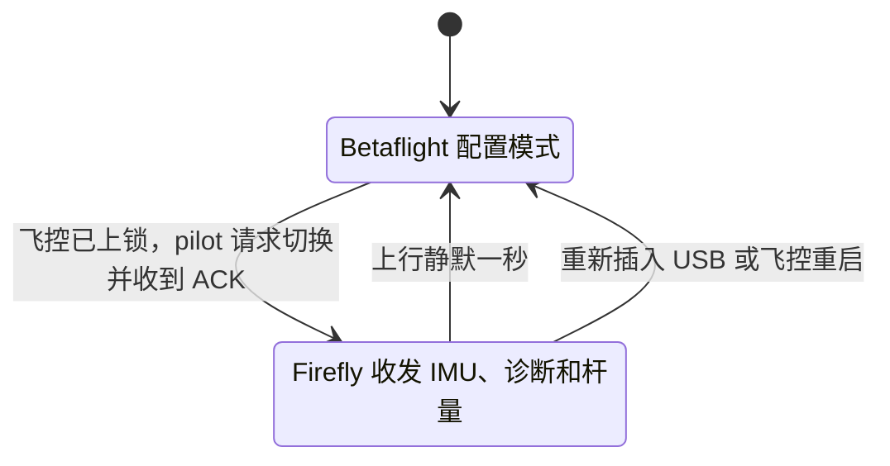
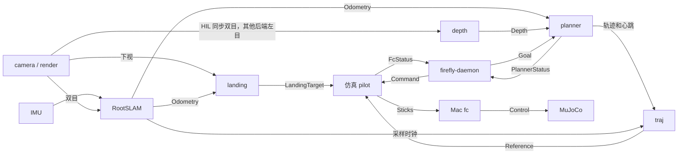

# Firefly 系统架构

## 部署与验证边界

| 环境 | IMU 和相机从哪里来 | 谁产生杆量，谁驱动电机 |
|---|---|---|
| 实机 | Orange Pi 的 `pilot` 从 Matrix USB 接收 BMI270 样本并发布 `Firefly/Imu`。Linux `camera` 按装配启用。 | 板上发布者向 `Firefly/Sticks` 写四通道杆量。`pilot` 下发给 Matrix，由 Betaflight 自稳、混控并输出 DShot。 |
| Mac 软件在环（SIL） | MuJoCo 生成 IMU 和机体状态，`render` 生成双目和下视图像。 | `pilot --simulation` 将任务参考转换成杆量。Mac `fc` 用杆量和仿真 IMU 计算四电机推力，MuJoCo 推进动力学。 |
| USB 硬件在环（HIL） | Mac 生成测量，通过 USB 桥发送给 Orange Pi 的 `camera --hil`。 | 任务、感知、规划和仿真 pilot 在 Orange Pi 运行。`motor --hil` 回传杆量，Mac `fc` 解算推力。宿主机 Mimir 同时录制板端遥测与仿真真值。 |

实机已在台架上验证 Matrix → pilot → RootSLAM 的 IMU 链路。固件还以 5 Hz 回传飞控诊断快照，pilot 通过 `Firefly/VizScalars` 发布给 Mimir。daemon 受理实机任务所需的机体参数与任务状态反馈仍待接入。SIL 和 HIL 提供这两项反馈。[台架结果](hw/spec.md#飞控电调板) · [板端进程](https://github.com/3SE-Competitive-Robotics-Team/firefly/blob/main/configs/processes.toml) · [HIL 进程](https://github.com/3SE-Competitive-Robotics-Team/firefly/blob/main/configs/processes-hil.toml)

## Matrix USB 会话

Orange Pi 的 `pilot` 独占 Matrix 的 USB 数据口。MSPv2 用于请求切换，收到 ACK 后，双方通过同一端口收发 `firefly_serial_protocol` 帧。

pilot 将飞控时间戳映射到 Orange Pi 单调时钟，加速度以 m/s²、角速度以 rad/s 发布。实机杆量发布者按横滚、俯仰、偏航、油门填写四个通道，`state_time` 使用 Orange Pi 单调时钟的秒数。

单独读取 IMU 时，pilot 每 250 ms 发送一次心跳。杆量有独立的 100 ms 超时，只有新的有效控制帧能续期。实体遥控器负责解锁并授权接管。ANGLE 模式下，横滚和俯仰给定倾角，偏航给定转速，油门给定推力。[帧格式和控制条件](https://github.com/3SE-Competitive-Robotics-Team/betaflight/blob/46710e33d2ae8eb3ee45f19f94c4ebf1f08a179f/docs/firefly_serial_protocol.md#usb-connection)

## 机载数据流

同机进程通过 iceoryx2 交换消息。下图中的线名省略了 `Firefly/` 前缀。操作员用 `ffctl mission` 通过本机 Unix socket 提交计划、查询回执或取消任务。[topic 目录](observability.md#ipc-topic-catalog)

### 坐标、时间与地图所有权

| 数据 | 使用约定 |
|---|---|
| `odom` | 本次 VIO 初始化建立的连续局部坐标。每一架次重新记录起飞点，任务偏移沿同一组轴相加。规划器、精降和 FC 使用局部反馈。 |
| 相机与机体 | 相机 ID 统一使用光学轴（右、下、前），机体轴为前、左、上。默认外参由 `firefly_base::rig::body_from_optical` 提供，Bevy 在相机挂载处转换渲染轴。在线深度沿左目光轴计米，离线渲染深度以独立深度机位为原点。建图和精降按采集时间配对机体位姿，再应用各自的相机外参。 |
| `map` 与 `world` | `Navigation` 携带地图对里程计的对齐。可选外部定位用 `PoseObservation` 与局部里程计更新对齐。启用时由 localization 独占导航和校正里程计发布。`world` 是模拟器真值系，评分器以首架次起飞锚点建立固定对齐。 |
| 测量时间与运行时间 | 图像配对、位姿插值、轨迹采样使用测量时间，RRD 以 `sim_time` 保存。新鲜度、看门狗和耗时采用进程单调时钟。RRD 的 `wall_time` 保存墙钟时间。 |

RootSLAM 的可选稀疏地标地图服务于定位。planner 的局部占据图服务于碰撞查询，由深度帧和同一发布端的里程计生成。已登记的场地以独立固定层参与碰撞查询。里程计发布端变化时，接收器停止提供状态与插值历史。USB HIL 关闭 RootSLAM 的稀疏建图和回环，同时运行 planner 的深度建图。[地图管理](map-management.md) · [在线估计配置](rootslam.md#online-operation-and-validation) · [外部定位](https://github.com/3SE-Competitive-Robotics-Team/firefly/blob/main/apps/firefly/localization/src/main.rs) · [HIL 进程清单](https://github.com/3SE-Competitive-Robotics-Team/firefly/blob/main/configs/processes-hil.toml) · [评分对齐](https://github.com/3SE-Competitive-Robotics-Team/firefly/blob/main/apps/firefly/firefly-verify/src/flight.rs)

RootSLAM 在静止窗口中估计重力方向，首帧航向确定 `odom` 的水平轴。精降用下视图像中的 H 标志、尺寸、相机标定和拍摄时的姿态求目标位置。planner 融合深度与里程计生成局部占据图，traj 在里程计的测量时间上采样已提交的轨迹。[在线估计](https://github.com/3SE-Competitive-Robotics-Team/firefly/blob/main/apps/firefly/rootslam/src/online.rs) · [精降跟踪](https://github.com/3SE-Competitive-Robotics-Team/firefly/blob/main/apps/firefly/landing/src/tracking.rs) · [深度融合](https://github.com/3SE-Competitive-Robotics-Team/firefly/blob/main/apps/firefly/planner/src/depth_mapping.rs)

## 系统运行、架次和任务

一次开机可以执行多项任务，共享一个 VIO 会话。每项计划用独立 ID 提交，daemon 在地面重新记录起飞位置。实测升高超过 0.15 米且飞控已进入飞行模式时分配架次号。地面取消仍有回执，架次号为空。VIO 会话在任务中改变时，daemon 中断任务。

### 多任务触发与 H 起飞交接

任务调度由 daemon 单独持有。起飞定位只负责一次任务的定位交接。下表是 H 模式的接入契约；目前观测器通过已记录的任务事件回放这一过程，在线任务沿用已有解锁与起飞流程。

| 触发场景 | 任务侧需求 | 定位侧动作 |
|---|---|---|
| 任意地点提交悬停，或提交含航点的巡航 | 普通起飞等待地面就绪；有航点时另查 planner 心跳 | 使用普通 VIO 路径。精降开关只决定着陆阶段。 |
| 从已知 H 坪提交悬停或巡航 | 计划显式选择 H 起飞。受理落盘，记录本次 home、任务 ID 和估计会话 | 以开机、任务 ID 和会话划定窗口。ARM 准备资源，任务进入 TAKEOFF 后开始计时，飞控报告 TAKEOFF/HOLD 后采纳观测。 |
| 客户端超时、重发相同 ID 和计划 | 返回原回执，包含当前进度；同 ID 改计划报冲突 | 沿用已记录的开始时间、已确认观测和中止结果。 |
| A 活动时提交 B，或 B 尝试取消 A 以外的 ID | 拒绝竞争提交，取消按 ID 定位。需要排队的客户端等 A 终态后再提交 B | A 保持控制权；迟到的 A 事件只属于 A。 |
| 上升、交接或飞行中取消，daemon 重启，或估计会话改变 | 按现有恢复流程收尾；需要操作员介入时持续持有任务。地面取消保留回执 | 撤销 H 交接资格。相同 ID 的后续 ACK、H 图像和 HOLD 都无法重开窗口。 |
| A 降落后立即或长停再提交 B | LAND 获确认且持续上锁 0.75 秒完成上一趟；B 重新检查地面条件 | 可共享 VIO 会话。B 重新建立 home、零速证据、H 确认计数、时间预算和坐标变换。 |
| 航点 HOLD、返航、精降再次看见 H | 由本任务导航、着陆阶段消费对应观测 | 起飞窗口在首次离开 TAKEOFF/HOVER 后关闭，直到该任务终态。 |

交接高度与任务目标高度分开。对于目标 1.7 米的方形航线，H 起飞需要先在约 1 米定高，完成交接后再爬升到 1.7 米、进入航线。目标低于交接高度时，按本契约应在解锁前返回计划不兼容，保留原定高度。普通起飞支持原有高度范围。飞控进入 HOLD 是运动模式反馈；交接确认来自同一任务的定位窗口。

H 的观测契约为 `T_body_H`。平移单位为米，机体系为 FLU，四元数按 xyzw 排列。H 的 X 轴横跨两根竖划，Y 轴沿竖划，Z 轴朝坪面上方。原图四个轮廓端点提供透视信息；外接矩形另用于重力辅助估高。标志绕自身 Z 轴旋转半周后图像相同，因此一帧表示两个等价旋转。接管比较两个分支中的最小三维角差。需要唯一绝对航向的任务还需要有方向的坪面标记或已登记且误差有界的独立航向。

在线接入时，飞控负责受控上升、定高和中止后的飞行处置。daemon 负责受理、取消、恢复和落地回执。相机是测量源，飞控的独立时钟负责断流超时。纯视觉位姿的有效位只表示这一帧能解出 H 几何，归属哪个坪面还需要起飞点或跟踪身份。在单目近乎正视时，roll/pitch 对角点噪声敏感。交接时比较固定坪面在 VIO 系中的完整位姿，并用独立 IMU 重力约束水平坪面。

### 板上服务与控制权

`firefly.service` 的主进程 `ffctl process supervise` 按进程清单启动设备和算法。独立的 `firefly-daemon.service` 监听 `/run/firefly/mission.sock`。systemd 在 daemon 停止响应时单独重启它。`ffctl mission status` 在传感器上线前也可查询。`ready` 需要机体参数、同一估计会话中的新鲜里程计和姿态、机体静止，以及飞控报告上锁并允许解锁。带航点的计划还需要 planner 心跳。[服务单元](https://github.com/3SE-Competitive-Robotics-Team/firefly/blob/main/configs/firefly-daemon.service) · [任务接口](https://github.com/3SE-Competitive-Robotics-Team/firefly/blob/main/crates/firefly-mission/src/lib.rs)

回执保存在 `state/missions/<boot-id>/<mission-id>.json`。同一开机内重试相同 ID 和计划会得到已有回执。首次受理落盘后才发送 ARM，架次号落盘后才发布离地事件。daemon 重启时从持久回执恢复，未完成任务进入收尾。桌面 SIL 用独立安装目录区分同一次 Mac 开机内的不同场景。[任务实现](https://github.com/3SE-Competitive-Robotics-Team/firefly/blob/main/apps/firefly/firefly-daemon/src/flight.rs)

| 对外阶段 | daemon 推进条件 |
|---|---|
| `arm` | 发送一次 ARM，等待 FC 报告 `ARMED_GROUNDED` 后进入起飞。 |
| `takeoff`、`hover` | 请求起飞，等待 FC 转入 HOLD，再按计划计满悬停时间。带航点的任务开始导航，悬停任务进入着陆流程。 |
| `navigate` | 发布本次目标，核对同一目标的新鲜规划状态与参考，再请求 TRACK。等待确认时，每份新的 HOLD 回报允许重试一次。收到 TRACK 后结束握手。途经点以 `passed` 推进，停稳点以完成标志和实测到达条件推进。返航沿用导航阶段。 |
| `hold`、`dwell` | 确认 FC 已从 TRACK 切入 HOLD，计满停留时间后进入下一航点或着陆流程。精降计划先进入 acquire。 |
| `acquire` | 进入阶段时建立本次确认窗口，累计至少三个不同时间戳的有效目标，首尾至少相隔 0.15 秒。目标失效时重新计数。 |
| `land` | 请求降落，观测到 FC 的 LAND 后等待 DISARMED。若 FC 回到 HOLD，重新请求并等待本次确认。 |
| `ground` | 本架次收到 LAND 后，以首份 DISARMED 飞控回报为起点。连续上锁回报覆盖 0.75 秒时记为完成。按飞控测量时间计时，漏报后重新计时，状态异常或遥测过期进入恢复。 |
| `recover`、`needs_operator` | 按 FC 实测模式请求地面上锁或空中降落。需人工处理时保留任务占用，持续确认上锁后记为 interrupted。 |
| `complete`、`interrupted` | 持久回执分别记录正常完成和中断收尾。每项已受理任务均可按 ID 查询。 |

三个下视相机贴地时可失去视觉特征。任务收尾以飞控回报记录触地后的阶段时间。下一架次重新执行起飞就绪检查，以同一估计会话的当前位置、朝向建立本架次的起飞点。若地面定位漂移导致飞控禁止解锁或里程计速度超过 0.12 m/s，下一项任务等待就绪。

普通 LAND 缓降时，飞控连续 1 秒同时满足以下条件才自动上锁：相对起飞点高度至多 6 cm、垂速绝对值和水平速度分别至多 0.15 m/s、上一控制周期的集合推力低于触地门限、独立 IMU 新鲜且比力模长接近重力、角速度低。证据中断后重新计时。

缓降仍在请求下降、速度和 IMU 均满足触地判据时，如果位置控制器自身请求的推力已降至悬停推力的 85% 以下，pilot 平滑减载。额外减载每秒最多减去半个悬停推力，到原有低推力门限为止。反弹、滑动、传感器失效或控制器重新需要悬停推力时，下一个控制周期恢复按位置控制器的请求输出。上锁前仍需验证连续的低推力和运动证据。

RootSLAM 随姿态预测发送本次后验中左右相机共同看到的既有地标数。至少 6 个且后验在 150 ms 内时，飞控使用 VIO 速度。飞控用双目观测充分的连续 1 秒比较 VIO 和独立 IMU 的速度增量，估计短时加速度偏差。偏差模长至多 0.15 m/s² 且校正仍新鲜时，距起飞平面 30 cm 以内的有效观测还可作为惯性推算起点。双目支持不足时，飞控最多用 5 秒独立 IMU 增量延续垂速和高度，供缓降控制与触地判断共同使用。在起点用两路机体姿态对齐坐标系，把经校正的速度增量按方向加回起点速度，保留刹停和反弹。失去同步、新鲜 IMU、里程计或有效起点时，停止使用惯性推算，暂停触地确认。

若降落面高于起飞点，普通降落可能持续等待触地。精降采用识别出的停机坪高度。收尾时，飞控进入 `ATTITUDE_FALLBACK` 或 45 秒内未确认上锁，回执进入 `needs_operator`，直至飞控持续报告上锁。

## 航点执行

停稳点等待规划完成、里程计进入 0.15 米且速度不超过 0.12 m/s，持续 0.5 秒后切入 HOLD。途经点和后继位置一起投递。planner 在实测位置进入途经点 0.35 米球内时切换到后继目标并锁存 `passed`，任务在 TRACK 下继续。后继目标默认停稳。连续途经时任务用下一条带后继位置的命令接续。目标身份采用命令时间戳，任务按访问序号区分相同坐标。

`STOP` 的底层 Goal 可携带终点 yaw。任务文件的 Waypoint 只有三维偏移和到达方式。最终可达段把位置和航向放在同一时间轴上，traj 同时采样两条曲线。重规划延续既有航向的角度、角速度和角加速度。目标方向超出前视范围时也可先制停转向。心跳过期时 traj 执行已提交的制停尾段，在尾段结束后停止提供参考。[任务字段](https://github.com/3SE-Competitive-Robotics-Team/firefly/blob/main/crates/firefly-mission/src/lib.rs) · [Goal 契约](https://github.com/3SE-Competitive-Robotics-Team/firefly/blob/main/crates/firefly-pubsub/src/goal.rs) · [航向规划](https://github.com/3SE-Competitive-Robotics-Team/firefly/blob/main/crates/firefly-planner/src/motion.rs) · [采样与心跳](https://github.com/3SE-Competitive-Robotics-Team/firefly/blob/main/crates/firefly-planner/src/traj_server.rs)

### 从一次运行到验收结果

1. daemon 将请求和阶段写入任务回执，Mimir 把任务事件、机载状态和配置写入本次运行目录的 `rrd/` 分段。前者供服务恢复，后者供回放与验收。板端按开机身份归档，同一次桌面命令的子进程共享运行目录。
2. verify 按运行、任务和架次检查阶段顺序、会话与 FC 实测模式。SIL/HIL 再把 `odom` 目标变换到仿真 `world`，计算途经点距离与速度、返航误差及落地后的稳定性。
3. xtask 核对提交结果、进程退出、任务 ID 和评分器退出状态。Rerun 可沿同一测量时间查看图像、估计、轨迹与真值，定位哪一步产生了偏差。[录制契约](mimir.md) · [真值评分](https://github.com/3SE-Competitive-Robotics-Team/firefly/blob/main/apps/firefly/firefly-verify/src/flight.rs) · [运行入口](development.md#运行)
