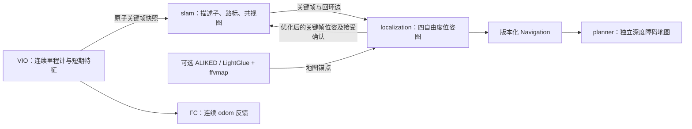

# 持久路标回环与地图定位

## 数据流与所有权



VIO 以最高 5Hz 发布左目像素、去畸变观测、轨迹 ID、可靠的三维初值、同刻原始位姿，以及
左右图像和标定快照。发布前复制必要数据，滤波器可以正常删除特征、边缘化克隆；
地图不持有滤波器变量，不回写状态、协方差或 FEJ。图像仅经 IPC 在内存中处理，不写 RRD。

几何初值优先使用 VIO 的 Global3D SLAM 点；其他轨迹复用 VIO 的多视图三角化和精化函数，
检查所有可用观测的正深度与 3px 重投影误差。这些初值不是独立于 VIO 的额外传感器观测，
不作为额外位置先验重复加权。

地图进程在原始 VIO 像素计算 ORB 描述子，另用四层 ORB 金字塔补充尺度与外观覆盖。
补充像素具有独立观测，绝不直接借用相邻 VIO 点的三维坐标；通过左右图像往返 LK
和双目三角化，或局部关键帧的真实多视图对应获得几何初值。无可靠初值的二维特征仍参与检索。
补充点描述子、双目计算、路标维护与回环验证均在 `slam` 进程，不能阻塞 VIO 更新线程。

## 地图维护与回环

- 常规建图最多每秒一个关键帧；回环连续确认阶段处理每张最高 5Hz 的快照，并保存约束端点。轨迹 ID 延续路标身份。补充角点通过 Hamming 双向唯一匹配、
  比率检查以及三角化/重投影验证关联局部路标。VIO 跟踪点与补充点共享同一份持久地图。
- 路标保存宿主关键帧中的坐标和最多 32 条实际观测。局部最多 10 帧，固定关键帧位姿
  精化三维点；保留左右目实际观测，防止点精化丢失双目尺度约束，采用 Huber 重投影代价、解析雅可比、线搜索和条件数检查。
  连续运动和米制尺度由 VIO 负责；地图不运行另一套缺少 IMU/双目因子的六自由度
  局部里程计。全局位姿由四自由度图修正。这不是 ORB-SLAM3 的联合局部 BA，
  也不提供完整视觉惯性 BA。
- 几何离群观测不参与共视与验证；长期没有可靠几何的临时路标清理后，关键帧外观仍保留。
  共享至少 15 个有效路标建立共视连接，不足时保留最强非零连接。
- 16 位二进制词的多表倒排索引按稀有度加权，召回最多 12 帧，再以完整 Hamming 匹配投票排序，选择最多三个
  非局部区域。排除当前共视邻居及其邻居。该索引是有界近似检索，不是 DBoW 词典。
- 每个区域使用代表帧和最多十个共视邻居；每个当前点、历史路标各计一次。
  双侧三维数据来自持久路标，**不要求两幅图同时具有可用的深度图采样**。
- 固定尺度三点刚体假设最多 300 次，初解要求 20 对应、15 共识，仅用于投影扩匹配；
  按两侧实际图像的重投影误差计共识；
  参照 ORB-SLAM3 `Sim3Solver::CheckInliers`，不能用恒定米制球代替远近不同路标的观测误差。
  初解引导投影搜索，随后精化位姿。最终要求至少 30 个内点、40% 支持、两侧均不超过
  3px、覆盖 4×3 图像网格至少四格，并通过原始 VIO 相对位姿的 3m / 15° 新息检查。
- 验证期间沿用已确认区域，通过相邻 VIO 运动传播初解，再用当前图像的实际对应进行投影匹配与几何精化；不把预测本身作为确认。
  连续三张不同图像快照的修正必须在 30cm / 5° 内一致，间隔不超过 3 秒。
  多区域解冲突则拒绝；约束发布后至少冷却 5 秒。
- 位姿图独立门控回环，端点测量时间至少相隔 15 秒，返回完整关键帧位姿快照。只有后端明确接受后，地图才融合跨区域
  路标身份；拒绝不污染地图。等待确认时停止处理新关键帧，5 秒无确认显式报错。
  关键帧 IPC 缓冲与等待队列上限为 64，先于预测里程计到达的快照等待时间覆盖，不丢弃。
  离线地图锚点引发的图修正也同步到路标地图；若快照尚未包含全部已建关键帧，则暂缓应用并记录诊断，等待完整修正快照。原始 VIO 位姿始终不可覆盖。

默认进程链不需要 ALIKED/LightGlue 权重、预建地图或已知起点。离线地图定位使用
`aliked` 与 `lightglue --map <map.ffvmap>`，要求显式外部地图对齐。
离线路标标签仍使用左目注册深度（重投影、z-buffer、空洞与边缘拒绝），不能同索引
读取居中深度相机；这与在线持久路标的几何来源分开。

## 图优化的数学定义

节点 `x_i = (p_i, ψ_i)`：地图位置与航向，滚转/俯仰固定为 VIO 重力估计。
首个注册节点固定为启动规范，异步补入更早的相机关键帧不会切换固定节点；默认启动位置为零、启动航向为地图 +X。可选 `[origin]` 对齐外部地图。VIO 相对边只连接相邻节点。
同一运动区间的跨节点差分共享测量，不能作为额外独立证据重复计权。

```
R_i = Rz(ψ_i) R_tilt_i
r_ij = [R_iᵀ (p_j-p_i) - t_ij,
        wrap(ψ_j-ψ_i-Δψ_ij)]
r_map = [p_i-p_observed, wrap(ψ_i-ψ_observed)]
```

残差按米/弧度的标准差白化。VIO 边用二次代价；回环与地图锚点用 Huber 核。
配置 `GraphOptions` 给出 VIO 扩散密度 0.1m/√s / 0.05rad/√s，
相邻间隔 Δt 的标准差为密度 × √Δt；地图标准差 0.1m / 0.05rad，
回环 0.05m / 0.03rad，Huber 转折 2.5。它们是工程噪声模型，没有宣称统计校准；
图不传播完整 VIO 协方差，相关视觉信息也没有完整去相关。
一维平移的累计方差与关键帧分段数量无关，测试同时检查解析融合结果与梯度差分。

解析雅可比组装稀疏四维块正规方程，块 Jacobi 预条件 PCG 求增量，回溯要求目标下降。
优化局部副本后一次提交；线性求解失败不发布部分解。最后节点给出：

```
R_map_odom = Rz(ψ_optimized - ψ_raw)
t_map_odom = p_optimized - R_map_odom p_raw
```

输出仅改变 map←odom，原始 VIO 和 FC odom 锚点保持连续。规划器和地图参考使用
校正状态；地图校正仍可能令地图参考在 odom 中变化，不能把反馈连续等同于瞬时无控制扰动。
`backend = "eskf"` 使用独立滤波模式，不接收回环图校正，不与图后端重复融合。

## 容量、会话和证据

在线关键帧与位姿图各默认最多 512 节点；稀疏路标默认最多 50000 个；图还包含地图观测时刻，因此可能先满。
容量耗尽明确拒绝新节点，保留已建立的地图对齐和已有节点约束；不宣称无限航程。
没有跨会话序列合并、持久化图恢复或全局束调整；在线障碍观测只在同一坐标修正版本内保留。
重启 VIO 后必须连同定位、规划与视觉进程建立新会话。

RRD 实体：

| 实体 | 分量 |
|---|---|
| `loop/debug/frontend` | 关键帧数、候选数、几何内点数、连续确认数 |
| `corr/debug/loops` | 接受回环累计数、图节点数、本次是否接受 |
| `corr/debug/gate` | 图模式：重投影像素误差、3px 门限、注入平移米、本次地图锚点是否接受 |
| `logs/slam` / `logs/localization` | 拒收、容量、同步和优化诊断 |

`logs/slam` 记录每个候选的外观对应、有效双侧路标数、共识与双向重投影拒收原因。
合成几何、真实描述子与校准双目测试不能替代实际跨视角回环验收。

## 参考源码与实现边界

- VINS-Fusion `be55a937a57436548ddfb1bd324bc1e9a9e828e0`：
  `loop_fusion/src/pose_graph.h::FourDOFError`、`pose_graph.cpp::optimize4DoF`。
  对照局部平移残差、四邻边、固定首节点、鲁棒回环与航向漂移输出。上游角度为度，
  本实现统一使用弧度并显式设置权重；线性求解器使用自有 PCG，非 Ceres。
- ORB-SLAM3 `4452a3c4ab75b1cde34e5505a36ec3f9edcdc4c4`：
  `src/LoopClosing.cc::NewDetectCommonRegions` 与 `DetectCommonRegionsFromBoW`，
  `src/Sim3Solver.cc::ComputeSim3`。对照近期邻居排除、几何共识、固定尺度和连续确认。
  本实现使用 ORB 描述子、持久路标、SVD 和固定关键帧位姿的路标精化；不包含 DBoW、Atlas 或全局 BA。

两个参考项目为 GPLv3；本仓库代码根据几何公式和流程独立实现，没有引入其源码文件、
词袋库、实现片段或权重。下载的参考仓库保留在 `~/Projects/`，不纳入本仓库。

## 状态可用性与库图观测诊断

localization 持续把有效的局部 VIO 状态变换到地图系；静止初始化建立会话坐标，可选固定启动先验提供外部地图对齐，
接受的库图观测与回环更新该变换。没有新观测时保持当前变换，继续使用新鲜 VIO，
不能重发旧位置伪造状态新鲜度。估计器重置后锁存停止输出，须在固定启动点重启。

planner 只消费原子 `Navigation` 快照，独立接收线程检查初始化、有限数值、严格递增时刻和 500ms
墙钟新鲜度；重规划不阻塞存活检测，发布参考前再次读取状态与坐标版本。不要求持续库图匹配。
FC 保持 odom 反馈，地图参考携带其生成时刻的
map←odom 变换快照；参考超时转 Hold 不构成独立于 VIO 的定点保证。

`configs/localization.toml [quality]` 的默认 3s 观测年龄、0.5m 融合后分歧只描述
库图观测的新鲜和一致程度，通过 `corr/debug/map_observation` 记录（年龄、分歧、
近期一致标志）。它不是位姿误差上界，也不代表 VIO 跟踪状态；同一相机的两条算法
链路不能据此视为统计独立。实际地图精度、真实航点到达和回环证据分别验收。

库图定位使用六条 ORT 算子线程；在线路标回环不加载 ONNX 会话。
地图候选最多三帧；提前结束要求至少 30 个三维匹配、点协方差最小特征值
大于 0.0025m² 且最小/最大特征值比大于 0.01，再通过 PnP 内点和重投影门控。
平面或弱匹配继续聚合候选，不承诺固定推理时延。

图像时刻 t 的查询先验为 `T_map_body(s) T_odom_body(s)^-1 T_odom_body(t)`，
其中 s 是地图里程计测量时刻。两个原始 VIO 位姿必须由历史覆盖，不允许以当前航向
给旧图像做候选或 PnP 几何门控。同刻图节点由首个原始位姿固定，异步地图与回环
观测复用这一快照，不覆盖历史。ALIKED 单线程最多 5Hz，忙时只取最新帧。

## 空地图启动与规划坐标一致性

默认运行 `slam` 创建会话路标地图；`lightglue --map` 显式启用离线库图。
库图匹配要求导航快照声明外部地图对齐，不能将会话坐标直接用于地图半径查询。
`planner` 默认创建分辨率 0.1m、半范围 8×8×4m 的滚动深度地图；`--map` 可加载
场地先验，但同样要求显式 `[origin]`。两个默认入口均不读取预建地图或已知起点。
局部窗口外的传感器 log-odds 保存在世界体素索引的有界会话缓存中，重新进入窗口时恢复，
保持原占据概率及膨胀净距。默认最多缓存 500000 个 log-odds 高于空闲下界的历史体素（含占据及未饱和空闲证据），
由 `[mapping].history_capacity` 配置；耗尽时停止发布运动参考，不静默淘汰障碍。
启用历史缓存时不按时间衰减占据；实际观测到的空闲射线仍可清除障碍，缓存不是不可擦除先验。
作业高度边界属于任务配置，单位为当前地图系的米；默认部署限制会话 z 在
(-0.505, 2.195) 内。它不提供地形或外部定位，切换外部地图时须显式配置该地图的边界。

`Firefly/Navigation` 原子携带地图位姿、map←odom 与单会话修正版本。跨版本不插值
深度位姿；规划器清除局部及历史传感器融合，保留显式地图先验，废弃执行轨迹，保持地图目标
坐标并重建全局引导。取得至少四帧有效深度后继续规划，等待期间发布当前测量位置的
零速参考。历史观测仅在同一修正版本中有效，不把整张历史地图按一个刚体变换搬移，也不
声称完成了全局稠密地图优化。关键帧路标保持机体系，位姿图优化各节点而不改写原始 VIO。

飞控参考原子携带生成时的 map←odom；较新的校正不会重新解释在途旧参考。
所有观测、参考与目标都使用明确的会话地图；没有外部对齐时不能接收场地坐标任务。

全局目标允许位于滚动窗口之外，仅作为方向引导。局部轨迹仍执行现有占据、膨胀与
连续碰撞检查。空地图的未观测空间沿用 EGO-Planner-v2 的乐观占据初始化，不能将其
解释为已观测自由空间或未知环境安全保证。保留历史能恢复已观测障碍，不能发现从未观测的障碍；
坐标修正清空地图后，只有当前视场能重新提供障碍证据，同朝向倒飞仍需要独立的已知空间约束。
深度无有效投票不刷新建图新鲜度，失联与非法状态仍按原阈值锁存停止。

仿真验收只在评分端用首个真值样本定义会话坐标，不拟合后续轨迹，不反馈估计或任务
决策；原始 RRD 保留场地真值。位置、速度、碰撞、到点及时间门限保持统一。在线回环
必须有已接受约束证据；仅成功启动或生成关键帧不能计作回环通过。
